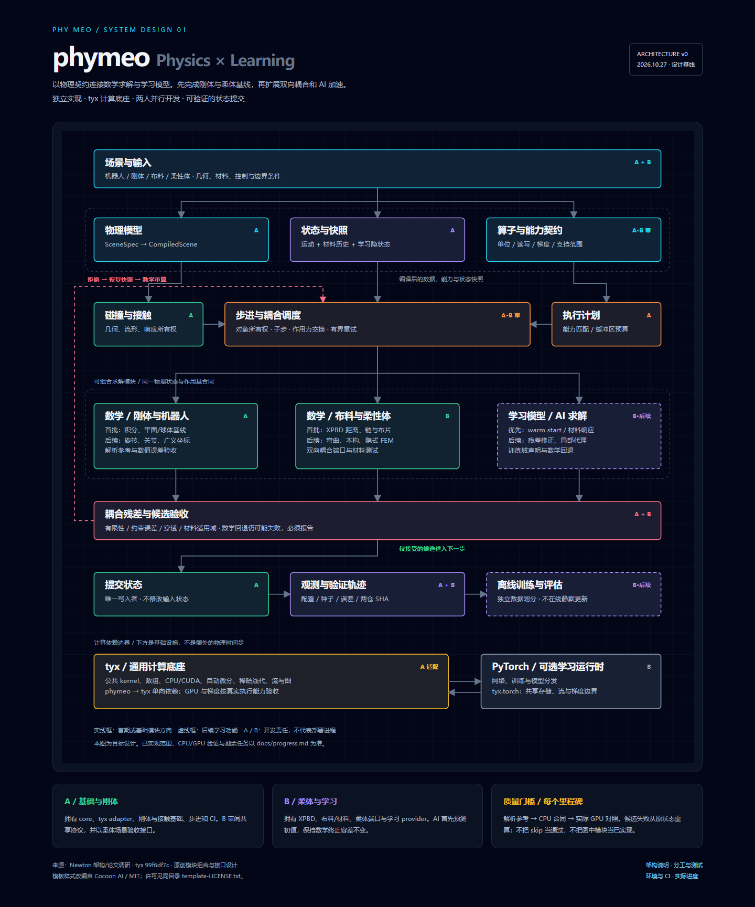

# phymeo

面向机器人、刚体接触、布料与柔性体的物理仿真引擎设计与首版开发。

**定位：** phymeo 拥有物理模型、状态、碰撞、数学/学习求解器和耦合调度；[tyx](https://github.com/ChenxrC/tyx) 拥有通用计算、编译、数组、自动微分和设备执行。

> 当前处于设计与基础实现阶段。图中描述的是目标架构，不能据此推断全部模块已实现、GPU 已通过验证或整体可微。实际交付以[进度记录](docs/progress.md)为准。



## 设计与实施入口

| 内容 | 入口 |
| --- | --- |
| 离线 HTML 架构图 | [下载/打开 phymeo.html](docs/architecture/phymeo.html) |
| 可编辑矢量图 | [phymeo.svg](docs/architecture/phymeo.svg) |
| 物理模型、接口与算法边界 | [架构说明](docs/architecture/overview.md) |
| 两人并行分工、里程碑与测试建议 | [开发与测试](docs/development/team-and-tests.md) |
| uv/pip、私有依赖、CPU/GPU CI 与发布计划 | [环境与 CI](docs/development/environment-and-ci.md) |
| 首版可执行大纲 | [v0 实施计划](docs/superpowers/plans/2026-10-27-v0-foundation.md) |
| 已验证结果与下一步 | [进度记录](docs/progress.md) |

GitHub 文件页不直接运行 HTML；下载后用浏览器打开即可，无网络字体或脚本依赖。

## 当前基础包与验证

已提供经过验证的粒子数据合同、NumPy 半隐式 Euler 积分器，以及 XPBD 距离约束与 y-up 静态平面接触，支持 FP32/FP64、外力与固定点。可选 tyx 自由积分适配已验证解释器、C++ CPU 和本机 CUDA 的 FP32 路径，安装见[环境说明](docs/development/environment-and-ci.md)。调度按[进度记录](docs/progress.md)逐批加入；此时尚无完整刚体旋转、机器人、自碰撞或摩擦。

```sh
uv sync --locked --group dev
uv run --no-sync python -m pytest
uv run --no-sync python examples/free_fall.py
uv run --no-sync python examples/hanging_chain.py
```

原生 pip 用户在激活的 Python 3.11+ 虚拟环境中执行：

```sh
python -m pip install --require-hashes -r requirements/dev.lock
python -m pip install --no-deps --no-build-isolation -e .
python -m pytest
```

## 文档检查

需要 Python 3.11+，不需要安装第三方包。

```sh
python scripts/check_docs.py
```

uv 与 pip/venv 的隔离环境、可选 tyx 安装和后续 GPU 计划见[环境说明](docs/development/environment-and-ci.md)。

## 来源与实现原则

借鉴 Newton 的公开架构与算法论文，独立定义物理数据、接口与实现，不复制其求解器源码。对照来源和 tyx 固定提交见[架构说明](docs/architecture/overview.md)。图表样式基于 Cocoon AI 的 MIT 模板改编，保留[许可声明](docs/architecture/template-LICENSE.txt)；该声明仅覆盖模板，不为整个项目指定许可证。
