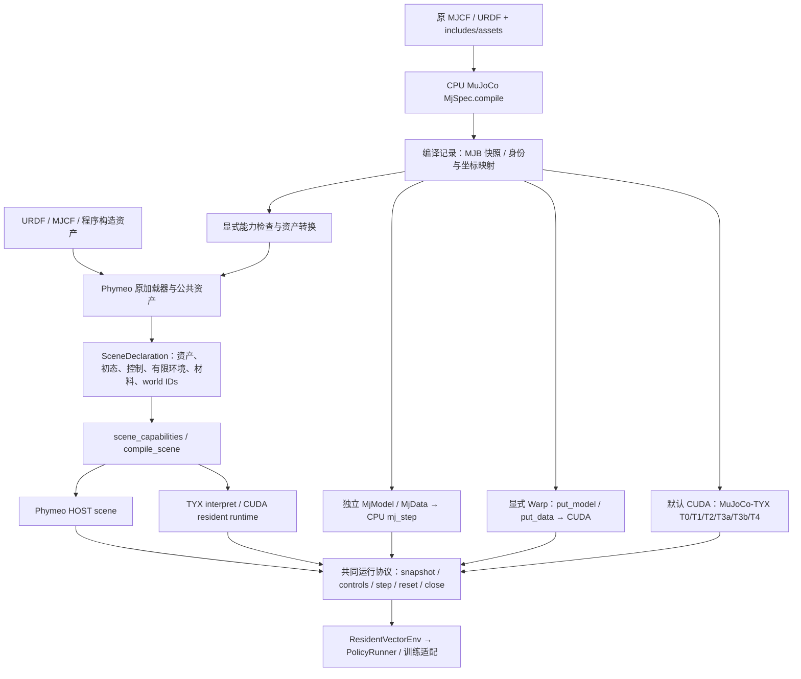
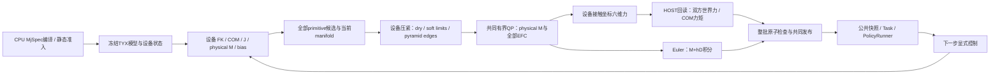

# 统一场景编译与可选 MuJoCo 路径

本层将资产编译、场景装配和求解后端分开。MuJoCo 编译是可选的 CPU 前端；已有 URDF/MJCF 加载器和 TYX 主线继续保留。对应[实施计划](../superpowers/plans/2026-11-10-unified-scene-compilation.md)。



## 构建与运行的边界

| 层 | 公共入口 | 负责的内容 |
|---|---|---|
| 原生编译前端 | `phymeo.builders.mujoco_compiler.compile_mujoco` / `compile_mujoco_xml` | CPU解析、defaults/include展开、推导惯量；保留完整编译物与来源；显式转换到已有资产 |
| 场景声明 | `phymeo.builders.scene_compiler.SceneDeclaration` | 拥有资产、初态、控制参数、静态几何和材料的冻结快照；多个world可有不同资产 |
| Phymeo编译 | `scene_capabilities` / `compile_scene` | 在支持域内选择HOST或TYX；保留原物理程序、碰撞身份和控制语义 |
| MuJoCo运行 | `phymeo.backends.mujoco_runtime.MuJoCoRuntime` | 选择原生CPU或独立CUDA路径；同一编译模型的多个独立world |
| 环境与策略 | 已有 `ResidentVectorEnv` / `PolicyRunner` | 消费运行协议，维护episode、动作保持、时钟和失败后的reset要求 |

`interpret` 是 TYX 的 CPU 解释路径，不表示已有通用原生 CPU 编译后端。原Phymeo resident接触路径仍可能包含HOST几何与力律；新的MuJoCo-TYX T4几何、行装配和共同求解在设备内执行。两条路径分别标注，CPU编译、观察与示例策略推理仍存在。

当前 MuJoCo 分支消费原编译记录；本批没有实现任意 `SceneDeclaration` 反向生成 `MjSpec`。这样可以保留原生模型中的 tendon 等功能，同时防止把原生 MuJoCo 能力错误归给 Phymeo/TYX。

## 可选依赖

核心安装仍只依赖 NumPy，导入新公共模块不加载 MuJoCo、Warp 或 TYX。

```text
pip install "phymeo[mujoco]"
pip install "phymeo[mujoco-warp]"
```

本批原生CPU使用 MuJoCo 3.3.7；独立CUDA适配限定已验证的 MuJoCo 3.3.7 / MuJoCo-Warp 0.0.2 / Warp 1.17.0 组合。TYX仍按项目原独立安装流程使用，未修改其pin。

## 两条使用方式

以下场景由一个有标量关节的编译资产建立。资产的q/v已经转换到Phymeo公共坐标。

```python
import numpy as np
from phymeo.builders.mujoco_compiler import compile_mujoco
from phymeo.builders.scene_compiler import ArticulationWorld, SceneDeclaration, compile_scene
from phymeo.core.robot import RobotState
from phymeo.runtime.robot_scene import RobotCommand

compiled = compile_mujoco("slider.xml")
count = len(compiled.asset.joint_names)
world = ArticulationWorld(
    4, compiled.asset, RobotState(compiled.initial_q, compiled.initial_v),
    kp=np.zeros(count), kd=np.zeros(count), effort_limit=np.full(count, 5.0),
)
declaration = SceneDeclaration((world,))
with compile_scene(declaration, backend="cuda") as runtime:
    runtime.set_controls({4: RobotCommand(compiled.initial_q, feedforward=np.ones(count))})
    accepted = runtime.step(0.001)
    state = runtime.snapshot()[4]
```

浮根资产使用 `FloatingRobotState` 和 `FloatingRobotCommand(RobotCommand(...))`。静态环境通过 `FiniteStaticShape` 及显式材料加入声明。编译记录的 `unlowered_world_geom_ids` 必须单独处理；`.asset` 本身不是完整环境。

选择原生 MuJoCo 物理时保留原生坐标、控制和接触律：

```python
from phymeo.backends.mujoco_runtime import MuJoCoControl, MuJoCoRuntime
from phymeo.builders.mujoco_compiler import compile_mujoco

compiled = compile_mujoco("scene.xml", require_asset=False)
with MuJoCoRuntime(compiled, world_keys=(4, 19), mode="cuda") as runtime:
    runtime.set_controls({4: MuJoCoControl([1.0]), 19: MuJoCoControl([-1.0])})
    accepted = runtime.step(runtime.timestep)
    states = runtime.snapshot()
```

`mode="cpu"` 使用 `mj_step`；`mode="cuda"` 默认选择新 MuJoCo-TYX，显式 `implementation="warp"` 才使用 MuJoCo-Warp。TYX的CPU解释验证用 `mode="interpret"`。缺少依赖、不支持特性或设备不可用均报错，没有CPU或Warp静默回退。控制长度必须匹配原生actuator数。含多后端选择的示例入口见 `examples/unified_scene.py`。

新MuJoCo-TYX是有限模型域的算法移植，独立于原Phymeo TYX resident。T0支持纯平移树、中心各向同性自由球、单个plane–sphere法向接触；[T1已验收](../benchmarks/p65-mujoco-tyx-rotational-tree.md)增加固定根1–8DOF hinge/slide混合树；[T2已验收](../benchmarks/p65-mujoco-tyx-floating-tree.md)增加一个原生自由根加0–29 scalar joints，nq≤36/nv≤35，保留偏心COM、非球惯量和完整根–关节耦合。T1/T2每步重算完整FK/J/M/bias；[T3a已验收](../benchmarks/p65-mujoco-tyx-coupled-normal.md)进一步在相同树上支持plane–sphere/capsule/box和sphere–sphere/capsule/box、多condim1法向共同求解。[T3b已验收](../benchmarks/p65-mujoco-tyx-finite-contacts.md)补齐capsule–capsule/box、box–box，合计九类配对，并完成八条连续1秒卸载重入轨迹。原.512秒胶囊静支撑门失败仍保留。后续T4已接入摩擦、soft limits和dry friction；最新逐组结果与G1窗口范围见[混合约束验证](../benchmarks/p65-mujoco-tyx-mixed-constraints.md)，不倒灌为T3b结果。详[扩展路线与多案例矩阵](../development/mujoco-tyx-expansion-plan.md)。

T1/T2的 `states[world].last_step.dynamics` 提供同次设备入步body pose/COM、世界COM Jacobian、M、bias、passive、applied和smooth acceleration；`integration_acceleration`另保Euler隐式阻尼解。T2的input_q/input_v保原生不同维度，root-origin世界线速度与root-local角速度不改为Phymeo资产坐标。端点CPU观察不能替代这些入步量。

T3a沿用上述动力学，在设备上按“FK→mechanics→normal geometry→coupled normal solve→Euler”五阶段执行。`last_step.contacts` 返回每个检测接触的双方geom/body、当前点/frame/J、实际normal force和双方COM world wrench；零力行不删除。`raw_contact_fields` 提供静态slot、完整dual matrix和求解诊断。`capabilities` 明示condim1/非负margin域、容量和 `normal-dual-active-set-v1`，source iterations作为face-solve预算，非原生Newton迭代。状态与接触力共同接受，求解/容量/晚回读失败整批回滚。当前仍有HOST调度和NumPy观察，不称全设备训练。 T3b含新配对时在common contact rows前增加extended manifold，合计6launch；仅原六类保持5launch。新pair预留2/2/24槽，总G128/P16/C32不变。接触ordinal标记为current-manifold-local-ordinal，不保证跨精度或跨步相同编号；完整当前J、共同QP及原子发布复用同一管线。

## 身份、坐标和发布

编译记录保留原body/joint/geom ID和名字、qpos/dof地址、关节参考值、主惯量坐标和COM映射。原始top-level XML、规范化spec归档与独立MJB都保存；不声称保留了所有include文件原始字节。`fresh_native_model()` 从拥有的MJB重建，之后不依赖源路径。公开的 `mj_spec/mj_model` 本身是可变对象，运行时使用独立模型，避免timestep或参数互相污染。

Phymeo浮根线速度位于根COM且在世界坐标下，角速度也在世界坐标下；原生MuJoCo自由关节qvel使用原点世界线速度与局部角速度。记录提供双向映射，不能只交换四元数元素就当完整速度转换。

共同协议统一方法与发布约定，不统一各后端的观测字段和控制schema；Env Task仍负责显式动作与坐标适配。所有快照是独立只读数据。HOST/TYX统一入口使用原 `RobotCommand` / `FloatingRobotCommand`；MuJoCo使用显式原生 `MuJoCoControl`。`step`给出完整world接受掩码。CPU原生模式支持已发布world保留的部分失败；GPU原生模式在未发布buffer完成整个批次，容量或回读失败保持全批原状态。

MuJoCo-Warp在回读前检查contact/constraint计数，因为对应版本的底层回读会截断溢出；constraint行数必须严格小于容量，覆盖上游恰满时提前返回的边界。请求控制与实际存储控制分别保留，FP32溢出在替换整批控制前拒绝。实际GPU接触字段和力存入 `last_step`；端点快照的几何/力来自明确标记的detached CPU `mj_forward`。这两者不混称整步冲量。TYX在设备积分核内用两FP32 high/comp作Kahan累计，发布high-comp并核前后pair与实际递推；运动和力仍FP32。仍要求高位每步增加。MuJoCo-Warp保留自己的实际设备累计时间，不能把请求dt当作精确设备累计时刻。

## 当前支持域与后续扩展

MuJoCo到Phymeo资产转换支持单个固定树或自由根、每活动body一个hinge/slide、球/胶囊/盒子、惯量主轴与偏心COM、浮根标量关节armature/damping、对称限幅的单位直接motor。显式contact pair/exclude、禁用actuator组、复杂传动、未折叠固定子body、球关节、tendon/equality、固定根非零armature/damping等会给出明确lowering问题。`require_asset=False`仍可在原生MuJoCo运行合法原模型。

Phymeo统一场景首域是每world一个独立关节系统与有限静态环境。机器人自身互碰、多机器人同world联合设备求解、静态胶囊HOST装配和固定根碰撞形状的部分跨后端反力场景，按能力报告拒绝。此处没有通过多次独立step模拟同world共同求解。

后续优先补全场景声明到MjSpec导出、更多显式资产转换和后端能力交集，再推进更大的GPU训练world数。不能用原生MuJoCo运行通过替代Phymeo自身碰撞、软体或联合求解验收。

## MuJoCo-TYX T4：原生语义的共同约束管线



T4保留原pyramidal condim1/3/4/6、scalar soft joint limits、DOF dry friction与黏性阻尼。所有接触共用完整根—关节质量矩阵，不逐点独立推进。当前混合算法按模型自由度规模批量释放违反KKT的bound，处理可行线搜索和边界重绑；face仍计原source iterations，最终从存储力独立回算质量方程与KKT。它不是CPU mj_step，也不要求复制MuJoCo Newton的迭代轨迹。

模型容量为G128/P1024/static slots2048，实际contacts128/EFC512（默认64/256）；超域或超实际容量整批拒绝。小自由面用平方根QR，大面用等价primal修正，不预分配EFC平方矩阵。全当前Jacobian、边界变量、零力接触与pure couple保留；接触力对应步入口，发布q/v对应步末。

公开last_step包含动力学、完整六维contact与typed constraints。设备输出接触坐标六维力；HOST回读发布层作双方世界坐标转换、COM力矩搬移及一致性检查，不重新求接触力。CPU detached mj_forward只作端点观察，不能替代设备真实载荷；验证harness的同入步native oracle和独立CPU反馈轨迹也只作对照。示例G1用CPU ONNX 50Hz反馈，这是该示例的策略选择，不是引擎固定要求CPU策略。现有快照/完整证据回读仍是HOST边界，尚未建立全设备训练或吞吐优势。

最新G1使用原primitive资产、502可能配对/942几何槽、原非零初态和原策略。F1三姿态在解释/CUDA通过；当前最终源码已完成原策略20秒/10000步、h=.001两秒/2000步及正反推扰各两秒/1000步，全部原工程门通过，未重置或拒步。最终210项通用矩阵、源码外双后端wheel和完整保存审计均已通过，476产品文件同源。实际验收持续更新到上面的混合约束报告；原HOST/resident的131.48秒结果不属于这条新后端。Mesh部署、椭圆cone、equality/tendon、GPU native sensors及完整舞蹈仍需独立扩展。
公开能力使用 mixed_articulated_constraints_supported 与 floating_mixed_constraints_supported 描述当前模型准入域；旧 g1_supported 是后者的弃用兼容别名。capability_scope 明确 admitted-model-domain; trajectory-validation-separate，支持此模型域不等于某个策略、时长或所有人形机器人都通过。
