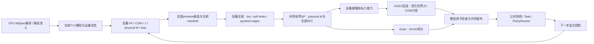

# 统一场景编译与可选 MuJoCo 路径

本层将资产编译、场景装配和求解后端分开。MuJoCo编译是可选的CPU前端；已有URDF/MJCF加载器和TYX resident主线继续保留。原[实施计划](../superpowers/plans/2026-11-10-unified-scene-compilation.md)保留历史设计。

**当前截点：2026-11-13，产品ec0e2997。** D5-A公共刚柔装配、R3-N/P原生接触组合、G2a原容量内异构规模和D6-A轴向材料耗散已有各自有限资格；D4无阻尼双后端3秒稳态失败仍保留，D6-B新c4096应用的run143已完成N1解释3秒，仍未过两稳态门；该系数的CUDA/其余案例停止扩跑。当前证据分层见[功能矩阵](../development/p65-feature-acceptance-matrix-20261113.md)，完整连接图见[架构草稿](../development/p65-feature-architecture-draft-20261113.md)。本页不将源码、指定安装消费者、完整应用或严格精度结果合并为一个PASS。

~~~mermaid
flowchart TD
  A[URDF / MJCF / 程序资产] --> B[Phymeo公共资产与来源校验]
  B --> G[原 SceneDeclaration → compile_scene]
  G --> Old[原受限 HOST / resident 场景]
  B --> P[ParticipantSceneDeclaration → compile_participant_scene]
  P --> R[host_patch / none：多参与者 ResidentSceneBatch]
  R --> RQ[真实设备FK → bounds/BVH / 有限查询]
  R --> RR[既有材料载荷与完整J/M → 原共同发布]
  Node[ParticipantDeformable：稳定节点/面身份与材料] --> P
  P --> D5[deformable_normal：唯一D3共同owner]
  D5 --> Q[同入步节点bank + 运动球/胶囊FK → 查询]
  Q --> Law[合法RESOLVED行 → facet NormalLayer]
  Law --> NC[节点 integrate / ordered elastic / reconstruct]
  NC --> DC[可选D6：一次ordered轴向速度耗散；None/零保持原路径]
  Law --> RC[反向COM wrench → 原刚体候选]
  DC --> Joint[完整候选/phase/反力先验证 → 一次共同发布]
  RC --> Joint

  Source[原MJCF/URDF + includes/assets] --> CPU[CPU MuJoCo编译 → 拥有的MJB/原生映射]
  CPU --> Lower[显式有限asset lowering]
  Lower --> B
  CPU --> Native[原生模型准入 → MuJoCo-TYX动力学/primitive约束]
  Native --> Runtime[MuJoCoRuntime → 专用VecEnv/RSL接口]
  CPU --> CPUrun[显式CPU mj_step：独立路径]
  CPU --> Warp[显式MuJoCo-Warp：独立路径]
  CPU --> Buckets[MuJoCoTyxHeterogeneousBatch：按完整来源分桶]
  Buckets --> Leaves[每桶原MuJoCo-TYX runtime候选]
  Leaves --> Aggregate[全部桶验证后聚合发布；独立world]
~~~

resident刚柔、原生MuJoCo-TYX、异构原生world聚合是三条不同的运行架构。图中没有D3到MuJoCo约束求解器的通用耦合边，也没有任意SceneDeclaration反向导出MjSpec的边。异构聚合不产生跨桶碰撞；CPU/Warp显式路线不作为TYX缺失能力的静默回退。

## 构建与运行的边界

| 层 | 公共入口 | 负责的内容 |
|---|---|---|
| 原生编译前端 | `phymeo.builders.mujoco_compiler.compile_mujoco` / `compile_mujoco_xml` | CPU解析、defaults/include展开、推导惯量；保留完整编译物与来源；显式转换到已有资产 |
| 原场景声明 | `phymeo.builders.scene_compiler.SceneDeclaration` | 每world一个受支持资产及初态/控制/有限静态环境；原语义不变 |
| 多参与者声明 | `ParticipantSceneDeclaration` / `compile_participant_scene` | 显式资产、participant/world、控制、collider和完整材料对表；host_patch/none复用resident共同事务 |
| 刚柔声明 | `ParticipantDeformable` + `contact_response="deformable_normal"` | D5静态lowering到唯一D3 owner；每world一个节点模型和一个ordinary单body运动球/胶囊 |
| 可选材料耗散 | `DeformableNodeWorld(dissipation=DistanceDissipation(...))` | D1直接使用或D5透传；原弹性重构后、候选发布前一次轴向速度pass |
| Phymeo编译 | `scene_capabilities` / `compile_scene` | 在支持域内选择HOST或TYX；保留原物理程序、碰撞身份和控制语义 |
| MuJoCo运行 | `phymeo.backends.mujoco_runtime.MuJoCoRuntime` | 选择原生CPU或独立CUDA路径；同一编译模型的多个独立world |
| 异构原生world | `MuJoCoTyxHeterogeneousBatch` | 完整来源分桶，复用原同构runtime；当前上限8模型16world、相同h |
| 环境与策略 | `ResidentVectorEnv` / `PolicyRunner`及专用`MuJoCoTyxVectorEnv`/RSL适配 | 显式消费相应状态/控制schema；不是所有runtime可以互换接入同一Task |

`interpret` 是 TYX 的 CPU 解释路径，不表示已有通用原生 CPU 编译后端。原Phymeo resident接触路径仍可能包含HOST几何与力律；新的MuJoCo-TYX T4几何、行装配和共同求解在设备内执行。两条路径分别标注，CPU编译、观察与示例策略推理仍存在。

当前 MuJoCo 分支消费原编译记录；本批没有实现任意 `SceneDeclaration` 反向生成 `MjSpec`。这样可以保留原生模型中的 tendon 等功能，同时防止把原生 MuJoCo 能力错误归给 Phymeo/TYX。

## 可选依赖

核心安装仍只依赖 NumPy，导入新公共模块不加载 MuJoCo、Warp 或 TYX。

```text
pip install "phymeo[mujoco]"
pip install "phymeo[mujoco-warp]"
```

本批原生CPU使用 MuJoCo 3.3.7；独立CUDA适配限定已验证的 MuJoCo 3.3.7 / MuJoCo-Warp 0.0.2 / Warp 1.17.0 组合。TYX仍按项目原独立安装流程使用，未修改其pin。

## 原两类编译使用方式（D5入口见后文）

以下场景由一个有标量关节的编译资产建立。资产的q/v已经转换到Phymeo公共坐标。

```python
import numpy as np
from phymeo.builders.mujoco_compiler import compile_mujoco
from phymeo.builders.scene_compiler import ArticulationWorld, SceneDeclaration, compile_scene
from phymeo.core.robot import RobotState
from phymeo.runtime.robot_scene import RobotCommand

compiled = compile_mujoco("slider.xml")
count = len(compiled.asset.joint_names)
world = ArticulationWorld(
    4, compiled.asset, RobotState(compiled.initial_q, compiled.initial_v),
    kp=np.zeros(count), kd=np.zeros(count), effort_limit=np.full(count, 5.0),
)
declaration = SceneDeclaration((world,))
with compile_scene(declaration, backend="cuda") as runtime:
    runtime.set_controls({4: RobotCommand(compiled.initial_q, feedforward=np.ones(count))})
    accepted = runtime.step(0.001)
    state = runtime.snapshot()[4]
```

浮根资产使用 `FloatingRobotState` 和 `FloatingRobotCommand(RobotCommand(...))`。静态环境通过 `FiniteStaticShape` 及显式材料加入声明。编译记录的 `unlowered_world_geom_ids` 必须单独处理；`.asset` 本身不是完整环境。

选择原生 MuJoCo 物理时保留原生坐标、控制和接触律：

```python
from phymeo.backends.mujoco_runtime import MuJoCoControl, MuJoCoRuntime
from phymeo.builders.mujoco_compiler import compile_mujoco

compiled = compile_mujoco("scene.xml", require_asset=False)
with MuJoCoRuntime(compiled, world_keys=(4, 19), mode="cuda") as runtime:
    runtime.set_controls({4: MuJoCoControl([1.0]), 19: MuJoCoControl([-1.0])})
    accepted = runtime.step(runtime.timestep)
    states = runtime.snapshot()
```

`mode="cpu"` 使用 `mj_step`；`mode="cuda"` 默认选择新 MuJoCo-TYX，显式 `implementation="warp"` 才使用 MuJoCo-Warp。TYX的CPU解释验证用 `mode="interpret"`。缺少依赖、不支持特性或设备不可用均报错，没有CPU或Warp静默回退。控制长度必须匹配原生actuator数。含多后端选择的示例入口见 `examples/unified_scene.py`。

新MuJoCo-TYX是有限模型域的算法移植，独立于原Phymeo TYX resident。T0支持纯平移树、中心各向同性自由球、单个plane–sphere法向接触；[T1已验收](../benchmarks/p65-mujoco-tyx-rotational-tree.md)增加固定根1–8DOF hinge/slide混合树；[T2已验收](../benchmarks/p65-mujoco-tyx-floating-tree.md)增加一个原生自由根加0–29 scalar joints，nq≤36/nv≤35，保留偏心COM、非球惯量和完整根–关节耦合。T1/T2每步重算完整FK/J/M/bias；[T3a已验收](../benchmarks/p65-mujoco-tyx-coupled-normal.md)进一步在相同树上支持plane–sphere/capsule/box和sphere–sphere/capsule/box、多condim1法向共同求解。[T3b已验收](../benchmarks/p65-mujoco-tyx-finite-contacts.md)补齐capsule–capsule/box、box–box，合计九类配对，并完成八条连续1秒卸载重入轨迹。原.512秒胶囊静支撑门失败仍保留。后续T4已接入摩擦、soft limits和dry friction；最新逐组结果与G1窗口范围见[混合约束验证](../benchmarks/p65-mujoco-tyx-mixed-constraints.md)，不倒灌为T3b结果。详[扩展路线与多案例矩阵](../development/mujoco-tyx-expansion-plan.md)。

T1/T2的 `states[world].last_step.dynamics` 提供同次设备入步body pose/COM、世界COM Jacobian、M、bias、passive、applied和smooth acceleration；`integration_acceleration`另保Euler隐式阻尼解。T2的input_q/input_v保原生不同维度，root-origin世界线速度与root-local角速度不改为Phymeo资产坐标。端点CPU观察不能替代这些入步量。

T3a沿用上述动力学，在设备上按“FK→mechanics→normal geometry→coupled normal solve→Euler”五阶段执行。`last_step.contacts` 返回每个检测接触的双方geom/body、当前点/frame/J、实际normal force和双方COM world wrench；零力行不删除。`raw_contact_fields` 提供静态slot、完整dual matrix和求解诊断。`capabilities` 明示condim1/非负margin域、容量和 `normal-dual-active-set-v1`，source iterations作为face-solve预算，非原生Newton迭代。状态与接触力共同接受，求解/容量/晚回读失败整批回滚。当前仍有HOST调度和NumPy观察，不称全设备训练。 T3b含新配对时在common contact rows前增加extended manifold，合计6launch；仅原六类保持5launch。新pair预留2/2/24槽，总G128/P16/C32不变。接触ordinal标记为current-manifold-local-ordinal，不保证跨精度或跨步相同编号；完整当前J、共同QP及原子发布复用同一管线。

## 身份、坐标和发布

编译记录保留原body/joint/geom ID和名字、qpos/dof地址、关节参考值、主惯量坐标和COM映射。原始top-level XML、规范化spec归档与独立MJB都保存；不声称保留了所有include文件原始字节。`fresh_native_model()` 从拥有的MJB重建，之后不依赖源路径。公开的 `mj_spec/mj_model` 本身是可变对象，运行时使用独立模型，避免timestep或参数互相污染。

Phymeo浮根线速度位于根COM且在世界坐标下，角速度也在世界坐标下；原生MuJoCo自由关节qvel使用原点世界线速度与局部角速度。记录提供双向映射，不能只交换四元数元素就当完整速度转换。

共同协议统一方法与发布约定，不统一各后端的观测字段和控制schema；Env Task仍负责显式动作与坐标适配。所有快照是独立只读数据。HOST/TYX统一入口使用原 `RobotCommand` / `FloatingRobotCommand`；MuJoCo使用显式原生 `MuJoCoControl`。`step`给出完整world接受掩码。CPU原生模式支持已发布world保留的部分失败；GPU原生模式在未发布buffer完成整个批次，容量或回读失败保持全批原状态。

MuJoCo-Warp在回读前检查contact/constraint计数，因为对应版本的底层回读会截断溢出；constraint行数必须严格小于容量，覆盖上游恰满时提前返回的边界。请求控制与实际存储控制分别保留，FP32溢出在替换整批控制前拒绝。实际GPU接触字段和力存入 `last_step`；端点快照的几何/力来自明确标记的detached CPU `mj_forward`。这两者不混称整步冲量。TYX在设备积分核内用两FP32 high/comp作Kahan累计，发布high-comp并核前后pair与实际递推；运动和力仍FP32。仍要求高位每步增加。MuJoCo-Warp保留自己的实际设备累计时间，不能把请求dt当作精确设备累计时刻。

## 原资产lowering与旧SceneDeclaration支持域

MuJoCo到Phymeo资产转换支持单个固定树或自由根、每活动body一个hinge/slide、球/胶囊/盒子、惯量主轴与偏心COM、浮根标量关节armature/damping、对称限幅的单位直接motor。显式contact pair/exclude、禁用actuator组、复杂传动、未折叠固定子body、球关节、tendon/equality、固定根非零armature/damping等会给出明确lowering问题。`require_asset=False`仍可在原生MuJoCo运行合法原模型。

旧SceneDeclaration首域仍是每world一个独立关节系统与有限静态环境；其self_collision、multi_articulation_world等能力报告仍有效。当前多参与者与刚柔入口另由ParticipantSceneDeclaration/D5提供，不能将旧入口的拒绝项写成整个框架未实现，也不能通过多次独立step冒充共同事务。

任意场景声明到MjSpec导出、更多资产转换和后端能力交集仍是独立缺口。当前后继按三主线的剩余依赖推进：持续载荷应用、更广关节/刚柔组合、异构资源和公平性能。原生MuJoCo运行通过不能替代Phymeo自身碰撞、软体或共同响应验收。

## MuJoCo-TYX T4：原生语义管线与历史验收窗口



T4保留原pyramidal condim1/3/4/6、scalar soft joint limits、DOF dry friction与黏性阻尼。所有接触共用完整根—关节质量矩阵，不逐点独立推进。当前混合算法按模型自由度规模批量释放违反KKT的bound，处理可行线搜索和边界重绑；face仍计原source iterations，最终从存储力独立回算质量方程与KKT。它不是CPU mj_step，也不要求复制MuJoCo Newton的迭代轨迹。

模型容量为G128/P1024/static slots2048，实际contacts128/EFC512（默认64/256）；超域或超实际容量整批拒绝。小自由面用平方根QR，大面用等价primal修正，不预分配EFC平方矩阵。全当前Jacobian、边界变量、零力接触与pure couple保留；接触力对应步入口，发布q/v对应步末。

公开last_step包含动力学、完整六维contact与typed constraints。设备输出接触坐标六维力；HOST回读发布层作双方世界坐标转换、COM力矩搬移及一致性检查，不重新求接触力。CPU detached mj_forward只作端点观察，不能替代设备真实载荷；验证harness的同入步native oracle和独立CPU反馈轨迹也只作对照。示例G1用CPU ONNX 50Hz反馈，这是该示例的策略选择，不是引擎固定要求CPU策略。现有快照/完整证据回读仍是HOST边界，尚未建立全设备训练或吞吐优势。

T4该次验收的G1使用原primitive资产、502可能配对/942几何槽、原非零初态和原策略。F1三姿态在解释/CUDA通过；该次最终源码已完成原策略20秒/10000步、h=.001两秒/2000步及正反推扰各两秒/1000步，全部原工程门通过，未重置或拒步。最终210项通用矩阵、源码外双后端wheel和完整保存审计均已通过，476产品文件同源。实际验收持续更新到上面的混合约束报告；原HOST/resident的131.48秒结果不属于这条新后端。Mesh部署、椭圆cone、equality/tendon、GPU native sensors及完整舞蹈仍需独立扩展。
公开能力使用 mixed_articulated_constraints_supported 与 floating_mixed_constraints_supported 描述当前模型准入域；旧 g1_supported 是后者的弃用兼容别名。capability_scope 明确 admitted-model-domain; trajectory-validation-separate，支持此模型域不等于某个策略、时长或所有人形机器人都通过。


## 2026-11-13 当前公共入口与能力分层

前文T0–T4及示例保留原阶段算法/资格；当前机器人、场景和材料增量如下。完整证据由[功能矩阵](../development/p65-feature-acceptance-matrix-20261113.md)和各专项报告索引，不倒灌旧版本，也不以包外脚本退出码覆盖完整应用失败。

### 三类声明与两个坐标体系

`compile_mujoco/compile_mujoco_xml`在CPU编译，拥有原生模型/MJB与映射；编译成功不保证Phymeo asset lowering、某个TYX runtime准入或具体轨迹通过。新增原生BALL不自动放开MuJoCo→Phymeo资产转换的BALL拒绝。

| 入口 | 当前语义 |
| --- | --- |
| `compile_scene(SceneDeclaration(...), backend=...)` | 旧单资产/world共同域，原能力和默认路由不变 |
| `compile_participant_scene(ParticipantSceneDeclaration(...), backend=...)` | 资产级多参与者装配，完整source_map、控制和材料对身份；host_patch/none复用原四类resident树 |
| 同一factory的`deformable_normal`模式 | ParticipantArticulation＋ParticipantDeformable静态核验后直接创建一个D3共同owner，不先创建独立刚体owner再顺序step |
| `MuJoCoRuntime(compilation, mode="cpu")` | 原生CPU `mj_step`；其通过不算TYX物理资格 |
| `MuJoCoRuntime(compilation, mode="cuda")` | 默认MuJoCo-TYX，显式准入与真实设备步；缺失能力拒绝 |
| `mode="interpret"` / 显式`implementation="warp"` | 分别是TYX解释验证和独立MuJoCo-Warp，结果不自动互授 |
| `MuJoCoTyxHeterogeneousBatch` | 多个原生模型world的分桶与聚合事务；不接D5节点模型，不产生跨桶物理耦合 |

resident浮根使用根COM世界线速度/世界角速度；native FREE保根原点世界线速度/root-local角速度。声明、控制与Task适配保各自真实坐标，公共方法名相同不表示schema可互换。

### D5公共刚柔装配与D6候选内耗散

D5保留原资产model token/collider来源、节点稳定point/facet/surface身份及完整NormalLayer/None pair表，统一step/query/snapshot/checkpoint/subset reset/restore。初始held controls进入共同初始checkpoint；reset恢复所选world双方状态及初始控制。显式当前query绑定共同revision，control-only变更也使旧query失效；`last_step.query`仍是该物理步的入步证据。

D3按同入步节点与运动球/胶囊设备状态查询，只对合法RESOLVED近接触行施加离散facet弹簧力。节点barycentric载荷、反向刚体COM wrench、完整材料固定反力和双方运动在所有候选通过后共同发布。CONDITIONING不转成法向；这是entry-sampled有限响应，不是隐式刚柔KKT、面积压力、摩擦历史或CCD。

D6是显式可选材料声明，每条原距离边按稳定ID/顺序绑定系数c（N·s/m）。原integrate→ordered elastic projection→reconstruct之后，设备保留原重构速度并做一次ordered轴向隐式速度pass，再验证status/32列trace/完整phase。每边只用一次h，未发布候选位置不变；None/全零保持原数值路径。D5透传同一声明，没有另一个阻尼求解器。

requested damping impulse来自设备trace的实际FP32 j·n，按边散射后FP64累计；actual velocity impulse用stored速度差及注册FP32 inverse mass独立记录。固定点速度为零，但其反力包含外/接触、完整ordered弹性和requested耗散冲量的负和。两种冲量、实际能量/理想功/舍入差分列，observer不修状态。checkpoint保存完整phase，restore不再执行耗散。该一阶有序split保轴向零模，平膜法向振动不保证全部衰减。

D5已获26新＋5受影响节点/后端、两包普通场景安装资格。专门带D6声明的D5只新增源码121/122各2资格；D6包外消费者验证D1/D3，普通D5安装132/133不能冒作专门带耗散D5安装矩阵。详[D5报告](../development/p65-deformable-scene-report.md)、[D6用法](../development/p65-distance-dissipation-usage.md)。

### 原生FREE+BALL接触与异构规模

R3-N在完整FREE+BALL/R/P结构准入后接原primitive condim1；R3-P复用原CSR与共同约束核支持NONE JOINT的pyramidal condim3。只有存在condim3才要求pyramidal cone；mixed1/3目前是编译路由资格，真实连续正控使用condim3。保nv35/nq45、body128、actor32、geom128/pair16/rawslot32和原求解预算，不扩activation、limits/dry、condim4/6、elliptic3或任意transmission/shape。固定BALL的更广组合不自动移植到FREE+BALL，也不转入D5普通单body路径。

R3-N源码55＋兼容7、首包75/76已过；R3-P源码69＋兼容4、第二包130/131已过，各指定消费者每后端112 worldsteps。该资格不代表人形长时支撑或舞蹈。详[R3-N](../development/p65-free-ball-normal-report.md)、[R3-P](../development/p65-free-ball-pyramidal-report.md)。

G2a完整来源分桶的W1/W8/W16源码矩阵已过，首包W16B3/W16B8双端安装已过，各27 calls/432 worldsteps。上限仍8模型16world、同h独立world；W1/W8不声称另做安装运行。不是单异构kernel、W256人形或跨桶碰撞，新增R3模型域也不自动取得所有异构组合资格。live/peak设备内存仍UNKNOWN，没有Newton同模型同输出性能结论。

### 验收必须分开看

| 项目 | 当前结果 | 不可推出的结论 |
| --- | --- | --- |
| 首包113629b3 / 第二包ec0e2997 | 分别530/532产品成员同源；指定D5、R3-N/P、G2a消费者通过 | 不是所有历史功能在两个新包全量重跑 |
| D6-A | 源码功能资格；包外128/129各22 calls/44 worldsteps，FUNCTIONAL_PASS | 同时strict_elastic_precision=FAIL_RECORDED；旧弹性重构最大速度差约1.253865e-4 m/s，原门未改写 |
| D4无阻尼N1 | interpret/CUDA各完成原3072步/3秒诊断，事件及其它硬门有记录 | 两预定稳态窗支撑力/速度RMS均FAIL，不能称仅精度问题或持续支撑通过 |
| D6-B c4096 | run143 N1 interpret完整3072步/3秒，DIAGNOSTIC_ONLY / FAIL；逐步law/耗散phase/算术/长参考通过 | 两稳态窗支撑均值21.46127/19.36649 N、刚体RMS .30439/.21363、中心RMS .16520/.11754 m/s均未过原门；停止该系数CUDA/余格，不扫参 |
| N5/N6/N7与真实CUDA PPO | 原随机q/v、控制窗口、更新/恢复/规模连接资格保留 | J/R学习、G1完整131.48秒、R03原门仍独立开放；不是物理可微或全流水线零HOST |

D6-B完整入层/释放/再接触事件与逐步phase通过不抵消稳态FAIL；另7项旧弹性短精度记录保留。该材料参数不被继续搜索，后继须由实际失败另立可检验合同；多body/关节刚柔、摩擦/换面/CCD、FREE+BALL更多执行器/约束及资源限定后的异构扩容/公平性能仍可独立推进。比较对象仍为既有固定Newton1.7.0；本页没有新调研、项目执行或性能实测。
