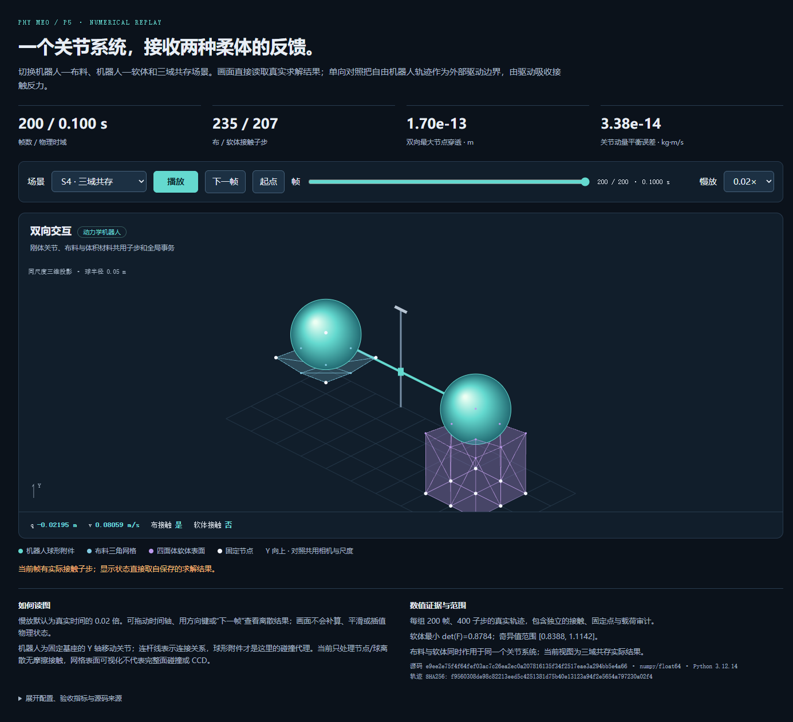

# P5 机器人、布料与软体的完整交互证据

P5 的五组物理实验、完整重复及旧 S0 完整 CPU/CUDA 回归已经通过；本页不是 P3–P5 最终工程验收。
阶段性能、最终安装矩阵及唯一一次整分支审阅仍需完成。

实现来源 `5634436919af1cc4ce113b8a6e68cec1f3a33f77`，重复运行来源
`523ff8754d883e3893eda15eaead6fdfeec0403d`。后者只增加回放及验证工具，
两轮包源码均为 `354be059215711712bcc7a6e1c92de0c6585f2392a464a1647e66c9805d67937`，
工作树干净，Python 3.12.14 / NumPy 2.5.4 / Windows 11。
[机器可读结果](p5-coupling.json)保存十次运行的完整配置、来源、质量及逐数组比较摘要。

## 冻结场景与实际结果

一个质量 0.5 kg 的 Y 移动关节，初速 -0.2 m/s、驱动力 -1 N、重力为零；
球形附件半径 0.05 m。布料含 9 个节点、四角固定；软体含 18 个节点、24 个四面体、底层 9 个固定节点，
材料为 E=500 Pa、ν=0.3 的有限适用域 StVK。
每组 200 帧、0.1 s，帧长 1/2000 s、2 子步；位置/速度各最多 200 次迭代、归一化容差 1e-8。
S4 中两个球形附件连接同一个关节系统。具体配对与全部参数在 JSON 中，没有为通过验收调整参数或阈值。

| 双向场景 | 布 / 软体接触子步 | 最大穿透 m | 最大关节动量平衡误差 kg·m/s | 最小 det(F) |
| --- | --- | --- | --- | --- |
| S2 机器人＋布料 | 235 / — | 1.39e-17 | 2.42e-14 | — |
| S3 机器人＋软体 | — / 235 | 1.39e-17 | 3.45e-15 | 0.817504 |
| S4 三域共存 | 235 / 207 | 1.70e-13 | 3.39e-14 | 0.878382 |

每组均接受 200 帧、独立审计 400 子步。各域至少 5 个接触子步；
穿透和闭合速度均小于 2e-7，相反载荷误差小于 1e-12 尺度，
固定点位置和速度误差为零。材料奇异值留在 [0.6, 1.4]、det(F)>0.2 的定义域内。
位置修正等效冲量只在平衡审计中除以 h 计入一次，没有再次施加。

外部驱动对照先生成无接触关节轨迹，再作为只读运动边界重放；
动态场景只包含柔体域，显式 history 保存驱动索引。反力由外部驱动吸收，单独记账，
不将其伪装成动力学机器人守恒。

| 对照 | 双向与自由轨迹末关节差 m | 双向与驱动边界的最大节点轨迹差 m |
| --- | --- | --- |
| S2 | 0.0077898645 | 0.0077899014 |
| S3 | 0.0017580936 | 0.0017576638 |

分别超过冻结的 1e-5 m / 1e-6 m 可观测门槛。两个对照各有 235 个接触子步，
驱动轨迹误差为零。最大吸收冲量分别为 0.009514824 / 0.007075 kg·m/s。

## 重复与真实回放

第二轮分别重新执行全部五组实验；S2/S3/S4/两个对照各 54/54/63/58/58 个数值数组，
共 287 个数组的 shape、dtype 和每个元素完全一致，涵盖每子步状态、事件及独立审计值。
计时不混入确定性轨迹指纹。原始 NPZ 在本地 `artifacts/p5-full-5634436/`、
`artifacts/p5-repeat-523ff87/`；仓库保留摘要和可再生成的回放。

[离线交互回放](../demos/articulated.html)嵌入实际 q/v、节点状态和拓扑；
S2/S3 同尺度展示双向与驱动边界，S4 显示三域共存。没有补算、平滑或插值状态。
7 项消费端测试验证嵌入数组与来源、损坏拒绝、短时域不能充当完整验收及输出不可覆盖。
本机 Chromium 153.0.8010.12 实测三场景、0/200 帧、步进、播放、暂停和 390 px 布局，
无脚本异常；[浏览器证据](p5-replay-browser.json)及截图如下。



## 时间观测与边界

旧 S0 再运行 NumPy FP64 和实际 tyx CUDA FP32，各接受 240 帧、独立审计 960 子步，
各 22 个数值数组与原同后端冻结参考逐元素完全相同。
[NumPy 记录](p5-s0-numpy.json)和[CUDA 记录](p5-s0-cuda.json)保存配置与逐数组比较。
两次包源码均为本页的 `354be059…`；CUDA 启动时工作树包含文档/工具测试改动，
因此来源如实标为 dirty，包源码未变。本批与工具开发交叠，S0 耗时只作诊断，
不当作无竞争性能基线。

两轮均逐场景串行执行。完整运行（含审计、记录和诊断）首轮/第二轮秒数为：
S2 137.212/45.444，S3 52.896/25.359，S4 171.701/163.264，
S2 驱动 43.097/96.718，S3 驱动 24.421/36.826。
同一源码与精确数值结果仍有明显时间波动；系统后台负载、CPU 频率及线程未控制，
不能据此声称提速或计算不同模型之间的加速比。后续串行固定状态微基准单独报告。

当前是 CPU FP64 参考实现、节点/球离散无摩擦接触；三角面、CCD、自碰撞、浮动基座、
闭环、通用强变形材料和新算法 tyx 移植不在本轮。剩余问题分别见
[几何边界](../legacy-issues/GEOM-001-discrete-vertex-contact.md)、
[材料定义域](../legacy-issues/MAT-001-bounded-stvk.md)和
[重复端口查询候选热点](../performance-bottlenecks/PERF-006-participant-point-queries.md)。
没有新的 tyx 缺陷证据，没有等价 Warp 实测。

## 复现

按[环境说明](../development/environment-and-ci.md)安装后，用两个不同的新目录分别执行：

```powershell
$runRoot='artifacts/p5-new'
foreach ($scene in @('S2','S3','S4')) {
  python examples/articulated_scene.py --scene $scene --output "$runRoot/$scene"
  if ($LASTEXITCODE -ne 0) { throw 'Scene failed' }
}
foreach ($scene in @('S2','S3')) {
  python examples/articulated_scene.py --scene $scene --experiment prescribed --output "$runRoot/$scene-driver"
  if ($LASTEXITCODE -ne 0) { throw 'Driver scene failed' }
}
```

随后用 `scripts/verify_articulated_runs.py --first FIRST --repeat SECOND --output REPORT.json`
核对完整时域、来源、全部数组和反馈门槛；用
`scripts/render_articulated.py --input FIRST --output REPLAY.html` 生成离线回放。
