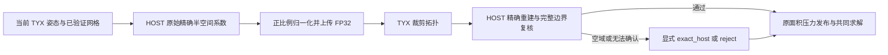

# I3e：TYX 裁剪拓扑＋HOST 精确边界复核

2026-11-18（11月17日开始），`codex/exp`，实现提交 `4489f456`。

**新路线已连接并通过验证，但这组小场景没有显示整步加速，因此保持显式可选，默认仍用原精确路径。**

## 完成了什么

新增持久 `TyxAreaPressureIntersector`，供单场景和异构场景复用。每个 tetra cell / rigid triangle 对由一条 TYX lane 计算裁剪多边形的 active 约束描述，固定双缓冲 scratch，最多七个多边形顶点。支持实际 interpret 和 CUDA。

当前环境的 TYX 只有 FP32，没有已验收的 FP64 设备类型。本批没有升级依赖，也没有把 FP32 当作原精确几何。计算路线为：



设备计算负责拓扑提案；HOST 重建每个顶点并验证它属于**完整交集**。验全部原始半空间、active 约束确实取零、全局凸性及每条边的真实支持直线。共面 tet face 的恒等零约束不能充当边界证书。通过后沿用原规范化、共享面归属、梯度规则、三角形 ID 和面积压力发布，正控输出与原精确算法逐字节相同。

空域、低维、数值不明确或边界证书失败不会被当作“没有接触”。`fallback="exact_host"` 显式调用原精确裁剪并记录原因；`fallback="reject"` 抛出 `device_unresolved`。损坏的设备元数据和容量溢出直接拒绝，不能通过 fallback 隐藏，也没有静默截断。

## 使用方式与生命周期

```python
from phymeo.backends.tyx_area_pressure_intersection import TyxAreaPressureIntersector
from phymeo.backends.mujoco_heterogeneous_area_scene import (
    MuJoCoTyxHeterogeneousAreaPressureScene,
)

with TyxAreaPressureIntersector(
    mode="cuda", capacity=256, fallback="exact_host"
) as clipper:
    scene = MuJoCoTyxHeterogeneousAreaPressureScene(
        batch, assets_by_model, intersector=clipper
    )
    scene.step(batch.timestep, expected_revision=batch.checkpoint_revision)
    stats = clipper.stats
    routes = clipper.last_routes
```

`capacity` 限制每次网格查询的 cell×face 数，最多2048；I0 三角形和求解器样本容量继续分别检查。模式必须与物理 runtime 相同；初始化要求资源处于 OPEN，UNKNOWN_RELEASE/CLOSING 不能绑定。

单场景 `MuJoCoTyxAreaPressureScene(..., intersector=clipper)` 同样可用。workspace 由调用者负责关闭，clone 沿用该 caller-owned 对象，不重复分配。reset/restore 后从新 owner 读取姿态；workspace 只持有查询 scratch，不放进物理 checkpoint。查询失败保留之前的 `last_result/last_routes`，整批几何或物理失败保留原场景发布。工作计数是尝试计数，并非接受物理步数。

## 验证结果

| 验证 | 实际结果 |
|---|---:|
| 精确边界证书与伪造负控 | 5 passed / 1.57 s |
| 静态案例 interpret | 12 passed / 1.71 s |
| 静态案例 CUDA | 12 passed / 2.17 s |
| 连续异构同输出与成本记录 | 2 passed / 16.52 s |
| clone／末 world 设备故障＋原单场景协议 | 4 新＋16 兼容 passed / 6.15 s |
| 非 OPEN 资源准入 | 2 passed / 3.92 s |

合计 **37 新＋16 兼容＝53 项通过**，无 skip、无功能失败、未调整物理参数或门槛。七个 Python 文件最终 Ruff/format 通过。源码审阅修正了异常签名误替换、非法设备 count 的截断风险和 OPEN 准入；均有相应校验或新增负控，不能称为实际测试失败。最终两项生命周期测试模拟 ledger 状态，不声称注入过真实 native free 失败。

静态覆盖原七组解析几何、有限边缘、斜面、多单元、完整压力体、共享面、变换/存储重排、原梯度拒绝、空域/退化、容量和晚读回失败。水平截面的正控明确禁用了 HOST `clip_triangle`，证明该例确实经过设备拓扑和边界复核。伪造负控包含恒等零面掩盖内部小三角、星形顺序、逆序、重复顶点、错误 active 和不可能的设备计数。

连续测试固定5个世界、3个物理桶、h=0.0005、12步。HOST 与混合路径的规范接触面、状态、力和统一观察逐字段/逐字节一致；只排除实时配置/修订身份。另检验选择重置后的新 owner、单场景 clone、最后一个 world 的设备读回异常及成功重试。原完整冲击/卸载/支撑长窗未重跑。

## 同输出整步成本

计时包括每步 FK、网格验证/系数、上传、设备裁剪、读回、精确复核/fallback、共同求解及统一观察读回。**不包含一次性的模型编译、资产构造和 workspace 分配。** 首步另列，不能将它解释为纯 JIT 耗时；部分编译缓存此前已经存在。

| 模式 | HOST 首步 | 混合首步 | HOST 后续11步合计 | 混合后续11步合计 |
|---|---:|---:|---:|---:|
| interpret | 0.4695 s | 0.4390 s | 3.4302 s | 3.9795 s |
| CUDA | 0.7965 s | 0.6931 s | 0.9153 s | 0.9268 s |

CUDA 后续平均约 **83.21 ms/步 vs 84.26 ms/步**，混合路径约慢1.3%。这是一次小型固定窗口，不能据此推断大规模性能；没有统计显著的加速证据。

两个模式均有48次查询/launch、192个 cell/face 对，其中36个设备拓扑复核通过、156个显式 HOST fallback。不是192对都在GPU完成。capacity=8 的工作区峰值9408字节；CUDA累计上传18432字节、读回89088字节。

CUDA 的12步查询累计：HOST准备0.3362s、设备执行/传输/同步0.0307s、精确边界复核0.0182s、fallback裁剪0.0803s、完整 intersector 调用0.4924s。分项之和不等于总时长：总调用还包含原归属/压力发布等工作，且这些查询时长是整步计时的子集，不能再次相加。

原始记录见[验证与成本清单](../../artifacts/area-pressure-device-topology-20261117-01/validation-summary.json)，包含两份同次 `complete-step-cost.json` 路径与 SHA。

## 下一批的具体顺序

1. **减少重复 HOST 准备**：拆分不可变资产验证、当前位姿处理和系数构建，缓存不变部分；每步的身份与几何检查继续保留。
2. **先排除可确认的空候选，再批量提交**：建立有明确分离证据的轻量筛选；不把FP32不确定结果当空。按固定容量将多个 world/pair 合并，减少当前每 world 一次查询的开销。
3. **同案例、同输出再比较整步成本**：继续保留小场景基线，再扩展固定模型数/面数；有整步收益才考虑自动选路或默认切换。

这批不是全设备有限面生成、CCD、任意变形体接触、面积摩擦或FFT非局部材料集成。它提供了一条已验的混合算法入口和可否证的成本结果。参见[实施计划](../superpowers/plans/2026-11-17-area-pressure-device-topology.md)。
