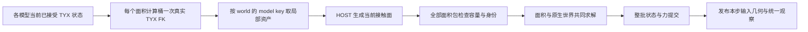

# I3d：异构当前状态自动生成面积接触并整批求解

2026-11-17，codex/exp，实现提交 `3f6265ad`。本批已通过 8 项新 interpret/CUDA 测试和 18 项受影响兼容测试；dev 不变，未 push。

## 已连接的流程

调用者现在只需在初始化时提供各模型的局部压力网格和有限刚面。每一步由场景入口完成：



同一个计算桶中的模型可以有不同压力场、材料身份和局部刚面；资产按模型身份选取。重置或恢复会替换物理 owner，下步重新从当前 owner 读取姿态和配置身份，不缓存旧设备或旧接触面。空接触面仍作为已声明 pair 的有效空结果保留。

## 使用方式

```python
from phymeo.backends.mujoco_heterogeneous_area_scene import (
    MuJoCoTyxHeterogeneousAreaPressureScene,
    MuJoCoTyxHeterogeneousAreaSceneCheckpoint,
)

# batch 的 ModelSpec 已声明 area_pressure_pairs；原生模型可不声明。
# asset 为 BodyAreaPressureAsset，网格坐标分别属于双方刚体局部坐标系。
scene = MuJoCoTyxHeterogeneousAreaPressureScene(
    batch, {"soft-model": (soft_asset,), "stiff-model": (stiff_asset,)},
)
scene.step(batch.timestep, expected_revision=batch.checkpoint_revision)
geometry = scene.last_geometry

with batch.prepare_device_workspace(include_area_pressure=True) as workspace:
    frame = workspace.refresh(expected_revision=batch.checkpoint_revision)
    accepted = workspace.readback(frame)

saved = scene.checkpoint().to_bytes()
scene.reset((selected_world,))
scene.restore(
    MuJoCoTyxHeterogeneousAreaSceneCheckpoint.from_bytes(saved),
    expected_revision=batch.checkpoint_revision,
)
```

assets 必须恰好覆盖全部面积模型，且各 tuple 顺序与模型的 pair 声明一致。原生模型不填资产。scene 不负责关闭 batch，控制与设备观察仍使用原 batch API。

scene.checkpoint 在原异构物理胶囊外绑定全部模型 key、压力/材料、网格拓扑和局部坐标。资产不同的场景会在物理 restore 前拒绝胶囊。只保存裸 batch 胶囊不会绑定调用者另行持有的场景资产。

## 相位与事务

几何对应本步入步 tick/time，力对应本步共同求解，返回状态对应端点。不会把历史接触面改名为当前几何。外部 batch 修订使 last_geometry 失效；成功 reset/restore 清除缓存，空 reset 保留。

全部几何和面积包准备成功后才进入原有所有桶 prepare/validate/commit。提交前已经构造好几何发布对象，提交后仅替换两个引用。某个模型的裁剪、容量或求解失败，都会保留之前接受的状态、力、receipt 和几何发布。失败尝试可以改写 FK scratch 和诊断计数，不承诺它们逐字节不变。

## 实际验证

固定 h=0.0005，5 个乱序 world、4 个模型 key、3 个计算桶。包括偏心 hinge、两种同桶不同资产的 slide、额外层外 slide，以及原生球/平面世界。soft/stiff 的初态相同，stiff 压力为 1.5 倍、局部刚面平移 0.01m、材料身份不同。

- 新 interpret：4 passed，21.78 秒。
- 新 CUDA：4 passed，14.34 秒。
- 受影响单场景协议：16 passed，1.99 秒。
- 原异构面积事务兼容：2 passed，4.27 秒。
- 4 个 Python 文件最终 Ruff 和 format-check 全部通过；功能测试前后源码 SHA256 一致。

连续 20 步逐字段比较混合批次与各模型独立运行结果，另用滑动体独立标量 BE 公式核力/速度/面积、手写旋转关系核 hinge 的间隙、入步刚面位置和配置身份。独立运行比较仅排除实时 configuration_id/source_revision；物理数据保持逐字节比较。world 305 在此短窗用于验证层外空面，不称它完成入层或卸载；既有完整入层/卸载轨迹没有重跑。

负控包括资产缺失/多余/错误 pair、过期修订、错误步长、改变压力或局部刚面后的 checkpoint 拒绝、胶囊 checksum 损坏、末世界几何异常、容量溢出、末桶物理异常，以及成功重试。容量负控明确在真实 I1 后注入合成超量结果，只验证容量拒绝，不作为几何正确性依据。选择性 reset、restore owner 替换后续步重现，以及统一观察旧 frame 失效均通过。

本批没有功能或数值测试失败。首次格式检查和 import 排序问题已修正；3 次入口 guard 在外部 TypeScript 编译期间阻止执行，未干预外来进程，后续在 fresh guard 允许后运行。解释与 CUDA 分别选择其 4 节点，合计覆盖全部 8 个新节点，无 skip。原始日志、guard、exit、源码清单见[验证记录](../../artifacts/area-pressure-heterogeneous-scene-20261117-01/validation-summary.json)。

## 范围与下一步

这是已声明的 full 零边界四面体压力资产对有限刚面三角网格的自动接线。当前姿态来自 TYX，几何裁剪仍在 HOST，随后进入 TYX 共同动力学；不是全设备碰撞、CCD、任意变形压力场、摩擦或 FFT 非局部材料响应。原训练成功 reader 对 area 声明的限制仍保持，本批不新增训练效果结论。

下一批优先把有限面生成推进到设备侧，并记录包含几何、同步、求解和导出的整步成本；随后补面积 body-pair 观察的应用适配。参见[本批计划](../superpowers/plans/2026-11-17-area-pressure-heterogeneous-scene.md)。
