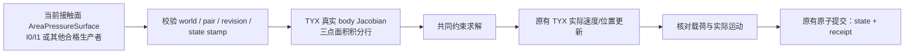

# 面积压力接入 MuJoCo-TYX 真实共同步：I2a

日期：2026-11-17。分支：codex/exp。验证源码提交：a898e3d1。稳定 dev 未修改。
本批实现了“给定当前接触面 → 设备共同求解 → 双方实际运动及载荷共同发布”。
它不是新的 FFT 标定，也没有把只输出总力的插值表接入物理步。

## 结果与范围

31 个新测试全部通过：16 个 HOST/interpret 节点、15 个 CUDA 模式节点。
修改到的原生 T4 接口另有 4 个针对性回归通过。没有重跑旧 I0/I1、
FFT 或 Kamino 案例。两次首轮动力学测试没有数值失败或参数调整。

| 检验 | 实际覆盖 |
|---|---|
| 双方真实运动 | 0.5 kg 与 1.25 kg 两滑动体，保留入步速度，零/非零关节阻尼 |
| 接触力与运动一致 | 与独立后向欧拉解析解比对；同时检查物理加速度和实际积分加速度 |
| 压力分布与转矩 | 三个不同杠杆的积分点，偏心 COM 的真实转动关节及另一滑动体 |
| 能量 | 线性案例机械能非增，独立核对后向欧拉离散耗散恒等式 |
| 接触选择 | 指定 body pair 的所有原生 geom pair 排除，其他原生接触保留 |
| 卸载语义 | 空接触面正常运动；非空但零压力、正在分离时不产生吸引力 |
| 状态与失败 | sparse worlds、旧时间/步号/配置/revision 拒绝；容量不足拒绝；第二 world 晚发布失败及重试 |
| 输出一致性 | 人为篡改实际输出速度会拒绝整批；旧状态及旧载荷记录仍保留 |
| reset | 选择性 reset 后要求新 stamp；未接通的 checkpoint/restore/clone 明确拒绝 |

新案例运动/力比较门为 rtol=4e-4、atol=2e-5；位置使用更小的绝对门。
这是 FP32 工程验收，不要求浮点发布端点数学意义上精确相触。没有声称性能优于 Newton。

## 已连接的路径



第一箭头目前是调用方提供的新面数据；runtime 不会自动重做裁剪，也不会
从旧接触面推断新接触面。configuration_id 绑定当前状态，不能代替几何正确性证明。

新增入口：

```python
runtime = MuJoCoTyxRuntime(
    compilation, mode="cuda",
    area_pressure_pairs=(("compliant", "rigid"),),
)
# 每个 world、每个声明 pair，提供当步 AreaPressureSurface；无接触用空面。
# stamp 使用 str(world)、当前 tick/time 与下列绑定：
configuration_id = runtime.area_pressure_configuration_id(world)
runtime.step_area_pressure(
    h, surfaces_by_world, expected_revision=runtime.checkpoint_revision,
)
# 输出与运动一起接受：
records = runtime.integration_snapshot()[world].last_step.raw_contact_fields["area_pressure"]
```

输入仍保存真实 dA、压力、有效梯度和材料身份。设备从实际 COM Jacobian 与
世界接触点计算 J=nᵀ(JA−JB)，不接受调用方伪造的力映射。逐点力、双方
世界力/共同原点力矩、sample/source 身份随同一条 step receipt 保存。
type 7 行有独立的 area-pressure-be-row-v1 语义，不伪装为 MuJoCo solimp。

## 时间离散与阻尼

本步固定入步几何和 J，采用弹性、无接触摩擦的法向模型：

- k=dA*g，phi=-p/g，力单位 N；
- R=1/(h²k)，aref=-phi/h²-Jv/h；
- f>=0，r=J*a+R*f-aref>=0，f*r=0；
- 实际速度更新响应为 M+h*D，与原有隐式关节阻尼积分一致。

保留原始 M；设备另有有效响应矩阵。receipt.qacc 仍是物理 M 方程的
加速度，integration_acceleration 对应实际速度更新。area 路由的
dynamics.smooth_acceleration 是有效响应加速度，capability 明示其
operator；不将两者混称。

零关节阻尼时，面积行可与其他原生接触/limit/dry-friction 行共用求解。
非零阻尼时，第一版仅准入面积约束；如果还有其他可能的原生接触或
limit/dry-friction，构造即拒绝。否则给不同约束使用不同响应矩阵会
破坏现有对称求解结构，或悄悄改变原生模型。

pair 归属按精确 body 名字，包含该 body 的直接 geoms，不自动扩张到
welded 子体。审阅曾发现用 weld component 排除会误删同属 world weld
的另一面墙，已改正并用 table/wall 负控验证。FP32 非零下溢沿用既有
准入拒绝；实际待提交速度必须与设备积分加速度相符，再参与力律检查。

## 生命周期与限制

新增缓冲计入原有 allocation manifest；共用 constraint_capacity，
与 native 行一起计算容量，不静默截断。所有失败沿原 prepare/commit
事务处理；没有主机运动更新或步后额外施力。

面积载荷目前仅在 step receipt 发布，尚未扩展旧设备 contact-entry ABI。
checkpoint/restore/clone 显式不支持这条新路由，不能用旧胶囊假装已支持。
首批也拒绝 activation/BALL；沿用已有 stateless hinge/slide/free-root
结构准入，但本批正向物理验证限上述滑动/转动关节案例。

尚未完成：自动当前面生成、跨步面身份/启闭、非线性终点几何收敛、接触
摩擦、完整 area 设备观察/生命周期、GPU 接触面生成、FFT 非局部材料域。
所以这是 I2a 的真实共同步接入，不是完整 Hydroelastic 或全部 I2 验收。

## 可复现记录

证据目录：artifacts/area-pressure-tyx-step-20261117-01。

| 命令 | 结果 |
|---|---|
| 01 环境 | CPython 3.13.3；MuJoCo 3.3.7；TYX distribution 0.1.0a0；NumPy 2.4.6；pytest 9.1.1 |
| 06 新 HOST/interpret | 16 passed，15 CUDA 节点有意未选；4.88 s |
| 07 新 CUDA | 15 passed，16 非 CUDA 节点有意未选；14.26 s |
| 08 原生 T4 混合接缝 | interpret/CUDA、condim 3/6 共 4 passed；5.25 s |
| 09/10 最终静态 | Ruff 与 format-check 通过 |

原始命令、入口感知执行 guard、stdout/stderr、退出码均保留。首次 lint
发现局部名字不明确和测试缺少异常导入，均在动力学执行前修复，原失败
日志保留。两种模式串行，无安装、远程 CI、性能 probe 或旧证据重审。
新测试是实际结果的断言验收，未额外输出完整逐步轨迹文件。

## 下一步

优先 I2b：以当前已接受状态更新 I1 压力场与有限表面，串起一条连续
入层—压缩—承载/卸载轨迹。先用两个可动体和偏心关节两类案例，
显式检查接触区变化、原生接触排除、能量和步长敏感性。不要只重复本批
给定面单步解析题，也不把尚未通过资格的力表作为运行时替代。

随后再补面积观察的设备 ABI、checkpoint/reset 完整性、摩擦与模型
组合，最后扩大设备几何和异构场景。FFT 保留为适用材料域的离线数值
参考，其跨接触区耦合不能被每个 pair 独立面积弹簧替代。

相关：[冻结计划](../superpowers/plans/2026-11-17-area-pressure-tyx-step.md)；
[既有 I2 裁定](area-pressure-3d-integration-decision-20261116.md)；
[总体目标架构](contact-model-architecture-20261117.md)。
