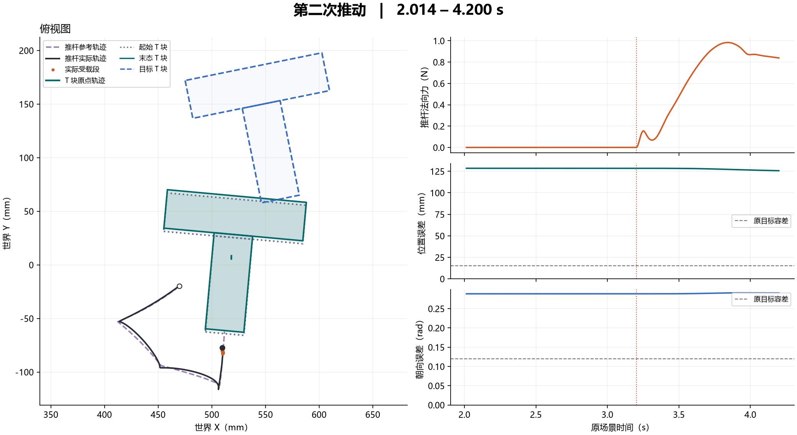

# RR Push‑T 第二次推动的实测结果

第二条路线在真实 CUDA 场景中运行至 4.200 s。推杆再次接触 T 块并连续施力 996 个 1 ms 步。T 块沿计划方向移动了 2.891 mm，位置误差缩小 2.822 mm，偏航误差增大 0.00234 rad。原任务在本段的全部入步观测中均未达到成功条件。[逐步核对](../../artifacts/rr-active-route-20261121-01/comparison.json)



左图蓝色虚线是目标，灰色点线是起始姿态，绿色实线是最终姿态。黑线与紫色虚线分别表示推杆的实际轨迹和指令参考。右图橙色竖线标记 3.204 s 首次重新测得正面积载荷。原生胶囊的几何距离仅用于解释跟踪误差；受载判据取每步面积接触的逐点实测法向力。

| 实测量 | 结果 |
| --- | --- |
| 新的已提交、已完整记录步数 | 2,186，2.014–4.200 s |
| 首次受载、峰值与末个入步 | 3.204 s 再次受载；3.841 s 达 0.9832 N；4.199 s 仍有 0.8386 N |
| 面积法向冲量、本段最低桌面法向支撑 | 0.65029 N·s、1.4504 N |
| T 块原点平面位移 | X +0.076 mm，Y +2.895 mm |
| 距目标位置 | 128.483 → 125.660 mm，容差 15 mm |
| 偏航绝对误差 | 0.28850 → 0.29083 rad，容差 0.12 rad |
| 末次任务观测 | 4.199 s 入步，T 形投影 IoU 0.00208，要求 0.90，合格保持时间 0 s |

表中终点位姿取 4.200 s 已提交输出。力与任务观测取各物理步的输入相位。该段继承的是 1.950 s 被接受的路线，2.014 s 起点已执行其中 64 ms。控制器在路线末尾记录累计完成两条，进度状态为 `continue`。[场景执行摘要](../../artifacts/rr-active-route-20261121-01/active-b.json) · [末态检查点清单](../../artifacts/rr-active-route-20261121-01/active-b.final.scene.metadata.json)

## 20 mm 的参考产生了多少运动

规划器用 20 mm 的物体平移和近零偏航变化估算这条路线的收益。沿其选定的水平方向，在标为 `push` 的首末入态（3.251–4.199 s）之间，推杆参考前进 **19.99 mm**，两关节实际带动推杆前进 **4.53 mm**，T 块原点前进 **2.88 mm**。推动阶段的推杆中心与参考中心最大距离为 16.11 mm。最后入态的原生推杆胶囊与 T 块最小有符号距离为 −1.87 mm；全推动段最深为 −2.14 mm。[分阶段几何读数](../../artifacts/rr-active-route-20261121-01/motion-summary.json)

这 949 步中，两个电机的实测绝对峰值分别为 0.585 和 0.282 N·m，原 PD 力矩裁剪触发次数为零。沿推动方向，推杆施加给 T 块的面积接触冲量为 +0.64655 N·s，桌面施加给 T 块的支撑接触冲量为 −0.64602 N·s。两个数来自同一批已提交步的实际力。它们解释了施力接近 1 N 时 T 块仍只缓慢前移的现象。此处比较的是同一方向上的合力投影，表格中的 0.65029 N·s 则是完整续跑中逐点法向力标量之和的时间积分。[方向投影、实际力矩与裁剪计数](../../artifacts/rr-active-route-20261121-01/push-attribution.json)

**下一批优先做一个可区分原因的对照。** 从同一加载前检查点比较现有位置跟踪和利用接触力反馈的控制，保持材料、桌面、参考路线、步长与成功阈值一致。以实际推杆沿向位移、T 块位移、偏航和两侧冲量判断更换控制是否有效。若推杆跟踪提高而物体仍少动，应修正规划器把参考距离换算为物体位移的估计。4.200 s 的公开检查点和控制器历史也可作为继续执行任务的起点。

## 如何复现

从原实验的摘要、已接受步日志、两条保存的路线及资产开始。第一条命令只在旧归档缺少 2.014 s 的引擎检查点时需要执行一次。每条命令指定一个全新的输出文件。为简洁起见，以下 PowerShell 变量从仓库根目录解析。

```powershell
$prior = 'artifacts/rr-public-feedback-20261121-01/continuous-damped.json'
$release = 'artifacts/rr-loaded-withdrawal-20261121-01/release-b.json'
python -m experiments.area_pressure.pusht_active_checkpoint --summary $prior --release $release --output entry.metadata.json
python -m experiments.area_pressure.pusht_active_route --summary $prior --release $release --checkpoint entry.metadata.json --output second-route.json
python -m experiments.area_pressure.pusht_active_comparison --input second-route.json --output comparison.json
```

在固定的 1 ms 步长下，控制器从实测关节状态、原路线的当前时间和原 PD 参数生成指令，经原 CUDA 动作接口提交给公开场景。每步一次发布实际位姿、速度、推杆面积力和桌面支撑。位置与朝向误差取物体自由体原点和四元数。判定任务成功还要求 T 形投影 IoU、支撑、倾角、线速度、角速度和离桌高度同时合格并持续 0.2 s。[原任务定义](../../src/phymeo/training/manipulation_tasks.py)

2.014 s 的设备四元数经过 FP32 更新，无法经普通 FP64 单位四元数初始化逐位还原。为恢复旧归档，从 1.700 s 重放了 314 个已提交控制，逐步核对了原 q/v、时钟、控制、接触几何、面积力、原生支撑和求解记录，随后保存了原生场景检查点。控制器、目标历史以及 1.950 s 选定的第二条路线从旧记录恢复，第一条续跑命令处于该路线 64 ms 处。独立计算的两个电机指令为 0.09853327 和 −0.54633814 N·m，与设备实际提交值逐位一致。[入口检查点清单](../../artifacts/rr-active-route-20261121-01/entry-a.metadata.json) · [首条指令](../../artifacts/rr-active-route-20261121-01/first-reference.json)

实验暴露并修复了异构引擎的一处转存缺陷。新场景第一次恢复后，本地事务版本为 1，历史物理步仍属于源场景。再次保存时，旧格式将这两个版本放在同一序列中检查，导致续跑第一步前被拒。现可将两者分别保存，在另一场景转存后继续推进。整条路线可从同一个 2.014 s 检查点启动。[跨场景检查点接口](mujoco-tyx-checkpoint.md) · [首次运行的原始拒绝](../../artifacts/rr-active-route-20261121-01/active.json)

## 验证范围

独立读取 2,186 行已提交记录，核对输入状态与前一输出的连续性、参考时间、控制、积分、逐点力、桌面支撑及目标观测，并核验终点检查点的字节和来源。在另一全新 CUDA 场景恢复了实际 4.200 s 检查点，逐位核对 q/v、时钟与最后一步收据的时标，并在原地成功转存。[终点读回](../../artifacts/rr-active-route-20261121-01/terminal-readback.json) 四个续跑测试文件共 32 项通过，异构事务与检查点测试文件共 51 项通过，后者包括解释与 CUDA 的跨场景接续。当前结果适用于这个两关节机器人、这组有限接触面和这条原路线。实际积分与混合接触求解使用 CUDA，报告中的原始形状距离和推杆跟踪量另从已发布关节状态用 CPU 正向运动学测得。[续跑测试](../../artifacts/rr-active-route-20261121-01/14-focused.stdout.log) · [引擎事务测试](../../artifacts/rr-active-route-20261121-01/25-checkpoint-suite.stdout.log)
