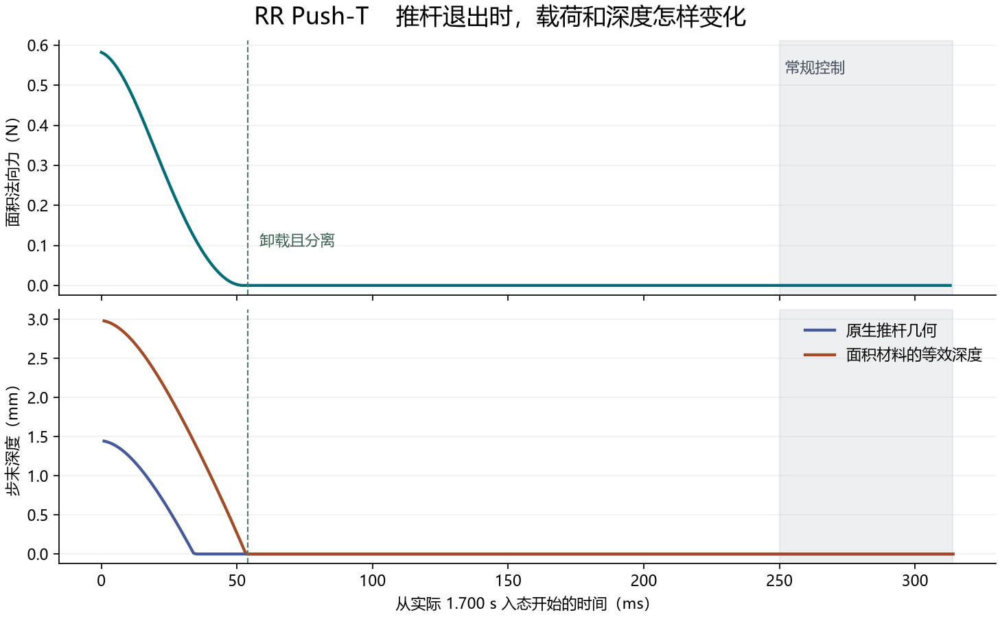

# RR Push‑T 从受载状态撤离

本实验问的是，末次推动结束时推杆仍压着 T 块，沿原控制器给出的退出方向驱动两个真实关节，能否卸载并重新规划。验证从上一条连续闭环轨迹的 1.700 s 端点开始。此前推杆和原生 T 块几何重叠 1.448248 mm，1.699–1.700 s 步的面积法向力为 0.584096 N。[上一批实测与原始双轨记录](rr-pusht-public-feedback-report-20261121.md)

## 同一条实际轨迹上的结果

从 1.700 s 到 2.014 s，CUDA 连续提交 314 个 1 ms 步。原平滑控制完成整段退出，随后普通规划器从实际状态接回。T 块仍未到达目标区。最后一次目标观察位于 2.013 s 入步，位置误差 128.48 mm，偏航误差 0.2885 rad。[逐步结果与独立核对](../../artifacts/rr-loaded-withdrawal-20261121-01/verified.json)

| 时间 | 观察到的变化 |
| --- | --- |
| 1.735 s 步末 | 原生推杆几何与此前受载的 T 块几何首次严格分离。有限面积材料仍在卸载。 |
| 1.753–1.754 s | 该步在输入几何上提交的面积法向力为零。步末 28 个压力四面体与六个有限材料面逐对严格分离。 |
| 1.950 s | 受控退出的 250 步完成。普通规划器直接使用该端点的实际位置和速度，按原上限通过下一条参考。 |
| 2.014 s | 新参考已实际执行 64 步，达到本实验的常规步数上限。这一段推杆对物体的实测冲量为零。 |



绿虚线标记卸载与分离同时满足的首个步末。灰色区是新的常规参考已经实际运行的部分。上图按求解的入步时间画力，下图按步末位姿画深度。原生胶囊和八角压力体具有不同外形，两个深度采用各自的几何定义。

## 入态和控制

新公开场景恢复原反馈世界 6 发布的关节、自由体位姿和速度，逐字核对 FP32，并继承原标量时钟、已选推动方向、反馈控制器的进度及任务成功历史。局部场景时标从第 0 步开始计数。原设备所有者的隐藏缓存没有归档，本实验只主张这些可核验的初值连续。

普通规划仍用 1 mm 路径上限。可选的受载撤离分支只给出已有接触对沿原退出方向的 250 ms 关节参考；按 1 ms 采样检查初始超限对的深度单调不增，终点严格分离，禁止新碰触。其后用真实设备步进检验能否跟踪。单独的普通规划必须从实际卸载状态重新通过，才能接回下一段推动。[规划入口](../../src/phymeo/control/manipulation_push_planner.py) · [路径检查](../../src/phymeo/control/manipulation_push_release.py)

每个候选都从公开检查点发出原 PD 控制和 CUDA 动作。首先试原平滑速度曲线；只在入口出现指定的卸载失败时，才试同一关节路径、同一时长的匀速参考。两者共用材料、增益、限幅、步长和求解门槛。拒绝后读回并核对状态、控制和前次步进收据。只有选中候选才能更新目标与反馈历史。[步进与恢复](../../experiments/area_pressure/pusht_loaded_release.py)

## 哪些量可比较

原生几何记录有符号距离、两侧接触位置处的相对法向速度。面积材料另记录整块和六个有限侧面。每面的深度取实际裁剪多边形顶点上压力除以法向压力梯度的最大值，单位为米；设备求解提交的各点法向力按面求和，单位为牛顿。整块用于核对总量，和逐面结果分别报告。新入态只继承上一份收据真实保存的整块载荷，第一次实际收据建立逐面载荷基线。原有桌面支撑允许继续受载，其余几何和材料对逐对检查。[逐对卸载规则](../../src/phymeo/control/manipulation_release_monitor.py) · [面积材料量与来源](../../experiments/area_pressure/pusht_release_material.py)

第一轮设备试步发现了一个量测问题。完全相同的 1.700 s 入态，CPU 正向运动学得到的整块深度为 2.985436763 mm，设备面得到 2.985447624 mm，相差 10.86 nm。把前一项当作上一步末值、后一项当作下一步初值，会报告一次发生在零位移上的加深。两种控制的首个实际候选均被恢复，逐项读回一致。平滑候选的面积法向力实际降至 0.582180 N，匀速候选降至 0.581136 N。原始试步保存在独立文件中。[首次试步及逐项拒绝原因](../../artifacts/rr-loaded-withdrawal-20261121-01/release-a.json)

## 修正量测之后

两个端点均由各自的实际已发布姿态，使用同一套 CPU 正向运动学与裁剪函数计算几何深度。载荷继续取本次求解使用的设备接触面及实际收据。每个候选同时保存设备入面、CPU 入面和 CPU 末面的逐面数据。若两条几何路径认出的受触面不同，程序保留差异并停止。回归用例分别覆盖同一物理姿态两种表示相差 10.86 nm，以及确实发生 10.86 nm 加深的情况；前者能够继续，后者仍受原零增长规则约束。[量测一致性与面身份测试](../../tests/test_pusht_release_material.py)

对原退出参考，新增的反例覆盖了另一个已声明形状上 0.50 mm 的浅碰，以及未声明形状上 0.05 mm 的浅碰。受载撤离分支能在普通容差本会放行的位置拦下这两种路径。初始已有且在普通容差内的浅接触随推杆一起退出的两项正控也通过。[路径反例与正控](../../tests/test_manipulation_push_release.py)

## 复现与验证

保留上一批实验的摘要、比较文件、逐步日志、路线和原候选资产，从仓库根目录指定一个尚未存在的输出路径。

```powershell
python -m experiments.area_pressure.pusht_loaded_release --summary artifacts/rr-public-feedback-20261121-01/continuous-damped.json --output release-new.json --steps 320 --regular-steps 64
```

修正后的实验使用原平滑控制，314 个候选全部被选中。独立读取 631 个日志事件，逐条比对收据、前后状态、六面载荷及普通路线的 SHA、入态和速度。控制器按上一个进度检查点累计的 0.0143261372 N·s 全部产生在 250 步撤离段；后 64 步常规段没有新的推杆载荷。两次直接对整段求和与逐步浮点累加在末位相差约 4 × 10⁻¹⁸ N·s；按控制器原递推逐步核对后，每个已发布的累计值相符。[完整运行](../../artifacts/rr-loaded-withdrawal-20261121-01/release-b.json) · [逐事件记录](../../artifacts/rr-loaded-withdrawal-20261121-01/release-b.trials.jsonl) · [逐步冲量核对](../../artifacts/rr-loaded-withdrawal-20261121-01/34-phase-impulses-exact-recurrence.stdout.log)

本批相关的 8 个测试文件共 131 项通过，覆盖路径、真实载荷、方向、完整状态回读、两种几何表示和失败恢复。验证范围为原 RR 世界、声明的六个有限侧面和采样状态。普通路线的总时长为 2.25 s，已执行其中 64 ms。下一批可以从 2.014 s 端点恢复这条进行中的路线，继续检查下一次实际受载和到目标区的误差。[测试记录](../../artifacts/rr-loaded-withdrawal-20261121-01/31-final-changed-suite.stdout.log)
