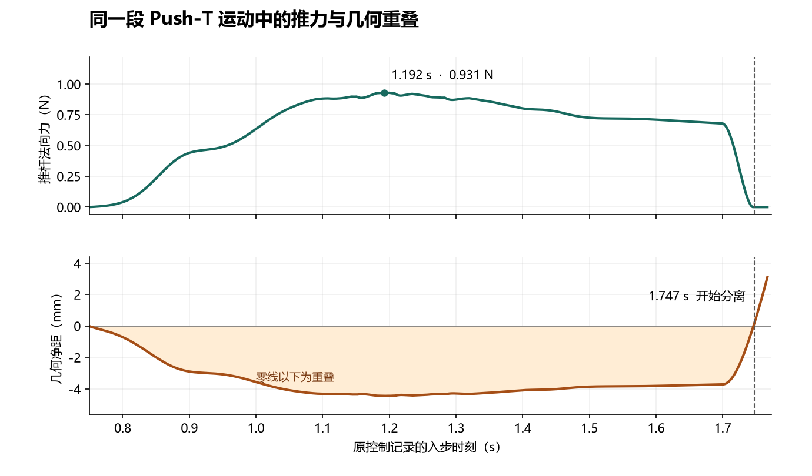

# 原始双关节 Push‑T 的面积推力、桌面支撑与撤离

从原记录首次受载的输入状态开始，两个电机沿用原来的控制命令，T 块与机器人只使用上一步新算出的位姿和速度。以 1 ms 步长连续推进 1,018 步，面积接触经历加载、持续推动、卸载和分离。推杆法向力在 1.192 s 达到 0.931 N，1.746 s 降为零，1.747 s 起连续 21 个入步的几何净距为正。最终入步净距 3.110 mm，桌面仍承载 1.570 N。本次验证覆盖原首个推段及撤离，任务最终目标位姿和完整 12 秒闭环策略仍待验证。



### 实际接入了哪些力

原模型有两个带阻尼和软限位的电机铰链，以及一个可自由移动和转动的复合 T 块，共 8 个速度自由度。每步从当前状态用 CPU MuJoCo 装配质量矩阵、驱动、偏置、被动力和原生约束行。根据几何身份移出胶囊推杆与 T 块两件几何的原生接触。余下九对候选继续走原生检测。活跃桌面接触保留原来的摩擦锥边和几何身份。另用偏离原轨迹的正反向双限位输入检查了两处铰链反力同时出现时的装配。

在两个盒子的并集外表面上，以胶囊到每个积分点的距离构造面积载荷。双方在同一世界点计算雅可比，力对两方反向施加。梯度沿用 1 MPa/m，摩擦系数为 0.7，平滑滑移速度为 0.01 m/s。每步冻结入步几何，在候选终速度下重新计算法向压力和切向摩擦。TYX CUDA 的现有工作集求解器在每次候选载荷下处理全部原生行。载荷和运动收敛后，使用含关节阻尼的速度更新和自由刚体四元数积分推进。CPU 负责几何、载荷迭代及位姿积分，CUDA 负责原生约束求解。[入步与原生行](../../experiments/area_pressure/pusht_entry_rows.py) · [面积积分](../../experiments/area_pressure/pusht_entry_area.py) · [CUDA 工作集](../../experiments/area_pressure/native_row_device.py) · [联合步进](../../experiments/area_pressure/pusht_entry_working_set.py)

### 固定原生姿态与连续推进

| 原始输入时刻 | 保留原生行 | 面积积分点 | 同姿态面积法向力 N | 同姿态桌面支撑 N |
| --- | ---: | ---: | ---: | ---: |
| 初始，0.000 s | 0 | 0 | 0 | 0 |
| 原记录首次受载，0.750 s | 32 | 219 | 0.000122 | 1.56960 |
| 原记录推力最高，1.255 s | 32 | 237 | 0.001847 | 1.56451 |
| 原记录首推段末，1.699 s | 28 | 237 | 0.001790 | 1.55838 |
| 原记录已撤离，1.767 s | 32 | 0 | 0 | 1.57012 |

原生模型在 1.255 s 的 0.105 mm 压入下达到 0.927 N。面积模型在相同入步姿态的力很小。让它用自己的运动继续推进后，0.931 N 峰值对应 4.440 mm 的几何重叠。两种模型得到相近的峰值，达到峰值的时间和压入深度随接触律而变。该压力梯度沿用静态实验设定，尚无实物标定。[原生同姿态对照](rr-pusht-area-reference-report-20261119.md)

从首次入步到最后出步，T 块自由关节原点的平面位移为 Δx = −1.198 mm、Δy = +3.829 mm。全段推杆标量法向冲量为 0.6540 N·s。推力峰值步对两个关节的面积力矩分别为 −0.454 和 −0.221 N·m。共有 996 步产生正推力。在 1.746 s 的入步时几何仍有重叠，但分离运动让终速度接触律给出零力。

### 独立推进的双精度对照

第二条轨迹只共享首次受载初态和原电机控制，随后每一步重建自己的接触面、原生行和质量矩阵，由 FP64 方程根推进自己的位姿和速度。两条轨迹均走完 1,018 步，在相同步号达到法向力峰值及几何分离。峰值力相差 6.65e−9 N。自由物体位置差的全程最大值为 2.44e−10 m，姿态差最大 3.88e−9 rad，两铰链的角度差最大 1.23e−8 rad。这些是实测分歧，两轨迹共享的接触材料与离散几何仍需另外检验。验算同时逐行核对了原轨迹的状态衔接、四元数积分和最终状态摘要。完整对照在本机收据 `24-independent-fp64-window` 与 `fp64-window.json` 中。[独立推进与校验入口](../../experiments/area_pressure/pusht_entry_window_reference.py)

### 精度、成本与适用范围

- 给每个入步另求一个 FP64 耦合方程根。全窗口最大速度分量差为 8.24e−8（平移 m/s，转动 rad/s），原生标量行反力差最大 8.35e−7，单点面积力分量差最大 7.33e−9 N。原生互补残差最大 8.11e−6，缩放后的动量残差最大 1.13e−9。原生接触行单位为 N，关节限位行随关节类型为 N 或 N·m。
- 每步最多 32 条原生行、238 个面积积分点及 18 次面积迭代。静态载荷包络目标为 2%。997 个带积分点的入步在当前细分预算下均未达到该目标。峰值步的静态载荷包络为 [0.752, 1.157] N。FP64 和 CUDA 路径使用同一离散面积，动力学对照只检验这个离散问题。刚体最大几何重叠为 4.440 mm。
- 单世界、1,018 步的命令墙钟约 95.8 s，其中累计主机装配 14.1 s、含设备初始化与传输的面积/原生行迭代 77.9 s。其余时间含逐步 FP64 参照、序列化及其他开销。此数值用于选择后续优化点。生产编译入口目前的摩擦点上限为 128，尚需处理容量与过载，接入设备常驻状态及缓冲区复用。[生产容量检查](../../src/phymeo/backends/mujoco_area_pressure.py)

### 复现

以下命令在仓库根目录串行执行，先将 `PYTHONPATH` 指向 `src`。五入步对照可以直接使用仓库内的原始输入包。连续窗口另需原先保存的控制归档，输出需选择新文件名。[便携输入包](../../experiments/area_pressure/pusht_entry_inputs.json) · [步进测试](../../tests/test_pusht_entry_working_set.py) · [几何测试](../../tests/test_pusht_entry_quadrature.py)

```powershell
$env:PYTHONPATH = (Resolve-Path src).Path
$python = ".\.venv-training-cuda313\Scripts\python.exe"
$archive = "artifacts/mujoco-tyx-push-feedback-20261115-01/world5"
& $python -m experiments.area_pressure.pusht_entry_working_set --output rr-five.json
& $python -m experiments.area_pressure.pusht_entry_working_set --trajectory $archive --output rr-window.json
& $python -m experiments.area_pressure.pusht_entry_window_reference --trajectory $archive --window rr-window.json --output rr-independent.json
& $python -m pytest -q tests/test_pusht_entry_quadrature.py tests/test_pusht_entry_working_set.py
```

本机完整收据位于 `artifacts/rr-pusht-entry-working-set-20261120-01`。首次试跑停于第 771 个入步。逐项检查发现，相邻 FP32 候选载荷相差 1.51e−9，对应速度变化约 4.94e−10。将内迭代停止条件改为同时检查逐坐标缩放载荷差与其引起的速度差，原先独立速度、反力、动量和互补验收门槛保持原值。全窗口收据为 `13-full-window`，原始结果为 `full-window.jsonl` 及 `full-window.json`。其控制读取器在推进前已核对完整归档摘要与每条动作实际通道。此次逐步输出可通过 tick 找到原始命令。当前保存格式另写出三个实际控制通道和原始行摘要，回归覆盖更新后的记录格式。两份新测试文件合计 15 个用例通过（收据 20 的 14 项及收据 28 新增的 1 项），七个 Python 文件的 Ruff 与格式检查通过。
