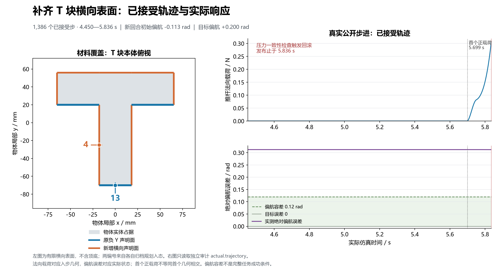

# RR PushT 的有限侧面承载实验

## 同一入态下，哪些面真的传力

上批 A 路线中，规划器选出的 4 号点位于 T 块局部负 X 侧。推杆到达计划位置后，原负 Y 材料面仍有间隙，物块没有受到推力。本次从物块自身的两个盒子生成并集外侧面，保留 T 形轮廓及其凹角。规划阶段用这份有限面做材料准入，步进阶段用同一资产积分压力和摩擦。桌面继续通过原生约束支撑物块。[上批路线](rr-pusht-pose-followthrough-report-20261121.md) · [实验前确定的条件](../../artifacts/rr-lateral-push-20261122-01/protocol.md)

每个点取归档路线的分离态和首次达到 0.1 mm 浅压入的入步。两种材料各启动一个新场景，以同样的公开初态、三路控制量和 1 ms 步长推进。下表的力、力矩和面积都取自实际接受的步；压入深度取自选帧时的独立几何计算。面积单位为平方毫米，力矩正号表示推动物块朝世界 +Z 方向转动。[八个 CUDA 单步与独立双精度参考](../../artifacts/rr-lateral-push-20261122-01/controls.json)

| 点与参考入步 | 压入深度 | 原负 Y 面 → 全侧面面积 | 法向推力 | 绕物块质心 Z 轴的力矩 |
| --- | ---: | ---: | ---: | ---: |
| 4 和 13，均在 4.450 s 分离 | 0 mm | 0 → 0 mm² | 0 → 0 mN | 0 → 0 N·m |
| 4，5.701 s | 0.102 mm | 0 → 15.54 mm² | 0 → 1.158 mN | 0 → +3.945 × 10⁻⁵ N·m |
| 13，4.959 s | 0.134 mm | 28.23 → 28.23 mm² | 2.555 → 2.555 mN | −2.584 × 10⁻⁵ → −2.584 × 10⁻⁵ N·m |

4 号的浅压入出现了 24 个面积积分样本。13 号的两种材料均有 24 个，物块出步速度一致。八步中每一项发布速度与独立参考的最大分量差不超过 2.33 × 10⁻⁸，各分量单位为相应自由度的 m/s 或 rad/s。[独立参考及控制绑定](../../experiments/area_pressure/pusht_lateral_controls.py)

## 几何和实验边界

低层几何输入是同一坐标系中的轴对齐盒子上下界。实现按各坐标轴的盒边划分单元，只保留实心单元与外部相邻的面。重合盒、重叠盒和共面拼接只贡献一次面积。PushT 选择局部 ±X、±Y 四个方向，顶底未登记为推杆的面积材料面。场景需要受支持的物块盒和推杆形状。[盒并集外表面](../../src/phymeo/geometry/box_union_surface.py) · [场景材料声明](../../experiments/area_pressure/pusht_public_scene.py)

实际模型的两个盒子在局部 Y = 20 mm 处交界。直接在二进制浮点中从中心加减半尺寸会算出两个相邻数，变换到世界坐标后又可能落到同一点。新材料将编译模型的中心与半尺寸按各自可往返的最短十进制表示解释，精确加减后把每个边界舍入一次。源值、直接浮点边界、材料边界及差值保存在声明记录中。显式输入的不同上下界保持独立，测试包含一个浮点间隔的真实窄缝。旧负 Y 声明仍为默认选择，测试核对原资产摘要。[几何和兼容性回归](../../tests/test_pusht_lateral_surface.py)

整条路线从归档的 4.450 s 实测入态建立新材料回合。关节、物块位置、全部入步速度和物理时间与归档逐位一致。公开初始化对自由体四元数做一次单位化，实际朝向差为 7.33 × 10⁻¹⁰ rad。接触力和目标历史从新回合起算。规划使用原参考时钟，目标观测使用物理回合的本地步号。首步分离通过几何和实际零载荷双重检查，后续控制器只读取上一已发布步的真实受力。[新回合入口](../../experiments/area_pressure/pusht_lateral_route.py)

## 实际推动及中止位置

规划器在全侧面资产上选中 4 号。原计划为 2,250 步；本次从 4.450 s 至 5.836 s 发布 1,386 步。接近段 1,001 步的推力均为零，5.699 s 首次出现正法向载荷。共 137 步受载，覆盖入层阶段和推进行程的前 85 步。5.836 s 的下一次尝试触发几何发布检查并回滚，结果文件保留原动作和检查点。[原始场景记录](../../artifacts/rr-lateral-push-20261122-01/live.json) · [逐步独立读回](../../artifacts/rr-lateral-push-20261122-01/route-audit.json)

| 观测 | 初态 | 最后已发布状态 | 原成功门槛 |
| --- | ---: | ---: | ---: |
| 到目标的位置误差 | 117.559 mm | 117.551 mm | ≤ 15 mm |
| 绝对偏航误差 | 0.312565 rad | 0.312343 rad | ≤ 0.12 rad |

物块沿世界 X 移动了 0.0362 mm。推杆峰值法向力 0.3040 N，法向冲量 0.01531 N·s，绕物块质心 Z 轴的角冲量为 +0.0004345 N·m·s。偏航向目标改善了 0.0002215 rad，位置误差改善了 0.0081 mm。原负 Y 材料在上批 4 号路线全程受力为零。最直接的因果对照是上表八个使用匹配入态和命令的单步；两条长路线各有自己的物理与反馈历史。[原材料实测基线](rr-pusht-pose-followthrough-report-20261121.md)



## 为何停在 5.836 s

从末态检查点恢复全部速度和接触收据，再提交保存的同一组三路控制。只重试这一毫秒，仍在主机生成接触面时拒绝发布。失败时物理步尚未推进，恢复检查确认该世界的状态完全匹配入步。源裁剪多边形有四个顶点，失败边属于外轮廓，两端精确压力均为零。对应单元为 `cell1`，刚性面为 `T-all-lateral-exterior-7`。[检查点重现与逐边误差分解](../../artifacts/rr-lateral-push-20261122-01/repro-01.json)

两端的精确压力差与梯度沿边的积分严格相等。把顶点分别舍入到世界坐标 FP64 后，按这些存储数值精确计算的偏差为 1.002995 × 10⁻¹⁰ Pa，越过原门槛 1.000000 × 10⁻¹⁰ Pa。实际浮点点积对结果的影响仅 3.52 × 10⁻¹⁷ Pa。更高精度的点积和更换多边形内部对角线均无法消除这条外边上的存储差异。[三角形发布](../../src/phymeo/geometry/area_pressure_intersection.py) · [原一致性检查](../../src/phymeo/geometry/area_pressure.py)

用保存的同一张三角形做独立表示对照，以刚体入步原点为共同原点、保持世界轴向。精确顶点先减原点再舍入，压力、梯度和原检查全部照用，该边残差降为 1.69 × 10⁻¹² Pa，整张三角形通过。把已舍入的世界点再减原点也恰好通过，但残差仍达门槛的 99.6%。对任一存储方式都应保留损坏检测；在前一种局部表示中人为改动一个顶点 1 Pa，原检查拒绝。该对照只覆盖一张三角形，未把局部点误作世界点送入动力学。[同一片的三种坐标表示](../../artifacts/rr-lateral-push-20261122-01/local-publication.json)

下一批的交付是让接触发布接口显式携带共同原点，在局部坐标验证几何与压力，再为求解器生成世界积分点，并核对双方载荷、质心力矩和关节响应。先用本失败片、刚体共同平移和非法压力三项对照，再从 5.836 s 检查点用原动作试一步。单步通过后才续跑剩余 864 步。当前规划仍由原机器人策略提出候选点，同一份有限材料面决定候选能否受力并供场景积分。当前证据限于轴对齐盒并集的侧面及本次 RR PushT 实验。

## 验证与复现

197 项相关回归通过，涵盖侧面生成、面准入、补偿、规划和反馈、检查点及候选回滚。独立的八个物理单步和本次长轨迹另有原始结果。报告中的法向力来自已接受步的推杆压力，力矩取物块一侧并绕当步质心累计。三角形几何与面积装配在主机，混合场景步进使用 TYX CUDA。[回归结果](../../artifacts/rr-lateral-push-20261122-01/36-final-regression.stdout.log) · [独立读回入口](../../experiments/area_pressure/pusht_lateral_readback.py)

在仓库根目录、已有 CUDA 训练环境中执行，输出使用新的文件名。

```powershell
$prior = 'artifacts/rr-pose-followthrough-20261121-01'
python -m experiments.area_pressure.pusht_lateral_controls --face4 "$prior/face4.json" --face13 "$prior/face13.json" --output new-controls.json
python -m experiments.area_pressure.pusht_lateral_route --summary artifacts/rr-public-feedback-20261121-01/continuous-damped.json --source artifacts/rr-pose-replan-20261121-01/resume-A.json --audit artifacts/rr-pose-replan-20261121-01/comparison.json --output new-route.json
python -m experiments.area_pressure.pusht_lateral_readback --input new-route.json --output new-audit.json
```
