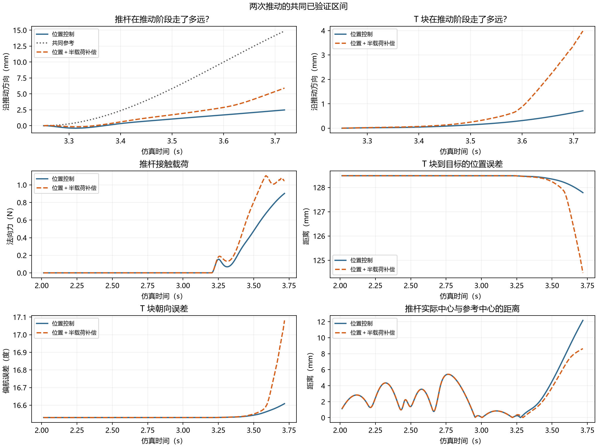

# RR Push-T：用上一帧的载荷补偿推动阻力

同一路线、同一入态的 CUDA 对照显示，推杆受到阻力时补偿一半载荷，能把更多参考运动传给 T 块。两路共同推动期间，T 块的沿向位移由 0.71 mm 增至 3.98 mm。收益伴随更高载荷和更大的偏航误差。补偿组在 3.719 s 入步被求解器拒绝，两组均未完成 Push-T 目标。本次保留原位置控制作为默认方案。



图上排从推动阶段起点重新计位移，灰虚线是两路共用的参考。下方四图显示完整的共同时间段。橙色推杆更接近参考，T 块也走得更远，朝向却进一步偏离目标。曲线在补偿组最后一个有效物理步处截断。

## 两条轨迹的共同区间

从 2.014 s 原检查点出发，A 使用纯位置控制，B 在同一控制上加入半载荷补偿。两个日志共同覆盖 1,705 个 1 ms 步，输入序号 2014–3718，末次已提交输出位于 3.719 s。A 此后的 481 步只属于基线。推动段单独对齐 3.251–3.718 s 的 468 个输入样本。[两路对照数据](../../artifacts/rr-load-feedback-20261121-01/ab.json)

| 同一时间、同一物理量 | A 位置控制 | B 位置控制＋半载荷补偿 |
| --- | ---: | ---: |
| 推动段参考推杆进给 | 14.863 mm | 14.863 mm |
| 推动段实际推杆进给 | 2.475 mm | 5.904 mm |
| 推动段 T 块实际进给 | 0.712 mm | 3.981 mm |
| 末态 T 块到目标的位置误差 | 127.781 mm | 124.451 mm |
| 末态绝对偏航误差 | 0.28988 rad | 0.29823 rad |
| 末态投影交并比 IoU | 0.000514 | 0.003068 |
| 全共同区间最大推杆位置跟踪误差 | 12.165 mm | 8.629 mm |
| 全共同区间峰值法向载荷 | 0.903 N | 1.104 N |
| 全共同区间法向冲量 | 0.21363 N·s | 0.31345 N·s |
| 推动段推杆作用于 T 块的沿向冲量 | +0.20989 N·s | +0.30942 N·s |
| 推动段桌面作用于 T 块的沿向冲量 | −0.20926 N·s | −0.30482 N·s |
| 全共同区间原生胶囊与盒子的最大重叠深度 | 1.989 mm | 2.357 mm |
| 电机达到限幅的步数 | 0 | 0 |

两路均在输入 3204 首次受载。此前连同输入 3204 共 1,191 步的入态及命令逐字节一致。输入 3205 首次产生非零补偿，也是两路第一次提交不同电机命令；到输入 3206，已提交的状态才首次出现差异。这个顺序验证了本次比较使用上一已提交步的力。B 末态的位置误差较 A 减少 3.330 mm，偏航误差增加 0.00835 rad。原任务最后一次评估在 3.718 s，B 的成功保持时间为零。[B 的独立逐步审计](../../artifacts/rr-load-feedback-20261121-01/audit.json) · [A 的原始逐步审计](../../artifacts/rr-active-route-20261121-01/comparison.json)

## 首个拒绝步及恢复

B 在原输入 3719 提交电机力矩 0.641515 和 0.301578 N·m，广义外力和物体外力均为零。物理步在候选发布前以状态 8 拒绝。原运行退出码为 1，已接受步数与已记录步数均为 1,705。事务恢复核查通过，随后在新 CUDA 场景恢复末次检查点，位置、速度、时钟和上一次发布记录匹配。该恢复检查没有额外推进物理时间。[失败命令与事务收据](../../artifacts/rr-load-feedback-20261121-01/half.json) · [末态恢复收据](../../artifacts/rr-load-feedback-20261121-01/terminal-readback.json)

在全新的 CUDA 场景中恢复同一个 B 末态，只提交原失败命令一次。得到了同一异常链，发布态逐项保持原入态。单次尝试前后的设备缓冲分别记录到 0 和 25 次内层求解。该次重放使用 54 个面积积分样本、4 个活动原生接触和 16 个原生约束行。25 次内层约束求解均报告收敛，外层在编号 2 起使用半步更新。最后一轮的归一化载荷变化为 7.408×10⁻⁷，满足 10⁻⁶ 门槛；归一化响应速度变化为 2.397×10⁻⁷，高于 10⁻⁷ 门槛。外层用完本步允许的 25 次评估，因而无法发布下一状态。原运行只保存了状态 8，这些中间量来自同入态、同命令的单步重放。[单步重放记录](../../artifacts/rr-load-feedback-20261121-01/single-step-diagnosis.json) · [对应的联合收敛条件](../../src/phymeo/backends/mujoco_tyx/_area_native_coupled_kernels.py)

## 工程决定与下一次验收

继续使用原位置控制作为默认，半载荷补偿保留为显式实验选项。已观察到的位移收益支持继续研究受载跟踪；规划器对实际运动仍较乐观，而本次直接阻断任务的是面积接触与桌面约束的联合速度收敛。此判断仅覆盖当前机器人、物体和路线。

下一批从 3.719 s 的固定入态、动作与材料开始，检验外层在接近收敛时如何选取更新步长。首先在同一迭代预算和原载荷、速度门槛下发布有效候选，再检验保持作用反作用、摩擦和原子发布的邻近受载步。单步和邻近步均通过后，从该状态续到 4.200 s，再比较位置、偏航及原任务成功条件。若单步仍失败，保留两种残差的逐次记录定位收敛瓶颈。

四个相关测试文件共 88 项通过。真实补偿运行及其首个拒绝步单独记录；完整共同区间的数据审计、检查点回读和绘图均已完成。[测试记录](../../artifacts/rr-load-feedback-20261121-01/09-four-files.stdout.log) · [控制实验退出码](../../artifacts/rr-load-feedback-20261121-01/11-half-cuda.RAW_EXIT.txt)

## 对照如何执行

A 使用上一批完整保存的位置控制轨迹。B 从同一个 2.014 s CUDA 场景检查点恢复，控制器与任务历史、已选路线、两个电机、材料、桌面、动作接口、物理步长和原成功阈值相同。实验在第一次读取 B 的结果前固定补偿系数为 0.5。[基线实验](rr-pusht-active-route-report-20261121.md) · [执行前固定的对照条件](../../artifacts/rr-load-feedback-20261121-01/protocol.md)

B 在进入接触和推动阶段，读取前一已提交步中各面积积分点作用于推杆的世界坐标力。将合力沿路线方向取反投影，取其正部作为阻力。用当前推杆几何中心的平移雅可比把一半阻力映射成关节力矩，加到原位置控制的未裁剪力矩上，再统一执行原 ±19.9 N·m 限幅和 CUDA 动作变换。接近阶段或没有抵抗载荷时补偿量为零。反馈有一物理步延迟。几何雅可比由 CPU 正向运动学求出，状态和接触力由原 CUDA 物理步发布。[反馈实现](../../experiments/area_pressure/pusht_load_compensation.py)

两路比较采用相同的时间和投影方向。推动段进给量取该阶段首末入态；目标位置和偏航误差取最终已提交输出。接触力取入步几何上的实际求解值。原生形状重叠指胶囊与 T 形盒子之间的最深采样重叠。成功仍由原任务逐步评价，要求位置、朝向、投影重合、速度与稳定支撑同时合格并保持 0.2 s。[原任务定义](../../src/phymeo/training/manipulation_tasks.py)

## 复现

在仓库根目录和原训练 CUDA 环境运行下列命令。基线摘要、已保存的路线、检查点及其元数据均需可读。为每次复现使用新的输出路径。绘图只读取已经生成的对照结果，可以在独立绘图环境执行。

```powershell
$prior = 'artifacts/rr-public-feedback-20261121-01/continuous-damped.json'
$release = 'artifacts/rr-loaded-withdrawal-20261121-01/release-b.json'
$base = 'artifacts/rr-active-route-20261121-01'
python -m experiments.area_pressure.pusht_active_route --summary $prior --release $release --checkpoint "$base/entry-a.metadata.json" --control-variant load-compensation-half --output half-new.json
python -m experiments.area_pressure.pusht_active_comparison --input half-new.json --output half-audit-new.json
python -m experiments.area_pressure.pusht_load_comparison --baseline "$base/active-b.json" --baseline-audit "$base/comparison.json" --candidate half-new.json --candidate-audit half-audit-new.json --output ab-new.json
python -m experiments.area_pressure.pusht_load_comparison --plot-only ab-new.json --plot ab-new.png
```
