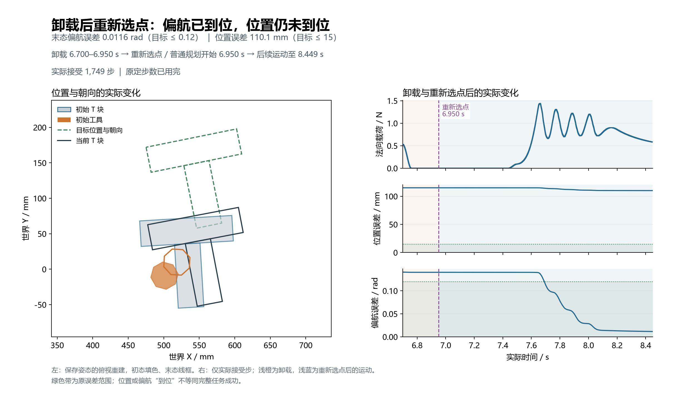

# RR PushT 从受载终点卸载、重新选点与推动

## 从同一物理状态接续

第 4 号路线在 6.700 s 结束。实验从它的公开场景检查点恢复两关节、自由物体、全速度、目标历史、累计规划开销和上一帧的接触收据。绝对步号为 6,700，本地回合步号为 2,250，两者相差 4,450。上一帧法向力 0.5292 N 属于 6.699 s 的输入接触面。新的目标观测继续使用本地回合时钟。公开 CUDA 场景推进设备状态，材料面重建与本实验的证据复核包含主机工作。[上一批终点](rr-pusht-local-publication-report-20261122.md)

撤离过程中，控制器读取当前状态，分别核对原生碰撞对和登记的面积材料面。用 CPU 正向运动学重建每一端时，裁剪顶点使用该端刚体自己的原点，速度雅可比使用世界坐标。已保存的面积力仍绑定到实际受力步的输入几何。监测逐步检查载荷、重叠、法向运动、新接触和原桌面支撑。[材料面观察](../../experiments/area_pressure/pusht_release_material.py) · [撤离判据](../../src/phymeo/control/manipulation_release_monitor.py)

## 卸载和选点

规划器沿已完成路线的反向生成 25 mm、250 ms 的撤离参考。推杆实际走完 250 个物理步。到 6.950 s，末步的卸载力和输出几何都通过分离检查，覆盖 30 个非支撑接触对。此处的分离是逐步采样验证。随后，普通规划器从同一个实际端点重新生成候选，并应用原有限材料面、逆运动学、路径及原位姿目标准入条件。[撤离参考](../../artifacts/rr-loaded-replan-20261122-01/live.release-route.json) · [新普通路线](../../artifacts/rr-loaded-replan-20261122-01/live.routes/route-02.json.gz)

入批前原实验已用 2,251 次物理尝试，其中有一次在 5.836 s 回滚。4,000 次总上限给本批留出 1,749 次。扣除撤离 250 次，5 号参考路线最多可运行 1,499 步；原节点从 6.950 s 延伸到 8.450 s，共 1,500 步，路线数据完整保留。


## 推杆实际做了什么

| 原目标误差 | 受载起点 6.700 s | 卸载终点 6.950 s | 5 号规划预测的终点 | 实际预算终点 8.449 s | 原门槛 |
| --- | ---: | ---: | ---: | ---: | ---: |
| 平面距离 | 115.084 mm | 115.090 mm | 112.921 mm | **110.100 mm** | 15 mm |
| 绝对偏航误差 | 0.140626 rad | 0.140139 rad | 0.113497 rad | **0.011592 rad** | 0.12 rad |

5 号路线的 1,499 个实测步包含接近 251 步、进入接触 300 步、推动 948 步。普通段第一次读到正法向力的输入时刻是 7.441 s。峰值 1.438 N，普通段法向冲量 0.7643 N·s。选中的材料面编号为 6，逐积分点读回的正载荷分布在 6、7 两面，与 4 号路线末次受载的两面相同。

从 6.950 s 起，物块向世界 X 正向移动 17.409 mm，向 Y 正向移动 3.942 mm。目标主要在 Y 方向，所以实际平面误差只改善 4.990 mm；规划预测改善 2.169 mm。偏航误差实际改善 0.128547 rad，预测改善 0.026642 rad。预测覆盖原完整参考，实测少最后 1 ms。末态中心为 (0.551808, 0.019915) m，目标中心为 (0.55, 0.13) m。



## 为什么机械臂没有从更合适的一侧推

在 6.950 s 的原候选队列里，普通规划器依次实际尝试 14、19、20，再选中 5。前三者推动方向在世界 XY 平面的单位向量约为 (−0.060, 0.998)，均在预接触逆运动学阶段被拒。两根连杆的长度各为 0.300 m，基座在 (−0.080, 0) m。即使忽略关节限位，预接触点到基座的平面距离减去两连杆长度之和，仍给出以下位置误差下界。原逆运动学容差为 0.5 mm。

| 候选 | 单靠臂长就无法消除的预接触位置误差 | 规划结果 |
| --- | ---: | --- |
| 14 | 34.856 mm | 预接触不可达 |
| 19 | 56.478 mm | 预接触不可达 |
| 20 | 68.216 mm | 预接触不可达 |
| 5 | 0 mm | 实际通过，主要沿世界 +X 推动 |

在与目标位移夹角小于 45° 的材料候选中，只有 15、16 的预接触位置通过上述半径必要条件。两者的单步力矩方向都被原偏航选择规则排除，所以没有进入逆运动学或真实执行。半径通过仍需验证姿态、关节限位、接近路径、真正受力和后继推的可达性。[原候选与臂长计算](../../artifacts/rr-loaded-replan-20261122-01/reach.json)

## 停止条件与下一次对照

本批 1,749 次物理尝试全部提交。合计 4,000 次尝试、3,999 个接受步。原任务的成功观察为假。独立读回核对了保存的状态、控制和积分点受力，并逐对重算卸载判据。入口另以保存的关节状态、独立多边形裁剪和完整点雅可比复核，材料接触区为 413.169 mm²，点法向速度范围为 +1.564 至 +1.685 mm/s。整段的连续碰撞仍超出这组离散记录能证明的范围。[入口几何参考](../../artifacts/rr-loaded-replan-20261122-01/entry-reference.json)

下一批从已绑定的 6.950 s 状态建立独立规划对照，先在原资产上比较单推与最多两推的可达候选。把预接触半径作为廉价必要条件，对 15、16 等候选实际做 IK 和路径验证；只有能提出第二次可达推动、且预计组合更接近原位置与偏航目标，才进入新的物理对照。6.950 s 留有逐步状态与控制记录，本批完整场景检查点保存在 6.700 s 和 8.449 s。静态筛选可直接读取 6.950 s 的关节状态；若两个策略进入动力学比较，须先从包含历史的同一场景状态分叉，并核对入步载荷与控制历史。两个策略使用相同预算、原碰撞判据和最终目标；后续对照另记。

本批最终五个相关测试文件共 93 项通过，覆盖完整路线恢复、累计预算、撤离几何、原撤离入口和回放证据篡改。九个涉及的 Python 文件通过 Ruff 与格式检查。物理运行完成后提取了公共撤离规划请求，单测分别覆盖保留候选诊断和原入口拒绝普通候选的行为。[最终回归](../../artifacts/rr-loaded-replan-20261122-01/21-integration-regression.stdout.log)

## 复现

在仓库根目录激活既有 CUDA 训练环境，使用新的输出目录，串行执行。第一份实测持续到普通路线结束、原总预算耗尽或实际拒绝，以最先出现者为准。第二条命令在物理进程结束后读回已保存的数据。

```powershell
$prior = 'artifacts/rr-local-publication-20261122-01'
$out = 'artifacts/rr-loaded-replan-reproduction'
New-Item -ItemType Directory -Path $out
python -m experiments.area_pressure.pusht_lateral_replan --source "$prior/suffix.json" --audit "$prior/suffix-audit.json" --checkpoint "$prior/suffix.final.scene.metadata.json" --output "$out/live.json"
python -m experiments.area_pressure.pusht_lateral_replan_audit --input "$out/live.json" --output "$out/live-audit.json"
```

[接续与普通规划入口](../../experiments/area_pressure/pusht_lateral_replan.py) · [独立读回](../../experiments/area_pressure/pusht_lateral_replan_audit.py) · [原始步进结果](../../artifacts/rr-loaded-replan-20261122-01/live.json) · [本批审计](../../artifacts/rr-loaded-replan-20261122-01/live-audit.json)
