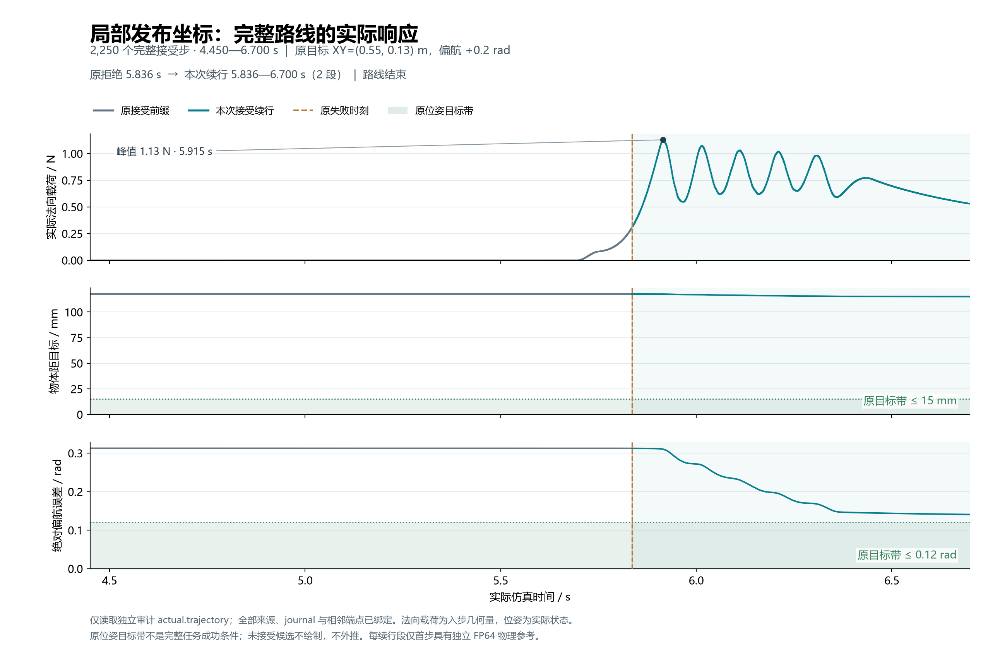

# RR PushT 的局部接触坐标和原路线续跑

4 号推动路线已走完。工具确实推动并转动了 T 块，末态仍在原任务目标外。此次修复让求解器能在世界坐标中正确使用很窄的面积接触片。

## 5.836 s 的同动作验证

工具推动 T 块时，接触面上出现了一个很窄的三角形。两个顶点在世界坐标里分别舍入，微小的边长误差经压力梯度放大，触发了原有的压力一致性检查。现在可以为每个面积接触物体对选择 `publication_frame="rigid-origin"`。裁剪得到精确交点后，先减去刚体在该入步的原点，再把局部坐标存成 FP64。面积、法向、压强差与积分在这组坐标中计算，世界轴方向保持一致。动力学收到的位置由局部积分点加上该原点得到，质心力矩仍用世界力臂计算。单世界、同构批次和异构场景都可以显式选择该方式。默认调用仍选择世界坐标。[接触三角形与积分](../../src/phymeo/geometry/area_pressure.py) · [场景接线](../../src/phymeo/backends/mujoco_area_pressure_scene.py)

从原 5.836 s 场景检查点恢复关节、自由体、速度、前一帧受力、控制器和目标历史。三路提交量（驱动、外加广义力、外加空间力）与存档失败动作的 FP32 字逐位相等。恢复首步成功发布于 5.837 s。独立参考使用原模型的双精度运动学和质量矩阵、自行实现的分数半空间裁剪和面积积分，再独立求解耦合速度。对照包含 24 个面积积分点和 32 条桌面原生约束行。[独立几何与动力学参考](../../experiments/area_pressure/pusht_lateral_resume_reference.py) · [首步原始证据](../../artifacts/rr-local-publication-20261122-01/first-audit-v2.json)

| 首个恢复步的读数 | 值 |
| --- | ---: |
| 接触面积 | 330.554 mm² |
| 面积法向力之和 | 0.310166 N |
| T 块所受世界力 (X, Y, Z) | (0.313444, 0.011615, −0.000264) N |
| 绕 T 块质心的 Z 力矩，发布 / 独立参考 | 0.008629866 / 0.008629135 N·m |
| 质心力矩最大分量差 | 7.31 × 10⁻⁷ N·m |
| 出步广义速度最大分量差 | 3.99 × 10⁻⁷（关节、平动、转动各按本身单位） |

公开世界顶点和积分点仍须有限、保有正面积和正确绕向。共同平移、原失败片、压力改坏 1 Pa、世界顶点或采样点塌缩均有对应测试。[几何对照](../../tests/test_area_pressure_local_origin.py)

## 原目标与完整路线

4 号接触路线从 4.450 s 连续到 6.700 s。归档前缀 1,386 步、首个恢复步和后续 863 步共 2,250 个完整接受步。物理尝试共 2,251 次，包含前一批在 5.836 s 回滚的那一次。续段沿用原动作路线、反馈、剩余预算和目标。第二段首步也通过独立参考。整条路线有 1,001 步法向力为正，峰值 1.1284 N 出现在 5.915 s，最后一个接受步的入步读数为 0.5292 N。[续段原始记录](../../artifacts/rr-local-publication-20261122-01/suffix.json) · [终点与逐步核验](../../artifacts/rr-local-publication-20261122-01/suffix-audit.json)

| 原任务指标 | 路线开始 | 路线结束 | 成功门槛 |
| --- | ---: | ---: | ---: |
| 平面位置误差 | 117.559 mm | 115.084 mm | ≤ 15 mm |
| 绝对偏航误差 | 0.312565 rad | 0.140626 rad | ≤ 0.12 rad |

目标为世界坐标 (0.550, 0.130) m、偏航 0.200 rad。最终物块位于 (0.534339, 0.015986) m，偏航 0.059374 rad。整段目标观察均未报告成功。下图的橙色线对应原失败时刻，灰色与蓝色合在一起是同一条路线。



## 推动段的动作与结果

用原关节模型的正向运动学从保存的关节位置分别恢复参考推杆和实际推杆。对 949 个推动步按同一组首末入态、同一规划方向 (0.994, −0.112, 0) 比较，参考推杆前进 **19.51 mm**，实际推杆前进 **19.81 mm**，T 块前进 **13.75 mm**。这段执行器饱和步数为零，推杆相对参考轨迹的最大空间距离为 2.48 mm。物块侧沿推动方向的面积接触冲量为 +0.6365 N·s，工具侧为 −0.6365 N·s。面积接触绕物块质心的 Z 角冲量为 +0.01862 N·m·s，桌面另有原生约束响应。[跟踪与冲量的逐阶段核对](../../artifacts/rr-local-publication-20261122-01/tracking-readout.json)

这次推动使偏航误差减少 0.17194 rad，位置误差只减少 2.475 mm。终点还需沿世界 +Y 移动约 114.0 mm，原推动方向主要沿 +X。下一项从 6.700 s 的真实位姿、速度、载荷和控制历史重新规划，记录候选预计的 XY、偏航改善与下一推实测值。推杆仍有载荷，需要检查原控制器能否有控制地卸载并换面；保留各候选拒绝原因。继续使用原位置、偏航和任务成功条件。

## 验证范围

局部坐标与场景协议组 35 项、几何回归组 72 项、真实场景回归组 14 项、续跑入口组 21 项、最终独立审计测试组 28 项通过。13 个本批 Python 文件通过 Ruff 和格式检查。首次独立读回发现 journal 比首步证据包多一个派生控制哈希，审计器现对提交数组、FP32 字与哈希分别核对。另用回归区分首个候选前失败，与候选已核验、反馈尚未记完这两种情况。首种情况下报告不授予首步物理验证。以上读回修正都只用保存的数据或合成测试。[最终独立审计回归](../../artifacts/rr-local-publication-20261122-01/19-final-oracle-tests.stdout.log)

## 本地复现

下面从原归档检查点开始，输出写到新目录。第一次只提交已保存的失败动作。独立读回通过后，第二次调用自动采用原路线剩余步数。使用本项目的 CUDA 训练环境，在仓库根目录串行执行。

```powershell
$oldRun = 'artifacts/rr-lateral-push-20261122-01'
$newRun = 'artifacts/rr-local-publication-reproduction'
New-Item -ItemType Directory -Path $newRun
python -m experiments.area_pressure.pusht_lateral_resume --source "$oldRun/live.json" --audit "$oldRun/route-audit.json" --checkpoint "$oldRun/live.final.scene.metadata.json" --steps 1 --output "$newRun/first.json"
python -m experiments.area_pressure.pusht_lateral_resume_audit --input "$newRun/first.json" --output "$newRun/first-audit.json"
python -m experiments.area_pressure.pusht_lateral_resume --source "$newRun/first.json" --audit "$newRun/first-audit.json" --checkpoint "$newRun/first.final.scene.metadata.json" --output "$newRun/suffix.json"
python -m experiments.area_pressure.pusht_lateral_resume_audit --input "$newRun/suffix.json" --output "$newRun/suffix-audit.json"
```

每段首步另外验证独立的几何与耦合速度解。长轨迹逐帧核对状态、积分、受力收据、控制器所用的上一帧载荷、目标观测和检查点。面积装配仍在主机上进行，联合动力学使用 TYX CUDA。[续跑入口](../../experiments/area_pressure/pusht_lateral_resume.py) · [逐帧核验入口](../../experiments/area_pressure/pusht_lateral_resume_audit.py)
