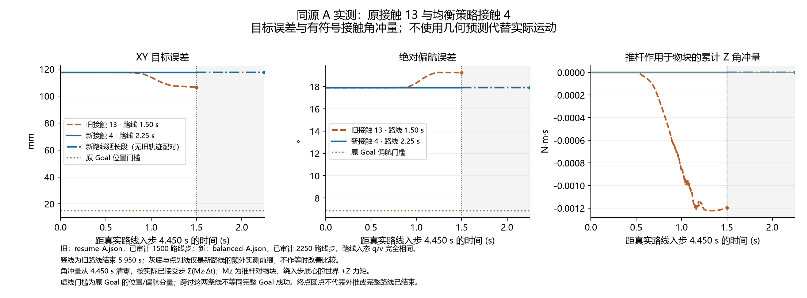

# PushT 的受力面选择与约束发布

本批在同一个 T 块推动案例中回答两个独立问题。A 用相同的物体和机械臂位姿检验规划预测能否转成实际角冲量。B 保留原来的路线，检验同一步中面积接触载荷与原生约束能否共同发布。任务目标仍为 (0.55, 0.13) m、+0.20 rad，位置门槛 15 mm、偏航门槛 0.12 rad，同时保留原速度、倾斜、轮廓和停留要求。[原始实验条件](../../artifacts/rr-pose-followthrough-20261121-01/protocol.md)

## A 的两次实跑

两次都从 4.200 s 检查点撤离 250 步。4.450 s 规划时，逐项核实两次机械臂和物体的位置、速度完全相同，逆运动学和路径检查预算也相同。实跑使用同一版本的动力学。原策略优先看位姿总代价，新策略优先改善两个超差分量中改善比例更小的一项。换排序后，4 号点预测可让物体转动 +0.0822 rad。下表只比较普通路线，不计撤离时已经存在的载荷。[保存态的候选与路线](../../artifacts/rr-pose-followthrough-20261121-01/saved-state-plan.json) · [实测逐步读回](../../artifacts/rr-pose-followthrough-20261121-01/balanced-audit.json)

| 自 4.450 s 开始的普通路线 | 实际步数 | 推杆有法向力的步数 | 峰值推力 | 到目标的距离 | 绝对偏航误差 | 推杆绕物块质心的 Z 向角冲量 |
| --- | ---: | ---: | ---: | --- | --- | ---: |
| 原策略，13 号点 | 1,500 | 993 | 1.095 N | 117.56 → 106.64 mm | 0.31256 → 0.33623 rad | −0.001195 N·m·s |
| 均衡排序，4 号点 | 2,250 | 0 | 0 N | 117.56 → 117.56 mm | 0.31256 → 0.31256 rad | 0 N·m·s |



4 号候选位于原始几何外壳的另一侧，距最近的已声明受力三角面 45.00 mm，两个法向近乎垂直。推杆中心一度距计划接触中心仅 0.34 mm，推动段实际向前走了 19.76 mm。所有已接受步中，胶囊到已声明有限面的最小间隙仍为 +24.29 mm。对原始碰撞盒做独立距离查询，最小值则是 −19.49 mm。这两个距离使用不同的几何对象。当前推杆和物块只在登记面上施加面积接触力。13 号点到登记面的距离为零，法向相合，在相同的测量流程中确实传出了力。[4 号诊断](../../artifacts/rr-pose-followthrough-20261121-01/face4.json) · [13 号对照](../../artifacts/rr-pose-followthrough-20261121-01/face13.json)

## 从实际材料面约束规划

新的可选参数 `--require-declared-material` 供 A 组普通规划使用。通用规划器可接收任意一组有向的有限三角面。实验从场景本次登记的面积接触资产按当前关节位姿变换这些面。候选必须同时满足距平面、三角形内部和外法向一致三项检查，才会进入逆运动学。共享边界上的所有同向匹配面均记录。面集合绑定当前状态字节与资产散列，写出的路线由读取器从原模型重建并核对。[通用有限面检查](../../src/phymeo/control/manipulation_push_material.py) · [场景接入](../../experiments/area_pressure/pusht_pose_replan.py)

在同一个 4.450 s 状态的 72 个“点位与推距”组合中，27 个匹配已声明材料面，分别来自 9 个点位。4 号点在调用逆运动学前被排除。19、20、14 号的预接触姿态未通过本次逆运动学，13 号命中 `T-exterior-3`。最终 20 mm 路线的全部采样节点逐项等于原 13 号已走过的路线。该结果来自保存态规划、真实逆运动学及路线文件写出和读回。本批没有为相同节点再运行一条动力学轨迹。[规划对照](../../artifacts/rr-pose-followthrough-20261121-01/saved-state-material-plan.json) · [正常读写入口核验](../../artifacts/rr-pose-followthrough-20261121-01/material-route-binding.json)

下一批先扩大可真实承载的外侧面。由同一份有限外壳生成材料面和规划候选，核对 T 形凹角及拼接位置的内表面剔除和重复面积。用旧 13 号验证已承载侧，用 4 号验证新侧，再从真实状态运行选出的路线。能否改善朝向以物块收到的有符号角冲量和实际偏航误差判断。

## B 的真实失败与恢复

在原 1.584 s 状态用原命令重放。第 8 次原生求解结束时，行方程最大残差为 1.46051×10⁻⁵。把最终面积载荷代入物理质量矩阵并重算加速度后，残差变为 2.07064×10⁻⁵，超过原 2×10⁻⁵ 发布门。改动在载荷、速度两项都收敛时，用准备发布的载荷和原生行力再检查一次行方程。未通过就继续现有迭代，共用原 25 次预算，再由最终发布路径独立复核。原命令在第 9 次评估后通过，发布残差 1.11074×10⁻⁵。[修复前的同一毫秒](../../artifacts/rr-pose-followthrough-20261121-01/trial-tail-before.json) · [修复后的同一毫秒](../../artifacts/rr-pose-followthrough-20261121-01/trial-tail-after.json)

B 从原来的物理检查点续跑 616 步，到 2.200 s 走完原路线。首条控制的 FP32 字、双方外力输入、状态和控制历史已经对齐。原有 1,584 步复用已保存记录。检查点保存时日志有 3,170 条，随后归档又追加失败和终止两条事件，恢复入口分别验证前缀和完整文件。全程 2,200 步中，位置误差由 117.64 mm 降至 113.90 mm，偏航误差由 0.30000 rad 降至 0.13382 rad。新增的 616 步贡献了 2.65 mm 的距离改善和 0.11291 rad 的偏航改善，峰值推力 0.871 N。原任务仍未达标。[逐步续跑审计](../../artifacts/rr-pose-followthrough-20261121-01/resume-B-audit.json) · [两组结果](../../artifacts/rr-pose-followthrough-20261121-01/outcomes.json)

一个独立的 CUDA 两行反例仍待处理。在原生行实验入口，一条尺度很大的非活跃行可使整组缩放指标通过，即使另一条行在可表示的 FP32 力值上达不到逐行门槛。B 的同一毫秒已经区分出最后换载荷的原因。本批改动覆盖共同发布路径，独立行实验入口仍有这个已复现问题。[反例与原始输出](../../artifacts/rr-pose-followthrough-20261121-01/01-row-red.stdout.log)

## 回归与复现

规划、目标和旧归档组合回归通过 176 项。检查点恢复与轨迹审计通过 63 项。新材料面及其规划入口、读取器的组合回归通过 85 项。原生约束、面积摩擦、收据篡改与真实失败步的 CUDA 配置组合通过 64 项。不同测试组有重叠。这些验证覆盖当前 RR 机器人场景和相应受支持的求解路径。[规划回归](../../artifacts/rr-pose-followthrough-20261121-01/22-controller-regression.stdout.log) · [恢复回归](../../artifacts/rr-pose-followthrough-20261121-01/27-resume-regression.stdout.log) · [有限面回归](../../artifacts/rr-pose-followthrough-20261121-01/39-face-entry-reader.stdout.log) · [共同求解回归](../../artifacts/rr-pose-followthrough-20261121-01/34-native-final.stdout.log)

在仓库根目录使用已有训练环境。B 的恢复和审计命令如下，新输出路径需要尚未使用。

```powershell
python -m experiments.area_pressure.pusht_pose_resume --summary artifacts/rr-public-feedback-20261121-01/continuous-damped.json --source artifacts/rr-pose-replan-20261121-01/run-B.json --audit artifacts/rr-pose-replan-20261121-01/comparison.json --checkpoint artifacts/rr-pose-replan-20261121-01/run-B.final.scene.metadata.json --output new-B.json
python -m experiments.area_pressure.pusht_resume_audit --input new-B.json --output new-B-audit.json
```

A 使用上批的相同运行入口和输入文件，将选项设为 `--case A --selection-policy joint-pose-balanced` 即可复现 4 号路线。再指定 `--require-declared-material` 可启用同一场景的材料面筛选。[上批完整输入命令](rr-pusht-pose-replan-report-20261121.md)
