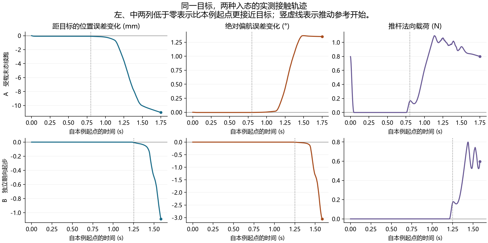

# PushT 两种入态下的位置与偏航重规划

固定同一个目标，实测 T 块在新接触点推动后能否同时缩短位置和朝向误差。受载续跑完成了整条新路线，位置改善 11.00 mm，偏航误差增大 0.02360 rad。独立起步的有效轨迹内两项都改善，随后一次原生接触行检查阻止了下一步发布。两组均未达到原任务。每项误差根据每组首末已发布位姿独立重算。[固定实验条件](../../artifacts/rr-pose-replan-20261121-01/protocol.md) · [逐步审计与力矩](../../artifacts/rr-pose-replan-20261121-01/comparison.json)

| 实际 TYX CUDA 轨迹 | 已发布步 | 到目标的距离 | 绝对偏航误差 | 峰值法向载荷 | 终点 |
| --- | ---: | --- | --- | ---: | --- |
| A，继承 4.200 s 的受载状态 | 1,750 | 117.64 → 106.64 mm | 0.31263 → 0.33623 rad | 1.095 N | 5.950 s，走完整条路线 |
| B，独立 +0.50 rad 起步 | 1,584 | 117.64 → 116.55 mm | 0.30000 → 0.24673 rad | 0.799 N | 1.584 s，下一步拒绝并回滚 |

两组目标均为 (0.55, 0.13) m、+0.20 rad。原场景的位置及偏航门槛分别是 15 mm 和 0.12 rad，速度、倾斜、轮廓、停留等检查继续由原 Goal 评估。B 使用 A 起点的物体 XY、原模型重置高度、机器人初始关节位置和零速度，经 200 步真实稳定后开始规划。A 继承速度、接触和控制历史。两组分别回答各自入态能否改善位姿，不能据此估算初始朝向的独立影响。



## 接触点怎样影响实际运动

新增可选的 `joint-pose-descent` 策略。每条候选推动都预估平移和绕质心的转动。对超出目标容差的分量，逐项要求预测改善。已经进入容差的分量需要留在容差内。要纠正偏航时，还需法向推力具有正确的力矩符号。保留各候选及拒因，沿用原逆运动学、采样路径检查和动作限制。各组各调用一次普通规划器。[候选准入](../../src/phymeo/control/manipulation_push_objective.py) · [路径选择](../../src/phymeo/control/manipulation_push_planner.py)

A 先通过原撤离流程走了 250 步。4.450 s 普通规划开始时，已核实非桌面接触零载且严格分离。72 个候选中有 21 个通过位姿筛选。排序在前的 14、19 号接触点未通过预接触位置的逆运动学，随后选中 13 号。该候选预测转角仅 +2.19 × 10⁻¹⁰ rad，因此严格正号也可以让几乎没有转动能力的推法入选。后续 1,500 步普通路线中，位置误差减小 10.92 mm，偏航误差增加 0.02366 rad，推杆对 T 块绕质心的实测 Z 向角冲量为 −0.001195 N·m·s。其它候选的预测收益仍须经机械臂可达性和真实接触检验。[候选与逆运动学结果](../../artifacts/rr-pose-replan-20261121-01/proposal-pools.json) · [A 原始运行与检查点索引](../../artifacts/rr-pose-replan-20261121-01/resume-A.json)

B 的 72 个候选中同样有 21 个通过筛选。选中的 16 号候选预测转角为 −0.09884 rad。200 步稳定阶段的水平位置和偏航误差均无变化。随后 1,384 个已发布步中，位置误差减小 1.088 mm，T 块实际转动 −0.05327 rad，Z 向角冲量为 −0.006443 N·m·s。本批只验证到已发布终点，未验证原定 2.200 s 路线最终效果。[B 原始运行与检查点索引](../../artifacts/rr-pose-replan-20261121-01/run-B.json)

## B 在哪一步停止

从 B 的 1.584 s 完整检查点，以同一控制量在新 CUDA 场景只重放了被拒绝的一步，复现同一错误并核实发布态仍在原输入。失败的是原生接触类型 6 的第 27 行（零起始编号），行力约 0.03239 N。用雅可比、实际加速度和正则项重算的活跃行方程残差为 2.070636 × 10⁻⁵，原门槛为 2.000000 × 10⁻⁵。设备保存的梯度与重建值仅差 8.65 × 10⁻⁹，通过了另一项一致性检查。下一批可以直接用该行区分迭代停止时残差偏大与最后重新计算加速度的影响。[失败步字段与两项检查](../../artifacts/rr-pose-replan-20261121-01/failed-row.json) · [发布条件](../../src/phymeo/backends/mujoco_tyx/_constraint_publication.py)

## 恢复和复现

普通路线和旧归档仍使用 `pose-cost` 默认语义。旧记录补齐新策略的默认字段后仍逐项核对，原始文件按原 SHA 绑定。A 首次恢复后，撤离读取器在提交物理步前遇到活动路线日志的测量字段位置差异。修复后直接使用原回调保存的双侧力、质心力矩及时相，从相同检查点只重试 A。B 的有效步和失败记录均复用首次运行。逐步核查区分已发布端点、被撤销候选、规划预测和原 Goal。共同求解采用现有的混合主机/设备路径。[A 首次停止记录](../../artifacts/rr-pose-replan-20261121-01/run-A.json) · [运行入口](../../experiments/area_pressure/pusht_pose_replan.py) · [独立读回](../../experiments/area_pressure/pusht_pose_replan_comparison.py)

历史兼容修正后的组合回归通过 133 项，末版实验入口、审计器及撤离材料回归通过 51 项，两组存在重叠。经独立读回确认的有效物理步共 3,334 步。13 个涉及的 Python 文件通过 Ruff 检查与格式检查。[组合回归](../../artifacts/rr-pose-replan-20261121-01/16-final-host.stdout.log) · [末版回归](../../artifacts/rr-pose-replan-20261121-01/34-final-source-regression.stdout.log)

在仓库根目录及训练 CUDA 环境中，使用新的输出文件名：

```powershell
python -m experiments.area_pressure.pusht_pose_replan --summary artifacts/rr-public-feedback-20261121-01/continuous-damped.json --release artifacts/rr-loaded-withdrawal-20261121-01/release-b.json --source artifacts/rr-coupled-step-20261121-01/resumed.json --audit artifacts/rr-coupled-step-20261121-01/resumed-audit.json --checkpoint artifacts/rr-coupled-step-20261121-01/resumed.final.scene.metadata.json --case both --steps 4000 --output new-run.json
python -m experiments.area_pressure.pusht_pose_replan_comparison --input new-run.json --output new-audit.json
```

接下来的两个验收点都有现成输入。规划上，在 4.450 s 的已保存位姿同时考虑可达性与两项预测改善幅度，避免把近零转角当作足够的偏航控制能力，再核实实际角冲量与误差。动力学上，从 B 的失败单步检查收敛判据和最终加速度，再决定如何续跑原路线。两者保留现有物理和任务门槛。
