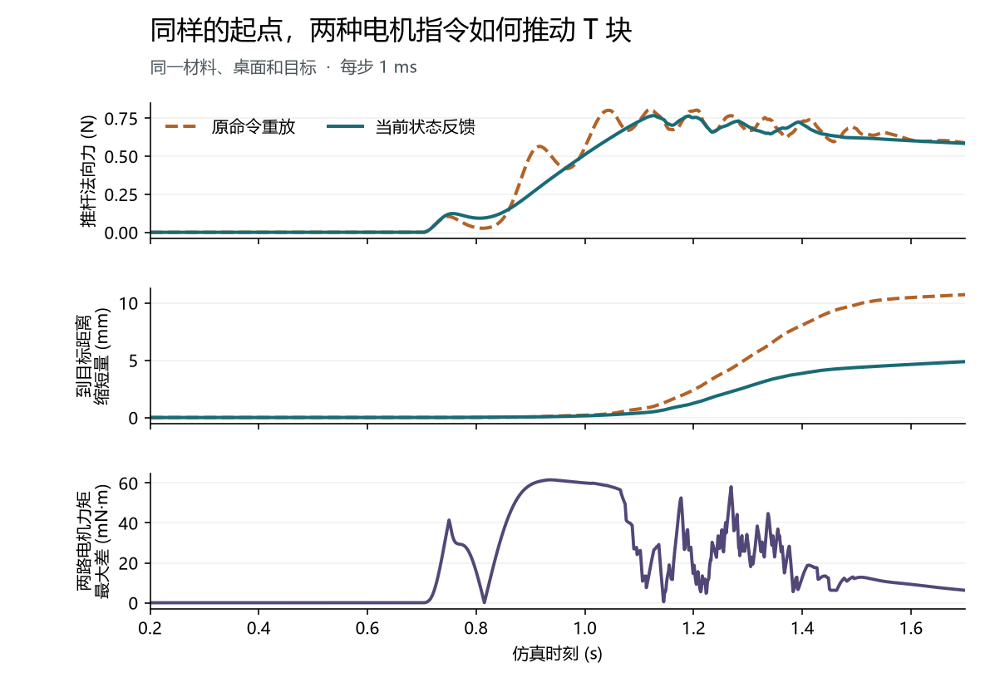

# RR Push‑T 的公开闭环步进与原命令对照

## 同一轨迹的最终结果

从 0.200 s 的同一状态重新开始，重放组和反馈组均连续接受 **1,500 步**，首次受载均在 0.703 s，并持续推动到 1.700 s。此时原控制器请求第二条路线，撤离路径检查拒绝了候选。原定到 1.768 s 的最后 68 步没有发出电机指令。两组均未达到原 Push‑T 目标。[逐帧连续性与目标](../../artifacts/rr-public-feedback-20261121-01/continuous-damped-comparison.json) · [运动与支撑汇总](../../artifacts/rr-public-feedback-20261121-01/final-motion.json)

| 同初态对照指标 | 原命令重放 | 当前状态反馈 |
|---|---:|---:|
| 首次受载 | 0.703 s | 0.703 s |
| 推杆峰值法向力 | 0.8073 N | 0.7668 N |
| 推杆累计法向冲量 | 0.5493 N·s | 0.5216 N·s |
| T 块到目标的平面距离缩短量 | 10.72 mm | 4.88 mm |
| 末出态距目标（1.700 s） | 122.70 mm | 128.54 mm |
| 末次目标评估的朝向误差（1.699 s 入态） | 0.4266 rad | 0.2878 rad |
| 有载荷半步更新的物理步数 | 41 | 7 |
| 单步最多原生求解调用数 | 19 | 19 |

两组起始距离均为 133.42 mm。这次重放组向目标移动更多，反馈组末次朝向误差更小。两组轨迹中最大的平面位置差为 7.12 mm。推杆受载期间，桌面法向支撑各有一个 1 ms 帧为零（重放组 1.403 s，反馈组 1.147 s）。图中第一行显示推杆对物体的法向力，第二行显示到目标的距离缩短了多少，第三行显示同一时刻两组电机力矩相差多少。力取该步实际接触，位置取已提交出态。



**撤离卡在什么地方？** 规划器确实读到了反馈组 1.700 s 已提交的完整位姿和速度，撤离逆运动学收敛到 1.84 µm 位置误差。但推杆与 T 块的原生碰撞几何此时已有 1.44825 mm 重叠，而原撤离路径最多允许 1.000 mm。在冻结物体位姿的 251 个路线采样中，只有这一个几何对越限，最初 20 个采样均被拒。采样重叠深度一路没有增加，候选相对时间 20 ms 后首次回到阈内。这个结果描述未执行的候选轨迹；长窗口没有产生对应的撤离状态或载荷。独立撤离短窗来自另一入态，其实测结果见下节。[撤离路线与真实端点绑定](../../artifacts/rr-public-feedback-20261121-01/withdraw-rejection.json)

下一项是给已经受载的接触增加专用卸载阶段。只允许已有接触在经验证的方向上减轻，逐步验证物体运动、深度和法向载荷；新接触、加深或转向其他表面应能拒绝。退出旧接触后，重新接回原路径检查与规划器。正控用这次保留的 1.700 s 真实入态，反控应覆盖向内推动与新几何对。普通接近、绕行和新接触仍使用已有路径界限。

本次最后的串行回归覆盖真实振荡入步、载荷历史篡改、原生与面积共同步进、控制回调、正常终止与失败前缀，共 68 项通过。另以缩短的控制器步数预算实测原终止语义，请求两步时仅提交一对步，并正确报告预算终止。原任务的长窗使用原预算。[68 项测试记录](../../artifacts/rr-public-feedback-20261121-01/final-focused.xml) · [有界终止记录](../../artifacts/rr-public-feedback-20261121-01/one-step-budget-stop.json)

## 两个世界怎样比较

两个世界使用同一份八自由度 MJCF、同一有限侧面压力材料和 1 ms 步长。每个窗口开始时，两者的关节和 T 块的位置、速度与时钟相同。开放组重放原始电机指令。反馈组根据自己刚接受的状态生成电机指令。两组使用相同的原始外力和外部力矩，都由公开 CUDA `Scene.step` 推进。上批已有的几何覆盖范围和支撑力验证见[公开步进报告](rr-pusht-public-mixed-scene-report-20261121.md)。

RR 有两级控制。每毫秒，关节控制器将本世界的关节位置、速度与当前路线的参考值比较，并计算两个电机的力矩。到路线边界时，规划器才根据 T 块的当前位姿、目标位姿和上段推动方向选择新路线。侧面接触力还用于累计本段接触冲量，供进度判断使用。原目标保留位置、朝向、轮廓重合、速度、支撑与持续时间要求。[原控制器](../../scripts/run_manipulation_push_feedback.py) · [原任务目标](../../src/phymeo/training/manipulation_tasks.py)

预先选定的短窗口分别是原记录 0.740–0.765 s 的触物附近区间和 1.699–1.768 s 的路线切换与撤离区间。首个短窗口刚起步时，两组在本批声明的材料上都已承受 0.11610 N 推力，无法据此定位首次触物。因此在长窗口执行前，将原计划的起点从 0.740 s 向前延到首次规划的 0.200 s，终点仍为 1.768 s。每个窗口各自比较同初态的两个世界。短窗口的末状态不拼接到另一段。

## 短窗口结果

| 指标 | 原命令重放 | 当前状态反馈 |
|---|---:|---:|
| 0.740 s 首步推力 | 0.11610 N | 0.11610 N |
| 随后 25 ms 内的峰值推力 | 0.14188 N | 0.14703 N |
| 1.699 s 首步推力 | 0.15454 N | 0.15454 N |
| 撤离时推力首次归零 | 1.743 s | 1.747 s |
| 正面积交区首次消失 | 1.744 s | 1.748 s |
| 撤离窗口末端仍为零载的步数 | 25 | 21 |

0.740 s 首命令和两个世界的初态均逐字节一致。随后 24 条电机指令有差异，单关节最大力矩差为 0.02808 N·m。1.699 s 起步的两个世界都连续推进 69 步；反馈组在 1.700 s 根据自己的出步状态规划撤离。两组在该窗口的单关节最大力矩差为 0.04402 N·m，桌面法向支撑均始终高于 1.55 N。反馈组晚 4 ms 卸载，可由逐帧载荷直接看到。T 块中心在此短窗的两轨迹最大坐标分量差低于 1 µm，并未验证操作效果优于原指令。[短窗受载对照](../../artifacts/rr-public-feedback-20261121-01/first-contact-comparison.json) · [短窗撤离对照](../../artifacts/rr-public-feedback-20261121-01/route-transition-comparison.json)

## 控制信号如何与物理帧对齐

热启动只恢复窗口开始以前的控制历史、已生成路线和进度状态。窗口内的新路线在反馈世界提交当前位姿后生成；对照程序核查新路线的输入 q/v 与对应世界这一帧相同。原始关节 PD 输出经过与原环境相同的 FP32 动作编码和 CUDA 解码，随后逐步核对实际发送的电机指令。[配对运行器](../../experiments/area_pressure/pusht_public_feedback.py) · [存档对照程序](../../experiments/area_pressure/pusht_feedback_comparison.py)

每步的目标判定使用该步入态与接触载荷。作用在 T 块上的推杆合力从压力积分点直接求和，送回原控制器累计冲量；桌面只计入支撑。两个控制器测试分别固定路线改变关节状态，以及在重规划处沿物体局部 Y 轴扰动 ±1 mm。前者验证当步 PD 响应，后者核对接触提案随物体位移、目标代价变化以及由新路线得到的电机指令。[可移植的因果与双世界测试](../../tests/test_pusht_public_feedback.py)

## 复现同一对照

在含 TYX CUDA 和兼容 PyTorch 的环境中，从仓库根目录运行。两条命令的输出文件都须为新路径。第一条会在摘要旁保存逐步的双世界记录和反馈路线，第二条只读取这些记录。

```powershell
python -m experiments.area_pressure.pusht_public_feedback --trajectory artifacts/mujoco-tyx-push-feedback-20261115-01/world5 --source artifacts/mujoco-tyx-grasp-wrench-20261114-01/push-original-qualification.json --start 200 --steps 1568 --output paired-new.json
python -m experiments.area_pressure.pusht_feedback_comparison --input paired-new.json --output paired-new-comparison.json
```

从 0.740 s 起运行 25 步可独立查看已经受载后的首次命令分歧。从 1.699 s 起运行 69 步可独立查看两组从相同撤离前状态出发的差异。改变 `--start` 与 `--steps` 时，也须换用新的输出文件名。

## 首次连续运行实际停在哪里

两组都在 0.703 s 首次产生推杆法向力。连续接受 947 对步后，1.147 s 的入步被拒，状态保留在 1.147 s。已核前缀中，两组的峰值分别是 0.8073 N 和 0.7668 N，443 条电机命令开始分歧；末次已核入步的目标距离误差为 132.12 mm 与 132.75 mm。此时两组仍在推动。上面的独立撤离短窗从各自相同的原记录状态起步，无法补充这次拒绝之后的运动。[初次长窗逐步核对](../../artifacts/rr-public-feedback-20261121-01/continuous-comparison.json) · [初次长窗曲线](../../artifacts/rr-public-feedback-20261121-01/first-attempt-prefix.png)

在保留最后已提交 FP32 位姿、速度与标量时钟的独立设备实例中，先逐位复现 1.146 s 已发出的反馈电机指令，再用同一路线重建 1.147 s 的指令。双世界再次同时拒绝。分别运行时重放组通过，反馈组用尽 24 次载荷更新；最后一轮缩放载荷差为 0.004369，缩放速度差为 0.001601，高于原门限 0.000001、0.0000001。候选载荷主要分量在根的两侧交替，误差减小得太慢。独立实例恢复的是已知物理输入，原运行的完整历史检查点和时钟双字没有归档。[逐组复现与设备迭代记录](../../artifacts/rr-public-feedback-20261121-01/same-entry-full/report.json)

修正保留原接触律、材料、1 ms 步长、24 次更新上限和两道收敛门。从第三次求值起，如果本轮绝对值最大的载荷修正分量与上一轮反向，而且整体缩放载荷差至少为上一轮的一半，本次求解之后的试载改用半步。所有收敛判断仍使用完整缺陷。回放核对每一步使用的模式及载荷历史，篡改半步标记会被拒绝。用同一份 1.147 s 输入再验，双世界用了 13 次原生求解（包含初始求值）并一起提交。该瞬间开环组有 24 条桌面原生行，反馈组没有桌面接触行，两组推杆侧面都在施力。可移植回归还从合法的公开初态比较了两个独立 FP64 参考解及动量收支。[修正后同入步](../../artifacts/rr-public-feedback-20261121-01/same-entry-damped/report.json) · [可移植回归](../../tests/test_pusht_coupled_oscillatory_entry.py) · [设备载荷更新](../../src/phymeo/backends/mujoco_tyx/_area_native_coupled_kernels.py)

短窗撤离后另用 CPU 正向运动学重建两组实际提交的位姿。沿推杆四面体与 T 块有限侧面构成的 168 对几何逐对求保守分离轴。从 1.744 s 和 1.748 s 起直至 1.768 s，分别有 25 和 21 个连续采样状态严格分离，末状态的保守间隙分别超过 2.230 mm 和 1.595 mm。该检查只覆盖声明的材料面和这些离散状态。[撤离短窗几何复核](../../artifacts/rr-public-feedback-20261121-01/route-transition-separation.json)
