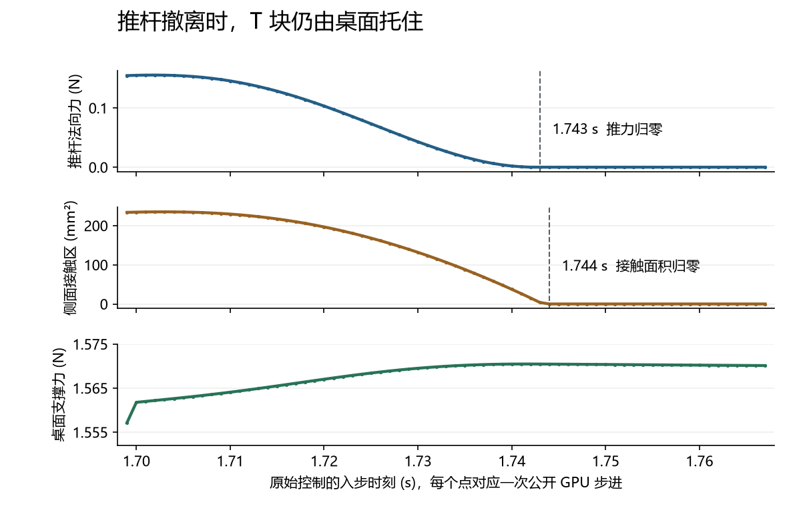

# 八自由度 RR Push‑T 公开步进

2026-11-21，`codex/exp`。五个世界分别从原始 RR Push‑T 的初态、首次受载、原记录峰值、推动末段和撤离状态起步。调用 `MuJoCoTyxHeterogeneousAreaPressureScene.step` 后，同一帧可读取自由 T 块和两个电机关节的新状态，以及推杆分布接触力、桌面支撑、双方力矩与设备观察。五个世界均从自身的出步状态继续积分了第二步。初始化时，仅将存档中受浮点舍入影响的自由根四元数归一化，最大分量调整为 6.55 × 10⁻⁸ 以内。从首步检查点恢复并重演第二步，物理状态、力和设备观察逐值一致。

## 这一次桌面和推杆各承担了多少力

| 原记录时刻（s） | 面积点 | 原生行 | 推杆法向力（N） | 桌面支撑（N） |
|---:|---:|---:|---:|---:|
| 0.000 | 0 | 0 | 0 | 0 |
| 0.750 | 24 | 32 | 0.151260 | 1.569595 |
| 1.255 | 24 | 32 | 0.165221 | 1.550503 |
| 1.699 | 24 | 28 | 0.154537 | 1.557152 |
| 1.767 | 0 | 32 | 0 | 1.570125 |

表中为每个入步推进 1 ms 的结果。1.255 s 来自原始任务峰值处的姿态，此步推杆切向合力为 0.004884 N。对两个连续步的十个世界状态，实际速度相对同材料双精度对照的最大分量差为 3.00 × 10⁻⁸，匹配原生行的最大力差为 7.33 × 10⁻⁷ N，两关节总接触力矩的最大分量差为 2.34 × 10⁻⁸ N·m。自由关节四元数的最大分量差为 6.00 × 10⁻⁸。对照使用独立 CPU MuJoCo 入步动力学、逐点雅可比和双精度联立解。每个入步还检查了面积积分点与原四面体压力场、刚性面的对应关系。[逐世界数据](../../artifacts/rr-public-native-20261121-01/five-public-steps-final.json) · [公开接口测试与独立对照](../../tests/test_pusht_public_mixed_area.py)

## 同一条轨迹上的卸载与撤离

从原记录 1.699 s 的状态初始化一次，连续调用公开步进 69 次，直到 1.768 s。每步重放原电机和外载命令，以实际接受的位姿、速度重新构造接触面。以下时间都是入步时刻。载荷采用该入步几何和当步求得的速度。窗口内 T 块获得的桌面法向支撑在 1.55715–1.57047 N 之间，每步实际调用 1–4 次原生求解。



| 入步时刻（s） | 接触区（mm²） | 推杆法向力（N） | T 块桌面支撑（N） |
|---:|---:|---:|---:|
| 1.699 | 233.758 | 0.154537 | 1.557152 |
| 1.742 | 15.299 | 0.0000381 | 1.570463 |
| 1.743 | 3.861 | 0 | 1.570453 |
| 1.744 | 0 | 0 | 1.570441 |
| 1.767 | 0 | 0 | 1.570108 |

撤离期间首次出现零法向力的帧仍有 8 个裁剪三角形。下一帧正面积交区消失，并持续到窗口末。该轨迹与原生接触轨迹共享 1.699 s 的入态和原始控制，在 1.767 s 同一入步，T 块中心相对原生轨迹的世界坐标变化约为 (+2.50, +6.86, −0.10) µm。这个短窗口的位置对照只描述两种接触律下的运动差异。公开回放按步保存了三类原始控制、输入输出状态、几何、反力和设备迭代记录。[69 步逐帧数据](../../artifacts/rr-public-native-20261121-01/withdrawal-public.json) · [原始姿态](../../experiments/area_pressure/pusht_entry_inputs.json) · [复现脚本](../../experiments/area_pressure/pusht_public_scene.py)

```powershell
python -m experiments.area_pressure.pusht_public_scene --trajectory artifacts/mujoco-tyx-push-feedback-20261115-01/world5 --output withdrawal-new.json
```

复现需要可用的 TYX CUDA 环境与原始控制归档，输出路径须为新文件。

**何时真的出现间隙？** 设备帧的轴对齐包围盒一直有重叠。独立复核读取同一存档的初态及 69 个出步位姿，用 CPU MuJoCo 做正向运动学，再对 28 个四面体与 6 个有限三角面的全部 168 对投影。每一对都须在至少一个方向上具有向外舍入后仍为正的间隙。从 1.744 s 到 1.768 s，连续 25 个采样位姿全部满足这一条件，保守间隙下界在首个状态为 **0.04589 mm**，在末状态为 **2.2309 mm**（均向下取值）。该几何结果适用于从已接受坐标重建出的有限推动面和推杆网格；采样点之间的连续路径及设备与 CPU 位姿差仍未验证。[逐状态投影与最小裕量](../../artifacts/rr-public-native-20261121-01/sampled-separation.json) · [独立复核代码](../../experiments/area_pressure/pusht_public_separation.py)

```powershell
python -m experiments.area_pressure.pusht_public_separation --input withdrawal-new.json --output separation-new.json
```

## 载荷的适用范围

本批保留原八自由度 MJCF、电机命令、惯量和原生地面。为了使用公开场景的自动三角接触面生成，实验为推杆声明了分片线性压力网格。它含 28 个四面体，八边形横截面外切原推杆，平面内半径为 18 mm，中心压力为 18 kPa。零压端盖沿轴向移至 ±212 mm。T 块的材料接触接口是原两盒组成的 T 形外表面中，法向朝局部负 Y 的有限侧面。工具–T 整个物体对使用这份声明，因此本试验不覆盖从顶、底或后方推动 T 块。

完整外壳的试算触发了现有求交器的有效压力梯度检查。保留该拒绝条件，并按上述侧向推动用途单独声明材料。最终三个有载入步的实际相交单元中，有效梯度下界超过 8.63 × 10⁵ Pa/m。此前自适应中点实验使用胶囊距离压力场；两份材料的离散方式和载荷均不同。本次误差以本次声明的材料为参考。[上一批五姿态基线](rr-pusht-resident-native-trials-report-20261121.md)

## 单步怎样提交

1. 从已接受状态计算当前接触面。几何裁剪在主机完成；设备保留原生候选，按物体对的归属替换两对工具–T 几何，另外九对继续检测。
2. 同一 GPU 入步装配惯量与原生行。基线使用原外载，随后按候选速度评估所有面积点的压力、正则化摩擦和双方广义力。每轮调用物理质量矩阵下的原生工作集求解器，阻尼速度方程使用 `M+hD`。外循环上限 24 次，主机读取状态与收敛标记；设备保存实际逐轮诊断。未达到收敛门时拒绝提交。
3. 闭合后只积分一次，使用实际出步速度复核力与冲量。公开接口一并提交状态、时钟、原生接触行、面积收据和设备观察。恢复检查分别绑定原生求解试载和最终积分净载，核对自由根积分、真实几何身份与面积载荷历史。

当前新增路径覆盖单自由根、总计 6–8 自由度、最多两个铰链或滑动关节以及 condim=3 金字塔摩擦。活跃原生支撑覆盖平面与球、胶囊、盒子；其他保留的有限形状候选必须在该步取得严格分离见证，缺少见证会拒绝整步。等式约束、肌腱和原生关节干摩擦沿用原有准入边界。[编译入口](../../src/phymeo/backends/mujoco_area_pressure.py) · [设备迭代](../../src/phymeo/backends/mujoco_tyx/_area_native_coupled.py) · [原生几何复核](../../src/phymeo/backends/mujoco_area_native_geometry.py)

## 失败恢复

在已发布首帧后，保持当前位姿、速度、电机控制及同一份压力场，把同一有限刚性侧面进一步三角细分。两个世界共用一份容量为 56 的模型。受载世界由 24 个面积点加 32 条原生行（恰好 56）变为 48 点加 32 行（80）。撤离世界始终为 0 点加 32 行。只有受载世界报告容量超限。整批保留前一帧的时钟、状态、几何、反力与设备可读观察。恢复原面分辨率后从同一入步重试，结果与检查点重演一致。另测了提交前注入失败，以及工作集收据、实际试载、源接触位姿和自由根坐标被改动时的拒绝。[恢复与收据负控](../../tests/test_resident_native_receipt_forgery.py)

本批 19 项公开步进与恢复测试、4 项分离几何对照以及 28 项既有混合接触回归均通过。四项几何对照覆盖包围盒重叠但两几何体严格分开、共面接触、仅一个顶点接触和三角面完全落入四面体。新增测试覆盖六、七、八自由度，故障注入和十种收据篡改；五个世界的连续两步与单世界 69 步回放可分别复查。[19 项测试与容量记录](../../artifacts/rr-public-native-20261121-01/public-final.xml)
