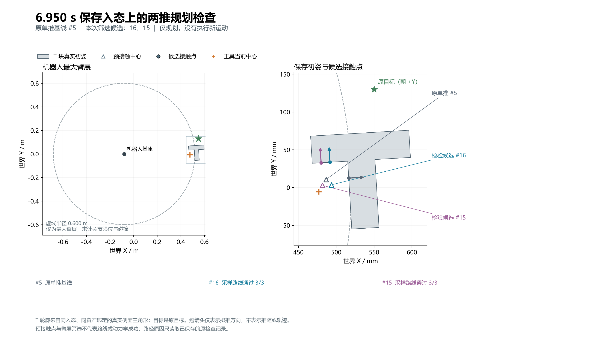

# RR PushT 的两推规划与实测对照起点

同一机械臂在 6.950 s 完成卸载，T 块的位置误差为 115.090 mm，绝对偏航误差为 0.140139 rad，目标分别为 15 mm 和 0.12 rad。原策略选中 5 号接触点，推向世界 +X。此次检验能否先从另一侧朝 +Y 推，再用第二推修正偏航。[上一批的单推实测](rr-pusht-loaded-replan-report-20261122.md)

## 哪些接触点真的能到

从已保存的状态和原有限材料面的完整候选集合出发，按与目标方向夹角至多 45°、材料准入和两根连杆的最大臂展筛选出 **15 和 16 号**。随后对各自的 5、10、20 mm 推距采用原逆运动学、接近、进入接触和推动路径检查。六条第一推参考均通过采样检查。原单推策略排除它们的原因是第一推会加大偏航误差。图中短箭头表示推动方向，三角形表示机械臂开始接近接触点时应到达的位置。[候选全集与几何筛选](../../artifacts/rr-two-push-planning-20261122-01/comparison/screen.json)



## 换面以后能改善多少

两推模型允许第一推暂时增大偏航误差，同时要求原归一化位姿代价改善。第一推预测给出 T 块平移和绕世界竖轴的转角，物体的原高度、倾斜及机械臂路线末关节姿态用于计算第二次接近。换面须通过沿原推向反向撤离 25 mm、重新接近、进入接触和推动的采样检查。两次推动使用同一模型和登记的材料几何。所有误差均从同一 6.950 s 起点计算。[搜索与预测实现](../../experiments/area_pressure/pusht_lookahead_pairs.py)

| 原接触点与推距 | 第一推后预测位置／偏航误差 | 末态预测位置／偏航误差 | 完整参考 |
| --- | --- | --- | ---: |
| 原单推 5，20 mm | 112.921 mm / 0.113497 rad | 112.921 mm / 0.113497 rad | 1,500 步 |
| 16，10 mm → 3，20 mm | 107.304 mm / 0.189558 rad | **105.969 mm / 0.076956 rad** | 3,250 步 |
| 16，10 mm → 4，20 mm | 107.304 mm / 0.189558 rad | 105.919 mm / 0.107393 rad | 3,250 步 |
| 15，10 mm → 3，20 mm | 108.214 mm / 0.196128 rad | 106.988 mm / 0.083525 rad | 3,250 步 |
| 16，20 mm → 3，20 mm | 99.544 mm / 0.238978 rad | 98.736 mm / 0.126375 rad | 3,250 步 |

找到的 6 组通过采样路径检查的组合，都比原入态更接近两个目标。表中前三个两推组合还同时优于 5 号的**预测**。其中 16 号推 10 mm，再换 3 号推 20 mm，在这三者中归一化代价最低；16 号若先推 20 mm，位置预测更近，但最后的偏航误差仍高于原门槛。第二推的检查从合成的预测姿态起步，实际首推产生的力、滑移和姿态需要动力学分支测量。原单推基线已经实测到 1,499 步，位置／偏航误差为 110.100 mm / 0.011592 rad，不能拿不同时间窗的预测与实测判输赢。[原基线及真实入态](../../artifacts/rr-two-push-planning-20261122-01/comparison/source.json)

本次两个搜索层合计新增 64 次逆运动学和 53 次路径检查。预留的逆运动学额度用尽，15 号的 10 mm 分支只检查了部分后续候选，两个 5 mm 分支的第二推均未检查。每个已通过的两推组合均需 1,500 步首推和 1,750 步撤离与第二推。原物理回合在此处只剩 1,499 步，已检查组合中能在原回合完整执行的有零组。原单推规划实际用了 6 次逆运动学和 3 次路径检查；两推搜索遵守同一上限，计算成本更高。[完整规划记录](../../artifacts/rr-two-push-planning-20261122-01/comparison/search.json.gz)


## 已准备可独立恢复的动力学起点

从上一批 6.700 s 的完整场景检查点重放原 250 个撤离步，得到 6.950 s 的完整设备检查点。250 步均已接受，逐步控制、进出状态、受力、几何和控制器回调与旧记录一致，逐步主机耗时单独处理。在两个新建的 CUDA 场景中分别公开恢复该检查点，两次读取的完整积分快照相同，重新捕获的持久状态均与原胶囊一致。恢复校验没有调用物理步进；额外执行的 250 步仅用于重建已有撤离段。[场景检查点](../../artifacts/rr-two-push-planning-20261122-01/fork.final.scene) · [完整恢复核对](../../artifacts/rr-two-push-planning-20261122-01/fork-audit.json)

动力学状态和上一接受步收据由场景恢复。控制器及目标历史保存在单独的记录中，分支调用者须从同一份记录恢复。场景的几何查询缓存按接口契约清空，每条新路线从恢复的关节与物体状态重新查询接触。下一次等时长实测可从这个时刻分别运行原策略与 16 号首推策略，保持相同目标、步长和资源门限。第一推结束后，用实测物体姿态、速度、载荷和撤离结果重新验证第二推，记下是否仍可换到 3 号。若入口拒绝，在相同时钟比较已接受的进展。

## 复现与验证

在仓库根目录使用原 CUDA 实验环境，串行执行下面的 PowerShell 命令。输入为前两批保留的本地实验数据，输出目录需新建。

```powershell
$prior = 'artifacts/rr-local-publication-20261122-01'
$last = 'artifacts/rr-loaded-replan-20261122-01'
$out = 'artifacts/rr-two-push-reproduction'
New-Item -ItemType Directory -Path $out
python -m experiments.area_pressure.pusht_lookahead --report "$last/live.json" --audit "$last/live-audit.json" --output-dir "$out/comparison"
python -m experiments.area_pressure.pusht_lateral_replan --source "$prior/suffix.json" --audit "$prior/suffix-audit.json" --checkpoint "$prior/suffix.final.scene.metadata.json" --steps 250 --output "$out/fork.json"
python -m experiments.area_pressure.pusht_lookahead_fork --source "$out/comparison/source.json" --fork "$out/fork.json" --output "$out/fork-audit.json"
```

本批四个专项测试文件共 **33 项通过**，涵盖原状态及预算绑定、材料和路径拒绝、无重置的搜索额度、合成姿态、预测指标及时间窗。九个涉及的 Python 文件通过 Ruff 和格式检查。独立读回从保存的提案和路径重新计算两项末态误差、完整参考时长及相对单推预测的改善。[各组合数值与选取依据](../../artifacts/rr-two-push-planning-20261122-01/comparison-summary.json) · [测试记录](../../artifacts/rr-two-push-planning-20261122-01/17-focused.stdout.log)
