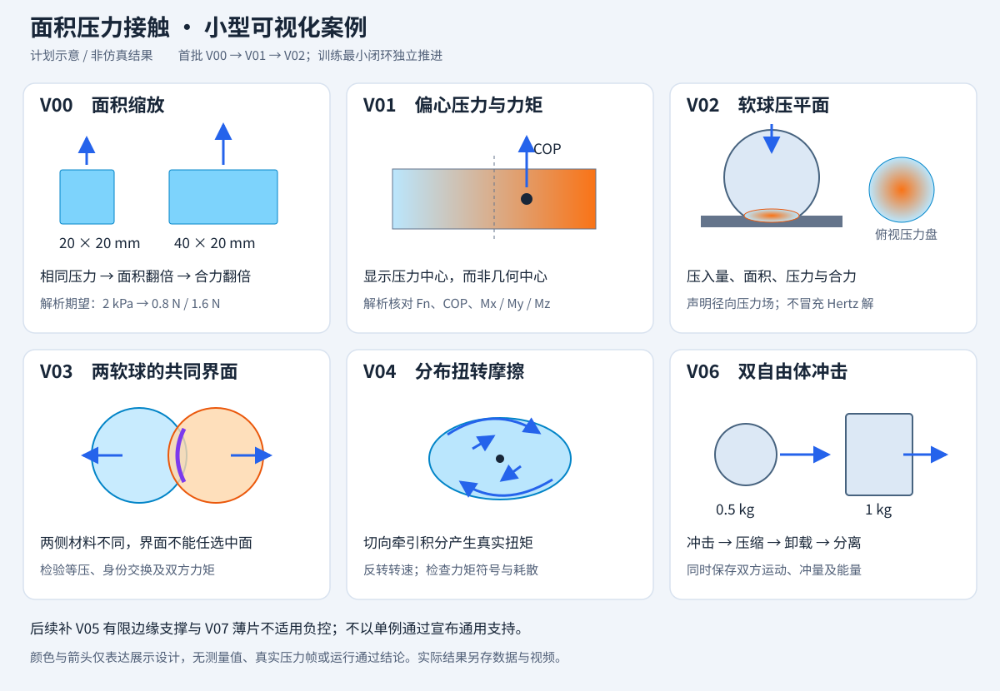

# 面积压力接触：小型可视化预研与训练最小闭环

日期：2026-11-15。状态：**exp V00–V03已执行；V03 Newton外部精度门未过，训练待做，最新见第10节**。
当前已验证产品截点：`d7c8195e4008828428a9394f8d16fb5fd1921cee`。
本轮按用户要求合入现有远程 `codex/dev`；三个未提交的 device-convex-patch 实验文件不纳入。
[当前续作入口](../../development/p65-continuation.md) · [异构训练总计划](2026-11-14-language-conditioned-gpu-manipulation.md)

## 1. 本次调整：先能训练，接触预研另走一条线

用户接受先跑通训练，不要求当前抓放或 PushT 成功。因此 T1b 接触切换、持握效果、原 0/3 PushT 的优化暂降优先级，**不再作为首次真实 PPO 更新的前置门**。原成功定义与失败记录保留；成功率可以为 0，不能用“能训练”改写为“已学会”。

先完成现有 CUDA 操作 Env → 状态/目标编码 → 共享 masked actor/value → rollout → PPO update → checkpoint 恢复。使用当前接触后端，Hydroelastic、FFT 和 Fourier 预研均不阻塞这条链。

当前已有同构 MuJoCo-TYX VecEnv 的 RSL/PPO 路径，但 [RSL adapter](../../../src/phymeo/training/rsl_mujoco_tyx.py) 不直接接受 [heterogeneous manipulation Env](../../../src/phymeo/training/manipulation_env.py)。当前操作 Env 的 HOST 成功评价与设备观察也须分开标注，不能宣称训练已接通或零读回。

**T-smoke 首个训练交付，难度中高：**

1. 复用 8 个原 GPU 环境与公共状态/动作/目标生命周期；接一个共享网络和一个优化器，不训练八套独立策略。
2. 实际状态/形态、全部可见目标、有效动作 mask 与自然语言目标进入网络；文本使用真实冻结预训练编码器，固定模型和 tokenizer revision。可以先缓存句向量，不把 world/task 编号、one-hot 或关键词分支当语义；不把语言理解成功作为 smoke 门。
3. 首次登记 seed=0，8 环境 × 32 个控制步，1 次完整 PPO update；原物理步长和动作能力不变，物理子步数量随 decimation 如实记录。设备推进、有限损失/梯度、Adam step 0→1、共享actor均值主干和critic实际参数变化、8 行样本归属及padding mask正确即可通过训练功能门。mask须覆盖执行、log-prob、entropy、KL及PPO重放；保留raw action，避免Env与策略重复tanh。
4. 奖励默认保留当前 Env 原始稀疏成功奖励；允许全零 reward、成功率 0。不得偷偷换成教师动作或合成标签让训练“过关”。若actor主干没有非零梯度或变化，只记部分管线可执行，不能以std/entropy变化冒充共享状态网络参与；先诊断优势、概率与mask，不添加假奖励。
5. 保存并恢复模型、优化器、RNG、Env/目标/episode；恢复后再执行 8 个控制步及一次 update，核对参数状态、动作 mask、时间和目标连续。对照同一保存状态，无需先做多 seed 或长程效果优化。
6. 预算是训练冒烟门，非性能或泛化结论。出现接口/生命周期故障，定位并修一次；没有证据不延长训练。完整训练效果、语言反事实、holdout、视频随后另列。

初次选用预训练模型时先检查已有缓存和兼容性，不在本计划提交中安装或下载依赖。训练实现是下一开发批，**本轮没有新增训练结果**。

## 2. 预研定位与可复用基础

[现有 ContactPatchSample](../../../src/phymeo/geometry/contact_patch_adapter.py) 的权重和为 1，要求每片法向一致；[sample_patch_loads](../../../src/phymeo/solvers/contact_patch_loads.py) 的 N/m 与 N·s/m 参数属于整片。它们可作点/片接触对照，不能把权重改名成 m²，也不能从离散力反推出唯一压力场。

新预研记录至少包含：双方物体/材料身份、模型版本、tick/采样相位、接触面拓扑、世界积分点/局部材料地址、每点法向、`dA_m2`、`pressure_Pa`、切向牵引 Pa、两侧速度，以及积分后的力 N、关于同一原点的力矩 N·m。面积和是实际接触面积。

MuJoCo-TYX [约束行](../../../src/phymeo/backends/mujoco_tyx/_constraint_rows.py) 仍是原生 MuJoCo 行语义。首轮只独立参考与案例，不往原 native 行里塞压力点，也不改老 patch 行为。

三条路线：

- **Hydroelastic 主线候选**：先验证压力场/共同接触面与积分，再决定接入。
- **FFT 独立参考**：用于适用的小变形半空间材料响应、标定与模型差异，不直接作为运行时前置。
- **Fourier 几何旁路**：先明确具体表示、查询、导数与参考精度，再比较总成本。傅里叶高度场、频谱碰撞查询、FFT 弹性求解是三件不同的事，不能互换名称。

Drake 的 hydroelastic modulus 不等于 Young 模量；FFT 的半空间假设也不适用于任意有限厚板。参考来源和使用范围见第 8 节。

## 3. 小案例矩阵

尺寸在文件内使用 SI；画面采用 mm、kPa、N、N·m。下列解析数字均为预登记的期望值，**不是运行结果**。

| ID / 难度 | 最小场景与固定输入 | 画面应展示什么 | 可否证的问题 |
| --- | --- | --- | --- |
| V00 面积语义 / 低 | 20×20、40×20、40×40 mm 平片；声明均匀压力场：κ=10⁷ Pa/m，δ=0.2 mm，p=2 kPa | 三片同色、不同面积；合力箭头与面积数值；网格细分开关 | 期望 F=0.8/1.6/3.2 N。扩大面积力应同比增加，同面积细分不改载荷；旧归一化 whole-patch 仅作明确不同模型的对照 |
| V01 偏心压力 / 低中 | 20×20 mm，x,y∈[−10,10] mm；p(x)=2000+10⁵x Pa，法向 +z | 压力渐变、COP 标记、合力和力矩；坐标旋转/平移对照 | Fz=0.8 N，COPx=1.666667 mm，My=−1.333333 mN·m；关于共同原点的双方总力矩闭合 |
| V02 软球压刚平面 / 中 | R=20 mm，径向场 p(r)=E(1−r/R)，E=100 kPa；δ=0/0.1/0.2/0.4 mm | 侧面压入、俯视压力盘、径向剖线、面积/力—压入曲线 | a²=2Rδ−δ²；中心 p=Eδ/R；F=πEδ²[1−2δ/(3R)]；零压入无正面积载荷。这里是声明压力场的解，不是 Hertz |
| V03 两软球 / 中 | 两球 R=20 mm，总重叠0.4 mm；E₁=100、E₂=300 kPa，沿用V02径向场 | 两侧压力切片、等压界面、双方力箭头；交换物体身份 | 中轴压入0.3/0.1 mm、压力1.5 kPa；完整界面不能随意取中面。交换身份应只改变方向与归属 |
| V04 分布扭转 / 中 | R=10 mm 圆盘，均匀 p=2 kPa，μ=0.5，ω=±1 rad/s；两同半径圆盘中心距30 mm、位于x=±15 mm，绕共同COM的z轴转动作holdout | 法向压力、切向牵引、总力和绕COM扭矩；无单点伪力偶 | 充分滑动极限 \|Mz\|=(2/3)μFnR；正则化模型用独立径向积分对照；力矩反号、摩擦功率非正，分离两块仍保完整矩 |
| V05 支撑后滑向边缘 / 中高 | 0.5 kg、40×40×20 mm块；80×80×10 mm支撑；μ=0.5；先居中承载，再朝边缘移动60 mm | 接触区缩小、COP迁移、载荷与俯仰；最后离开有限表面 | R2先做预设姿态序列，不能叫动力学；R3再由实际水平外力推动，全部受力/运动同一步。不得在离开后继续产生无限平面支撑 |
| V06 双自由体冲击 / 高 | 0.5 kg、R=20 mm球与1 kg、80×80×10 mm有限厚刚性目标均可运动，重力0，初始间隙2 mm，相对速度0.2 m/s；窗口0.5 s | 入层→压缩→卸载→分离；双方轨迹、压力面积、冲量、总动量与能量 | 同一步力与运动共同发布；无外力总动量守恒到预定工程误差；无粘附模型分离后无拉力。先零耗散，再显式耗散参数对照 |
| V07 不适用负控 / 低 | 两薄片交叉与大幅折叠的固定状态 | 清楚显示 unsupported/model-domain，不生成可信压力动画 | FFT半空间或体压力场不自动支持薄布自碰；不适用必须被标识，不用正体积或渲染图掩盖 |

V00/V01 是**制造压力场的积分案例**，不声称自动生成了接触面；V02/V03 才检验压力场前端。V01 的力矩含二次多项式，当前仅承诺仿射积分的顶点权重不能直接复用为精确参考；采用独立解析积分和至少二阶精确面积积分。

V02 的刚性一侧以参考工具明确支持的 rigid-compliant 模式执行。若 Newton 版本只接受两侧有限压力场，不用“极大刚度”冒刚体；Newton 首先对照 V03 的双软体域。不同表示只有在压力场定义相同后才做实现误差比较。

## 4. 最小可视化交付

每个案例一个离线 HTML 查看器 + 原始 JSON/NPZ/CSV + 10–20 s MP4；首批统一复用一个查看器，不各写一套渲染。
输入只来自保存的参考结果，时间拖动不重新求解；压力色标固定，不逐帧自动拉伸掩盖变化。

画面固定三栏：

1. 左：物体/接触面、法向和合力箭头、COP；可切双方身份、网格、接触缩减前后。
2. 中：压力/牵引热图与剖线；显示真实面积、积分点数、参考工具与模型版本。
3. 右：面积、Fn、Mx/My/Mz、压入或速度、动量/能量误差随时间或压入量变化；无结果的项明确空白。

静态序列标记 **PRESCRIBED_POSE / 非自由动力学**；V06等真实闭环标记 **DYNAMIC**。旁路样例/示意图不能拼成已经接入 Phymeo 的运行视频。失败也保留同格式快照，禁止只输出成功片段。

本页配图仅是布局/案例示意；没有压力实测、仿真帧或性能曲线。

## 5. 参考、标定与一次性验收

R0 先落小型 case manifest：几何、单位、模型公式、材料、初态、载荷、网格、步长、容差、数据拆分、参考软件版本及运行命令。当前表已经固定主要物理输入；参考驱动版本、网格资产和具体耗散律在首次运行前补入manifest，不根据结果倒填。

- V00/V01：解析积分是独立oracle；同面积用1/4/16片及三角形重新剖分，FP64相对误差≤10⁻⁶，COP绝对误差≤1 μm。这个轻量代数门不扩成动力学精确接触要求。
- V02/V03：压力场空间分辨率2/1/0.5 mm三档，报告每档；最细档对声明场的 Fn/面积误差≤5%，COP≤0.2 mm；最后两档 Fn/面积变化≤5%。δ=0单独验无正面积/无正载荷；相对误差门仅用于参考值非零的档位。不满足则定位前端/积分，最多一次修正；不增加第四第五档来掩盖表示不适用。
- V04：先无正则化的解析极限，再固定正则化律；扭矩误差≤5%，摩擦功率符号正确。正则化参数必须在第一次计算前登记，不能按每个转速分别调整。双盘holdout按各积分点相对共同COM的力臂独立积分，不能直接套单盘公式。
- V05/V06：h=1 ms 与0.5 ms对照。有限量/状态合法，无漏掉明显贯穿；V06总动量误差≤初始动量尺度的1%，零耗散能量变化幅度≤初始动能的5%，两步长峰值合力/总冲量变化≤10%。V05静止段平均承载误差≤10%，无逐步增大的沉降；这不是零穿透或高精度弹性认证。
- “实现是否解对声明模型”与“模型是否适合目标材料”分两列。Hydroelastic在一组载荷标定后冻结，用其他压入/姿态验证；FFT/Hertz不要求和另一种压力场逐像素相等。
- 预定门不可边跑边改。确认模型域不适用时保留 FAIL/UNSUPPORTED，选择范围/路线；不要调质量、摩擦、目标或门槛追求绿色。

首轮参考顺序：解析V00/V01 → Drake V02/V03 → 具有相同压力定义的Newton交叉对照。记录现有安装能力；缺一个参考工具先完成其余独立参考，不为复现工具安装阻塞训练主线。

## 6. FFT 与 Fourier 的小型旁路

**F-FFT / 中**：刚性球 R=20 mm、线弹性半空间 E*=1 MPa，非粘附小变形。压入0.05/0.1/0.2 mm；160×160 mm非周期域，128²/256²/512²网格。
显示位移场、压力盘和载荷—压入，与独立 Hertz 参考比较。明确非周期边界处理及域截断误差。
有限厚板另标不支持；没有相应层状Green函数，不拿半空间参考替代薄层。
一次固定载荷用于标定，其余用于验证，不能把E*直接赋给Hydroelastic E。

**F-GEO / 中高**：仅在明确具体傅里叶碰撞算法与论文/源码后开工。首个候选输入是40×40 mm有界光滑高度场（两条已声明正弦模式）与R=5 mm球；比较原精确/网格距离、法向、Jacobian及旋转后误差。
首轮模式数8/16/32；同时记录预处理、旋转/频谱更新、查询、内存与必要传输。若算法仅支持高度场，不宣称任意旋转闭合体。
没有固定误差下的总成本或功能收益，停止移植。这个分支不是Hydroelastic前置，也不是用FFT接触力公式充当碰撞检测。

## 7. 批次、并行和收敛规则

| 批次 | 工作 | 完成交付 | 继续条件 |
| --- | --- | --- | --- |
| A：现在 | 经过验证的当前代码合入dev；写训练smoke与本案例计划 | Git合并结果、这份MD和计划画板 | 不修改现有物理产品 |
| B：优先 | T-smoke训练接线；独立参考作者准备R0/V00/V01 | 一次真实共享PPO更新/恢复；面积与COP静态图 | 训练效果不是门；两个工作面隔离，共享接口父负责 |
| C：小参考 | V02/V03，FFT适用域对照 | 参考复现说明、R2压力/面积/力矩比较报告、短视频 | 能解释自身模型误差与模型差异 |
| D：选型前动力学 | V04/V05/V06；V07负控 | R3真实双方响应与卸载；R4采用/缩域/停止结论 | 不以几何通过替代动力学 |
| E：正式集成 | I0声明/面积数据 → I1接触面 → I2 MuJoCo-TYX共同求解 | 一个首域的同一步状态/载荷发布 | 原native路线保留；同pair不重复施力 |
| F：扩展 | I3设备缓存/容量/恢复 → I4多机器人/训练 → I5变形体 | 分范围CUDA与多场景结果 | 不同时重写两套响应体系 |

阶段B/C不要求把全部可视化做精美才继续。每个问题最多一次有依据修正；同一既过几何不反复重跑。没有完整一小案例或明确否证结果，就不增加更多数学子计划。单个案例不能证明通用模型；一个失败也不自动否定其他已声明域。

仅原agents隔离编码/参考文档可并行。所有项目import、数值、测试、参考运行、构建和训练由一个串行owner排队；视频只读已保存结果。此计划不创建周期任务或期限，不开远程CI、不更改TYX pin、不清理既有验收证据。

## 8. 已核验的一手资料

2026-11-15在线核对；首次参考执行另记录实际安装版本，网页版本不冒充本机版本。

- [Drake 参数与解析估计](https://drake.mit.edu/doxygen_cxx/group__hydro__params.html)：参数语义与有限柔顺；不能把Hydroelastic modulus等同Young模量。
- [速度级压力场接触论文](https://arxiv.org/html/2110.04157v2)：局部面积、压力梯度到等效接触响应的推导，支持后续I2研究；不意味着已适配MuJoCo原行方程。
- [ContactMechanics官方文档](https://contactengineering.github.io/ContactMechanics/)：小变形半空间与FFT参考范围。
- [Newton 1.6.0碰撞管线](https://newton-physics.github.io/newton/1.6.0/concepts/collisions.html)：SDF压力面、采样与缩减；其模型/参数/求解接线须明确后才能跨引擎比较。

初次规划时只完成源码/资料核对与Git集成，没有数值结果。最新执行增量见第9节；三种接触模型的正式集成及新训练仍未完成。

## 9. 2026-11-15 exp 首批实际结果

用户要求 dev 保留稳定基线，创建 exp 开始实验。GitHub 默认现为 `codex/dev`；当前独立工作在 `codex/exp`，详[分支清单](../../development/branch-consolidation-20261115.md)。

V00/V01 的面积积分与 V02 声明径向场已完成首批 **NumPy 独立参考**，源码48c4a14b。
14个新HOST节点通过；固定30格完整输出，0 failed。V02最细档最大面积误差0.506923%、载荷误差0.00307865%，最后两档收敛满足原5%门；粗档全部保留。没有更改参数、门槛或产品物理。
[实际报告与可视化](../../development/area-pressure-static-reference-report-20261115.md)含离线HTML、JSON/CSV与15秒静态参数扫描MP4。

这一结果覆盖 R0 的首批固定网格与 R2 自身模型静态积分对照，**不完成 R1 Drake/Newton 复现、R3动力学、R4选型或 I0–I5 集成**。
V02的独立NumPy离散是参考基线，不替代下一批外部参考。T-smoke仍未新增实现/执行，按第1节优先级继续；训练不等待接触模型选型。

下一接触小批：先核现有参考工具与版本 → 相同压力场/网格下V02/V03对照 → 再V04扭转。不得重做本次已通过的几何积分来延后动力学或训练接线。

## 10. V03外部参考执行结果与下一批

2026-11-15：V03独立曲面/压力参数oracle及Newton1.7.0 CUDA七格完成，见[实际报告](../../development/area-pressure-newton-reference-report-20261115.md)与[固定批次合同](2026-11-15-area-pressure-newton-reference.md)。新43 HOST通过，外部最细力误差约3.4%、面积约6.46%；最后两档变化仍>5%，资格为FAIL_RECORDED。一次计数读取接口修复已经结束，没有调模型参数或添加网格档。

- 已完成：独立V03等压曲面/真实dA、Newton未缩减数据捕获、七格固定比较和解释性图像/视频。
- 未通过：Newton本表示下原面积与收敛门；不能把“成功采集”改成“精度通过”。零接触、材料交换通过。
- 下一独立功能节点：V04分布摩擦/扭转与双盘holdout，先固定正则化律和参数；不重跑旧静态组。然后V05/V06共同状态/载荷的动力学。
- 如继续修V03，仅先分析本次已有raw，区分SDF/界面截取/积分误差；不加第四第五档追绿，也不立即移植TYX。
- T-smoke不等待接触精度升级，本批没有新的训练执行。V02刚平面的Drake等外部参考仍待做。
