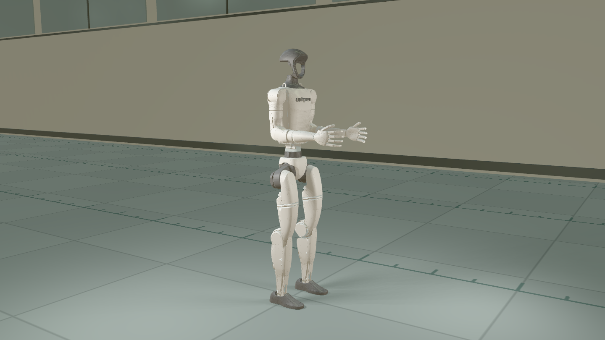

# Phymeo 渲染与仿真监看快速入门

第一次使用，建议先看牛顿摆。在这个例子中，MuJoCo 推进动力学，自研 Vulkan 渲染器拍摄相机画面，浏览器只负责显示。它不依赖八工位的训练归档，也不需要下载机器人。以下命令均从仓库根目录运行，命令行示例使用 Windows PowerShell。

## 一分钟打开第一幅画面

已有项目 Windows 渲染环境时运行：

```powershell
.\rendering\examples\open_simulation_monitor.cmd --scene cradle
```

终端会打印形如 `http://127.0.0.1:端口/` 的地址，并尝试打开浏览器。看到摆球运动后，切到“俯视”或“深度”。再按空格冻结两秒并恢复，画面应跳到仿真此刻发布的状态。切回终端按 `Ctrl+C` 结束示例。若浏览器没有自动弹出，复制终端地址即可。

同一入口也能显示多米诺骨牌。想并排观察两个试验，可在另一个 PowerShell 窗口运行下列命令；两套仿真各自打印自己的地址。

```powershell
.\rendering\examples\open_simulation_monitor.cmd --scene dominoes
```

启动脚本会查找项目已有的 Python 3.13 和原生构建目录。首次克隆仓库或换电脑时，先完成下面的“准备 Windows 环境”。[后台仿真示例](../examples/view_background_simulation.py)

## 根据工作方式选模式

| 我想做什么 | 入口 | 谁推进物理 | 浏览器能做什么 |
| --- | --- | --- | --- |
| 在训练或测试运行时看一眼 | `open_simulation_monitor.cmd --scene cradle` 或 `dominoes` | 后台仿真循环 | 自动跟随、冻结画面、恢复到最新帧。浏览器可以跳过中间帧 |
| 检查某一次有问题的动作 | `open_training_viewer.cmd --scene panda` 或 `eight` | 读取已有轨迹 | 暂停、播放、逐帧、拖动时间轴或输入帧号，可反复检查同一时刻 |
| 手动试验八工位的下一步 | `open_training_viewer.cmd --scene eight-live` | 新帧请求驱动示例向前推进 | 可查看当前帧并向前一步，后退需要重新开始或使用录好的轨迹 |

例如，下面两条命令分别启动双 Panda 回放和八工位单步试验，每次使用其中一条。在双 Panda 示例里，A 臂保持第一条记录的姿态，B 臂回放已存轨迹；可以分别查看总览和腕部画面。

```powershell
.\rendering\examples\open_training_viewer.cmd --scene panda
.\rendering\examples\open_training_viewer.cmd --scene eight-live
```

八工位回放需要归档目录（内含 `motion.npz` 和该次归档的配套文件），通常在项目的本地 `artifacts` 下。要使用自己的原格式归档，可运行 `.\rendering\examples\open_training_viewer.cmd --scene eight --motion D:\archives\my-run`。双 Panda 的默认轨迹和厂家视觉网格则在仓库内。两类回放支持的输入格式见[训练查看器数据源](../examples/_training_view_sources.py)。

**画面怎么读。** “仿真时间”取自所显示的物理帧；“采集耗时”统计该数据源采集所选机位/通道的时间，PNG 编码和网络传输另计。深度图显示沿相机光轴的米制距离，每个机位有自己的灰度量程。实例图给同一场景内的固定实例 ID 着色，背景为黑。需要用于训练的数值深度或精确整数 ID 时，从原生 `Capture` 读取对应数据平面。网页里的 PNG 用于观察。[数据平面定义](../src/phymeo_rendering/outputs.py)

## 准备 Windows 环境

| 部分 | 需要什么 |
| --- | --- |
| Python | 基础包要求 Python 3.11+。下方用 64 位 Python 3.11 单独建环境，与 `ibl` 声明的 NumPy 版本匹配。已配置的本机启动脚本则调用 `py -3.13` |
| 运行摄影路径 | 提供 Vulkan 驱动的显卡。`StudioRenderer` 默认启用硬件光线查询、4× MSAA 和 HDR 环境照明，需要相应设备能力。示例中的设备号是 Vulkan 枚举序号 |
| 仿真与图像 | 牛顿摆/多米诺使用项目指定的 MuJoCo 3.3.7。`ibl` 安装 HDR 环境所需的 NumPy，`textures` 安装纹理读取所需的 Pillow |
| 原生渲染 | 当前源码构建的 `phymeo_native.dll` 和同次构建的 `*.spv` 放在同一目录。Python wheel 带原生源码和着色器源码；平台二进制需另行构建或由项目提供 |
| 本机编译 | Visual Studio 2022 C++ 桌面开发工具、CMake ≥ 3.20、Vulkan SDK。CMake 从 SDK 查找头文件、加载器导入库和 `glslang` 或 `glslangValidator` |

在一台新机器，先安装 Python 包。命令显式指定虚拟环境解释器，因此无需激活环境。

```powershell
py -3.11 -m venv .venv-render
.\.venv-render\Scripts\python.exe -m pip install -e ".\rendering[ibl,textures]" "mujoco==3.3.7"
```

若已有别人交付的配套 DLL 与着色器，可以直接使用那一整套目录。自己构建则运行：

```powershell
cmake -S rendering/src/phymeo_rendering/backends/_native -B artifacts/rendering/quickstart-build -G "Visual Studio 17 2022" -A x64
cmake --build artifacts/rendering/quickstart-build --config Release
Get-Item .\artifacts\rendering\quickstart-build\phymeo_native.dll
Get-ChildItem .\artifacts\rendering\quickstart-build -Filter *.spv | Select-Object -First 5
```

使用新建的环境直接启动牛顿摆。下例选择 Vulkan 设备 0；如果独立显卡在其他序号，改为该设备。

```powershell
$renderDll = (Resolve-Path .\artifacts\rendering\quickstart-build\phymeo_native.dll).Path
.\.venv-render\Scripts\python.exe .\rendering\examples\view_background_simulation.py --scene cradle --library "$renderDll" --device-index 0
```

本机牛顿摆和训练查看器的 `.cmd` 默认尝试设备 1；下面的 G1 启动器默认尝试设备 0。两者均可覆盖设备号。这三个入口均从 `artifacts\physics-vulkan-interop\p1-raster-20261124\build` 查找库。要让该入口使用另一套构建，可在当前 PowerShell 设置 `$env:PHYVIEW_LIBRARY = $renderDll` 和 `$env:PHYVIEW_DEVICE = "0"`。使用上面新建的 Python 3.11 环境时，请继续直接运行 `.py`。八工位还需完整 Phymeo 源码、示例依赖和对应资产；这套最小环境面向后台牛顿摆和多米诺。[Python 依赖声明](../pyproject.toml) · [原生构建输入](../src/phymeo_rendering/backends/_native/CMakeLists.txt)

## 机器人模型、运动与控制

### 第一次看到宇树 G1 行走

这个示例使用宇树发布的 G1 十二驱动关节模型和配套行走策略。MuJoCo 以 2 ms 推进自由根动力学及足地接触，策略以 50 Hz 根据当前状态更新腿部目标，配置中的前向速度指令为 0.5 m/s。画面来自 Phymeo 的 Vulkan 摄影路径。模型的初始姿态、接触和速度都取自同一条仿真；可用场边固定镜头观察相对于地面的实际移动。[宇树官方策略配置](https://github.com/unitreerobotics/unitree_rl_gym/blob/276801e46c5d433564f24658bac64f254b7d2d4b/deploy/deploy_mujoco/configs/g1.yaml)

在已配置的项目 Windows 环境里，第一次运行下列命令会准备官方资产并打开网页。这个示例还需要 Git、可在 CPU 上执行 TorchScript 的 PyTorch、PyYAML 和 MuJoCo。启动器按固定版本下载并校验 33 个文件，连同上游许可证保存在 `artifacts/unitree-walk`。之后可以省略 `--download`。网页默认跟随 30 秒仿真，`--duration 60` 可延长到一分钟。[Unitree Robotics 模型与策略的许可](https://github.com/unitreerobotics/unitree_rl_gym/blob/276801e46c5d433564f24658bac64f254b7d2d4b/LICENSE)

```powershell
.\rendering\examples\open_unitree_walk.cmd --download
```

若使用前面新建的独立环境，录制样片时用到的 MuJoCo 版本为 3.9.0。以下命令为这个 G1 示例选择该版本，策略只用 CPU 推理。若需同时保留牛顿摆的 3.3.7，给 G1 单独建立虚拟环境并安装同一套渲染依赖。

```powershell
.\.venv-render\Scripts\python.exe -m pip install "mujoco==3.9.0" torch PyYAML
.\.venv-render\Scripts\python.exe .\rendering\examples\view_unitree_walk.py --download --library "$renderDll" --device-index 0
```

**仿真第 0 帧**。机器人双脚位于带米制刻度的地面上，双臂保持在身前。这个模型只驱动腿部的十二个关节。画面保留官方 CAD 的颜色，地面与背景是示例搭建的工作室。



[播放同一次仿真的六秒行走短片](media/unitree-g1-walk.mp4)。本次 3,000 个物理步内，骨盆沿前向移动 2.70 m，左、右脚分别单独支撑 2.74 s 和 2.65 s，以 1 N 法向载荷为触地阈值。前侧跟拍会让机身保持在画面中央，判断步幅时可参照脚下的地面刻度。

要看从第 0 帧开始的完整六秒，直接录制，播放速度由仿真时间决定。录制需要可执行的 `ffmpeg`（含 libx264）和 Pillow。下面生成 1440×810、30 FPS 的 H.264 视频、原始首帧和一次运行的物理统计。启动后端与发布器的完整用法见[行走示例源码](../examples/view_unitree_walk.py)。

```powershell
.\rendering\examples\open_unitree_walk.cmd --record .\artifacts\unitree-walk-preview
Invoke-Item .\artifacts\unitree-walk-preview\g1-walk.mp4
```

默认机位是前侧跟拍。录制时加 `--view fixed` 选择固定场边机位，也可使用 `side` 或 `front`。网页上可直接切镜。渲染器使用默认 HDR 环境、两盏矩形面光源（每灯 16 采样）、4× MSAA 和光线查询阴影；示例将宇树的外观网格放在带世界坐标刻度的展示地面上。物理地面来自官方场景。运动策略、可见网格与自研渲染器的职责可以分别更换。

### 自己导入模型时需要哪些数据

把机器人“画出来”和“让它自己运动”需要不同输入：

| 已有输入 | 可以得到什么 | 下一步还需要什么 |
| --- | --- | --- |
| 外观网格、纹理与材质 | 指定位姿下的可见表面 | 把每个视觉实例绑定到正确的连杆节点，处理长度单位、轴向和局部偏移 |
| 机构描述与已有状态/轨迹 | 从关节状态求连杆位姿，或回放已记录的位姿 | 明确关节名称、顺序、根位姿和时间戳；运动中的腕部相机使用同一帧的腕部位姿 |
| 可执行物理模型与驱动 | 求解器可根据外力、碰撞和输入推进 | 若目标是站立、行走、跳舞或抓取，还需与该模型匹配的控制器或策略、观测映射和动作映射 |

仓库中的 Panda 提供了一个可追查的例子。厂家可视网格负责外观，URDF 提供运动学链，归档负责提供关节和方块状态。切换机位就能检查抓取过程；这项回放本身不会产生新抓取策略。接入下载的其他机器人时，应先用已知姿态核对外观，再用独立的控制或回放来源驱动。当前后台示例只转换它使用的箱体和球体，其他几何、文件格式与策略需要各自的适配入口。[Panda 视觉资产与来源](../assets/panda/README.md) · [Panda 轨迹适配器](../src/phymeo_rendering/adapters/panda_replay.py)

## 接入自己的物理循环

`VisualScene` 保存长期有效的网格、材质和实例到节点的绑定。每次完成物理推进后，发布 `SceneFrame`，内含 `FrameKey`、仿真时间和各节点的世界位姿。位置单位为米，`Pose` 使用 XYZW 顺序的单位四元数。相机朝局部 −Z 方向观察，+X 向右，+Y 向上。

下面是可嵌入调用方的函数。`accepted_frames` 由你的物理循环产生；`camera_pose` 是固定相机的相机到世界位姿。若使用腕部相机，把相机挂载的局部位姿与**传入帧**里的腕部世界位姿组合后传给 `Camera`。回调和渲染在工作线程执行，读入步后快照可避免把新关节状态与旧画面混在一起。

```python
from phymeo_rendering import LiveSceneViewer, StudioRenderer
from phymeo_rendering.cameras import Camera
from phymeo_rendering.outputs import Channel


def monitor_run(scene, accepted_frames, camera_pose, library, device_index):
    def wide_camera(frame):
        return Camera("wide", frame.key, camera_pose, 960, 540,
                      700.0, 700.0, 480.0, 270.0, 0.03, 20.0)

    with LiveSceneViewer(
        scene,
        cameras={"wide": wide_camera},
        camera_labels={"wide": "全景"},
        depth_ranges={"wide": (0.3, 8.0)},
        channels=(Channel.RGB, Channel.FORWARD_DEPTH, Channel.INSTANCE_ID),
        renderer_factory=lambda: StudioRenderer(library_path=library, device_index=device_index),
        title="我的仿真",
    ) as viewer:
        print(viewer.url, flush=True)
        for frame in accepted_frames:
            viewer.publish(frame)
```

三个容易混淆的量分别是物理步长、发布间隔和浏览器跟随频率。控制器可以每步运行，发布器可以每若干步发布一次，浏览器只请求选中的机位与通道。`publish` 记录最近八个不可变快照并返回单调递增的发布序号；重置物理场景时由调用方更新 `FrameKey.epoch`。需要完整数据集时，在物理/采集进程另行保存每个要求的状态与相机观测。

可直接阅读牛顿摆的 `visual_scene`、`snapshot` 和 `run` 对照三个位置。它先建立静态实例表，将已完成步的 `qpos` 复制到单独的 `MjData`，在该副本计算连杆世界位姿，再调用 `publish`。这避免渲染回调改写下一次控制读取的物理状态。带动捕节点等额外输入的模型，也要把相应的状态带入自己的快照计算。[可运行发布循环](../examples/view_background_simulation.py) · [公共监看 API](../src/phymeo_rendering/live_viewer.py)

## 从另一台电脑观看

服务绑定在运行仿真的机器的回环地址。以下示例在远程 Windows 机器上固定端口，保留终端运行：

```powershell
.\rendering\examples\open_simulation_monitor.cmd --scene dominoes --port 8765 --no-browser
```

在观看端的终端执行下面的命令，将 `username@simulation-host` 换为实际远程登录地址。远程主机需要已启用可用的 SSH 服务。

```powershell
ssh -N -L 8765:127.0.0.1:8765 username@simulation-host
```

保持 SSH 会话打开，再用本机浏览器访问 `http://127.0.0.1:8765/`。两端使用相同端口可保持浏览器 Host 与服务校验一致。远程 GPU 完成渲染，浏览器接收所选画面的 PNG。若本地端口已占用，请在**服务端、转发命令和浏览器**一起换到另一个空闲端口。[服务监听与请求校验](../src/phymeo_rendering/viewer.py)

## 常见问题

| 现象 | 首先检查 |
| --- | --- |
| 终端提示找不到 DLL 或着色器 | 核对 `--library` 的绝对路径和同目录的 `*.spv`，使用同次编译的整套产物。`native_shader_manifest.txt` 位于构建目录，可核实本次应生成的 SPIR-V |
| 页面能打开，第一张图报 Vulkan 设备或验证层错误 | 核对所选设备的 Vulkan 能力。摄影默认需要硬件光线查询和 4× MSAA。开启 validation 的示例还需要 `VK_LAYER_KHRONOS_validation`；便携验证层的 `VK_LAYER_PATH` 应指向其 manifest 目录 |
| 运行 `.cmd` 时找不到 Python 或模块 | 本机脚本固定调用 `py -3.13`。若依赖安装在其他解释器里，用该环境的 `python.exe` 直接运行对应 `.py` 并传入 `--library` |
| 八工位缺少 `motion.npz` | 使用 `--motion` 指定完整八工位归档目录。只想先验证浏览器与渲染链路，可以运行牛顿摆 |
| 观察模式一直等待首帧，或仿真瞬间结束 | 确认宿主进程仍在运行、进入了 `with LiveSceneViewer(...)`、且已经 `publish` 了属于该场景的帧。短时批处理可改用已保存的轨迹回放 |
| 冻结后仿真时间跳过几帧 | “恢复跟随”读取最新发布状态。要精确返回上一帧，使用带时间轴的回放模式 |
| 实例 ID 的彩色图正确，训练却需要数值 | 通过 `session.capture` 请求 `Channel.INSTANCE_ID` 或 `Channel.FORWARD_DEPTH`，从返回的平面读取 uint32 或 float32；显示用 PNG 会把数值映射成颜色 |

想对照其他引擎的入门范例，可阅读 [MuJoCo 的被动查看器](https://mujoco.readthedocs.io/en/stable/python.html#passive-viewer) 与 [Newton 的查看器选择](https://newton-physics.github.io/newton/stable/guide/visualization.html)。
