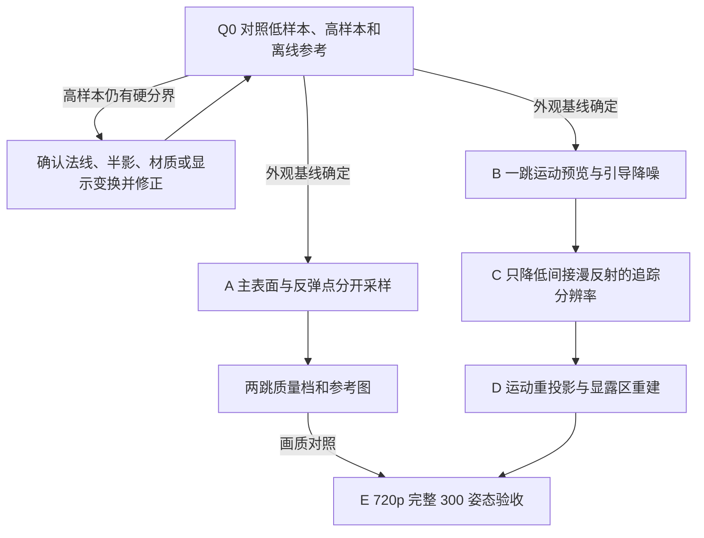

# 自研 Vulkan 综合光照：画质与 30 FPS 路线图

**2026-11-24 实施结果**　[先看 720p 抓放影片](../results/lighting-preview/2026-11-24/panda-balanced.mp4)，[再看滤波前后同帧对照及逐项验收](../results/lighting-preview/2026-11-24/README.md)。完整距离一跳、每锚点八个方向提案、低分辨率几何引导滤波、最多四帧刚体重投影，固定镜头两轮 RGB 达 37.22 / 37.49 FPS，P95 为 30.92 / 30.84 ms。左臂六组块亮度误差下降 14.26%–15.71%。12 cm 近场档满足四通道同步交付的速度门槛。主表面与反弹命中点的灯光预算已可独立指定。下文保留原验收条件；薄边、半影分层和参考图精度在交付报告中分别记录。

目标是在 RTX 4060 Laptop GPU 上，以 1280×720 连续观看 Panda 抓放。白壳应有连贯的明暗渐变，夹指与载荷接触处能分辨前后关系，移动时细边稳定、显露区没有旧影。保留一条可检查多次反弹的质量路径。

## 基线与第一项决定

第 60 帧的 [16 样本原图](../results/hdr-importance/panda-16spp.png) 在白壳上仍有斑驳；[同版本 1024 样本](../results/hdr-importance/panda-1024spp.png) 的颗粒明显减弱，夹指上方凹槽和左臂仍有成片明暗分界。HDR 重要性采样解决了漏采小亮区的问题，2×2 档的白壳**原始线性**高频波动下降约 85%；经滤波和显示变换的波动只从 0.03140 降至 0.02169。这些数据只支持对白点的判断，材质观感仍需独立验收。[已提交的测量和旧／新对照](../results/hdr-importance/README.md)

| 同卡、同输入，720p 四通道同步返回 | 平均整帧 | 能据此作出的决定 |
| --- | ---: | --- |
| 直接光、预计算环境光、近镜面反射，灯 2×2 | 31.4 ms，P95 41.0 ms | 即使无路径漫反射，也要查主机等待、交付和帧时间波动 |
| 一跳 / 两跳，灯 2×2，均有 HDR 采样和引导降噪 | 211.7 / 405.3 ms | 一跳约 4.7 FPS；到 30 FPS 仍需约 6.35 倍整帧提速 |
| 两跳，全 8×8 / 主 8×8、次 2×2 原型 | 1777.3 / 513.3 ms | 同场次快 3.46 倍；第 60 帧 99% 像素的最大通道差 ≤1 个 RGB8 色阶 |
| 两跳 2×2，只留四条主路径的原型 | 147.6 ms | 相对 16 路径，逐像素最大通道差 P99 达 34 个色阶，白壳颗粒可见 |

成本研究采用 42 次预热和 84 次计时，每档两轮逆序。这些是已测样本的均值或分位值。之前同设备另一次全 8×8 得到 827.5 ms，跨场次变化原因未定位；今后在同一次交错对照内判断收益。两种候选的基线不同，收益不能相乘。[此工作树的完整计时与裁图](../../artifacts/rendering/lighting-cost-study/run-02/report-zh.md)（本机实验产物；上表保留供其他检出阅读）

## 路线与依赖

| 顺序 | 难度 | 要交付的可见结果 | 进入下一步的依据 |
| --- | --- | --- | --- |
| Q0 · 先确定好画面的样子 | 中 | 固定机位下的白壳、夹指、橡胶台三处原尺寸裁图，短回放；逐项隔离残余噪声、分面、阴影和材质 | 得到可复现的归因和可接受的外观目标；参考本身观感欠佳则先修可复现的外观原因 |
| A · 主表面与反弹点分预算 | 中 | 质量路径能显式选 8×8/2×2，与原全 8×8 同帧比较 | Panda、封闭室、细遮挡的面积灯响应和半影过门。详见[任务 A](2026-11-24-native-secondary-light-budget.md) |
| B · 一跳运动预览＋降噪 | 中 | 一种具名、可复现的运动预览配置，以及固定机位、腕部和遮挡揭露的对照短片 | 通过[任务 B](2026-11-24-native-motion-preview.md)的运动画质和状态切换检查；先作为预览候选发布 |
| C · 分离间接漫反射，减少实际追踪像素 | 高 | 全分辨率直接光、近场镜面和几何通道，独立间接漫反射缓冲。先做棋盘格半数像素，再比较宽高各半的四分之一像素 | 在相同帧和画质门槛下比较两种模式的 GPU 时间、总帧时间与显存。奇数尺寸、夹指细缝、薄遮挡都要有样例 |
| D · 运动中重用有效样本 | 高 | 以前后相机及物体变换生成运动向量，沿历史位置复用间接光。用当前深度、法线、实例和材质识别可复用位置 | 静止降噪，运动少闪烁；遮挡揭露、转向、开关灯、切世界和窗口缩放能拒绝失效历史 |
| E · 整帧交付与签收 | 高 | 成片、逐帧时序、质量对照、实际输出模式，按下节规则分别签收 | 画质和时序同时过门，再将候选称为实时档 |

Q0 冻结输入后，A 和 B 可分别开发。已有一跳 2×2 可以直接进入 B；A 主要改善高质量半影和静态预览。C 从 B 的同画质基线出发，D 使用 C 的间接光与表面信息。E 的计时埋点、无 GI 基线和交付成本分析从 Q0 同步开始，最终签收放在 D 之后。共享后端入口由一位集成人维护，同卡构建与设备验证串行。

## Q0 · 如何判断还该不该调 HDR

1. 用[同一份 Panda 资产和机位构造器](../examples/panda_render_performance.py)固定姿态、HDR 方向及强度、曝光、色调变换与灯；保存未曝光线性 RGB、最终 RGB、深度、实例 ID、掩码。把第 60 帧、25 姿态薄板回放的 0/15/24 和封闭室登记为不同案例。预先固定观察区域，录像保留一倍速和原尺寸局部。
2. 固定几何和材质，比较独立种子、16 和 1024 样本；同时看未滤波和显示结果。随种子改变且随样本增加而消失的颗粒进入采样／重建排查。对高样本仍稳定的分界，逐项显示几何法线、着色法线、基础色、粗糙度、直接漫反射、间接漫反射和镜面项，缺失的调试输出列入本步开发。用相同灯强分别比较 2×2 与 8×8 半影，再逐项切换法线或材质。每次只改一项；记录哪个开关能在相同像素重现或消除分界。
3. 参考分两层。相同输入的高样本 Vulkan 图检查本引擎的收敛；匹配相机、米制几何、HDR、材质、灯和显示变换的离线路径追踪图检查外观偏差。优先复用[SAPIEN 参考入口](../results/r2/README.md)和[封闭室路径深度对照](../results/progressive-room/README.md)。旧摄影棚影片的环境、分辨率与当前基线不同，只作视觉参考。当前 SAPIEN 入口不支持同一张法线贴图；外部配对只能在双方同时关闭该选项的共同能力子集上定量比较，另以 native 高样本检验完整材质。封闭室原有 native 与 SDK 镜面模型也有差异，沿用原逐阶容差；新优化仍须与相同模型基线对照。
4. 交付一张标注“颗粒、半影、材质或几何分界”的同帧图板，配一段原速盲标 A/B 短片。先确认白壳和夹指的目标外观。若高样本仍呈现硬分界且根因在资产法线或材质，则开一个带独立夹具的修复，沿用同镜头复核；若主要差异来自低样本，则直接进入 C/D。**Q0 结束时应能指出要改哪一层，以及哪一张图能证伪判断。**

## 30 FPS 怎样签收

- **运动预览的主指标为公开 RGB 完成延迟。** RTX 4060 Laptop、720p、1× MSAA。胜出档与同画质基线使用相同 DLL/SPV 集合、录制轨迹、资产和机位，各预热 10 帧，再连续采集 300 个唯一姿态，两轮逆序。计时从提交该帧至 RGB 能被调用者使用。每轮平均 ≥30 个新帧/秒且最近秩 P95 ≤33.3 ms（300 个耗时升序的第 285 个），报告 P50、P99、最慢帧、超预算次数、冷启动和显存。拍摄、顺序或时间戳缺一帧即失败。编码和离线分析单列。已有单方向光快速档曾以 11.43 ms 的 P95 通过这一 RGB 标准；本次要达标的是包含漫反射间接光的运动档。[原验收口径与快速档记录](09-acceptance.md)
- **四通道采集单独复测。** 同一胜出档、同样 10＋300 帧、同样的均值与 P95 门槛，从公开请求到同步取得 RGB、深度、ID、有效掩码计时。RGB 与对应四通道帧核对颜色，三几何通道与同姿态基线核对。以现有资产构造器返回的完整轨迹扩展基准包装器；短跑用作筛选，只对基线和胜出档做完整验收。两种输出分别标注“已达标／未达标”。
- **交互窗口另列。** 若新增设备常驻预览，从输入姿态到对应显示帧完成记录延迟，并记录相邻实际新画面的间隔、总完成数、在途深度与丢帧数。没有显示端测量就只报告设备完成时间。异步读取保留每帧身份和所有权；平均提交速率、视频文件标称帧率和单个 GPU 核耗时均不能单独签收。显示达标、四通道采集超时可以作为两个明确的结果交付。
- **先量能用于 GI 的余额。** 无 GI 基线已经是平均 31.4 ms、GPU 12.0 ms。逐帧记录主机准备、提交、等待、复制及颜色交付，在 GPU 上分别测主着色、间接追踪、重建与复制。先优化实际限制整帧的阶段；等待中包含正在进行的 GPU 工作，阶段时间不得重复相加。对同机异常波动记录驱动、功耗模式、频率和其他负载。
- **速度与外观同批比较。** 所有档位在相同曝光下输出同姿态真图。沿用 [A 的静态门槛](2026-11-24-native-secondary-light-budget.md)和 [B 的运动门槛](2026-11-24-native-motion-preview.md)，对 C/D 重验遮挡和运动。高样本参考使用独立种子；几何三通道按对应姿态逐字节一致。Q0 的外观图板和一倍速回放都进入最终评审。
- **停损。** 任一改动只改善 GPU 核时间而整帧仍未改善，先查同步和交付。四分之一像素模式如果抹掉指缝，退回棋盘格或对边界补样。若直接光加输出本身已超预算，优先改帧交付；若快速路径只能满足速度，保留具名快速／质量档并公开各自差距。每个节点保留一份配对图和时序即可作出继续、回退或改方向的决定。

低分辨率 GI 的导引与历史拒绝可对照 [NRD 的输入和分辨率说明](https://github.com/NVIDIA-RTX/NRD) 与 [SVGF 的时空方差滤波](https://research.nvidia.com/labs/rtr/publication/schied2017spatiotemporal/)。两者提供重建方法，最终帧率以本机上述协议为准。
