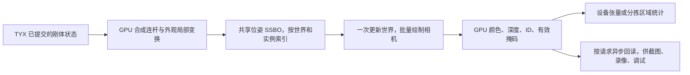

# 并行仿真与 Vulkan 渲染的 GPU 缓冲互通计划

**2026-11-24 实机进度。** P0 双槽互通已通过。P1 已在同一张 RTX 4060 Laptop GPU 上用两个真实滑块世界、各两个固定机位，证明一次设备位姿发布可供多个相机绘制。16 对共享／主机参考曝光的四类通道一致，单世界重置与移动阴影已验证。[光栅实测和对照图](../results/device-interop/two-world-raster/README.md) · [P0 记录](../results/device-interop/README.md)

P1 的随动机位、刷新失败拒绝曝光、RGB 4× MSAA 与硬件光追阴影已通过同卡实测。两世界四机位的 300 批计时中，4× MSAA 将轮廓误差降低 73%，硬件光追阴影与 4× MSAA 并用时，共享路径整批 p95 为 11.11 ms。小场景的主机位姿基线仍然更快。[性能、原图与复现](../results/device-interop/mounted-quality/README.md)

P2 已打通跨世界一次位姿打包、同世界多机位一次 Vulkan 提交与等待。两世界、四机位的 64 组曝光与原逐拍结果及前次归档逐字节相同。硬件光追阴影配合 4× MSAA，两轮各 300 批的 p95 从 8.48 / 8.09 ms 降至 6.48 / 6.27 ms，设备本地附件占用随同时在途的机位增加。[批拍报告、图像与内存成本](../results/device-interop/shared-camera-batch/README.md)

下一批连接跨世界可等待的整批结果与 P3 实时设备附件，先让 Torch 在自己的 CUDA stream 上消费图像，再检验慢消费者、批次释放、重置和失败重试。保留现有 CPU 图像对照、传感器中心采样、4× MSAA 和硬件阴影。P3 的归档图像检验已通过。P4 的八世界十六机位要分别测量 CPU 与 GPU 消费者的整批时延和内存峰值。

首版面向 Windows、同一张 NVIDIA GPU、MuJoCo‑TYX 刚体和 Phymeo 原生 Vulkan 光栅。目标是每个已提交的物理状态只生成一次渲染位姿，供同世界的所有相机共读；训练消费者直接在 GPU 上取得图像。面向文件和调试的调用方仍可选择主机图像。

**第一段可验收的演示**是两个真实仿真世界中的滑块沿相反方向运动，两台相机观察同一物理时刻。**最终规模验收**沿用八个异构世界、十六台相机，对照画面、观察来源和整批耗时。R1 分拣可直观看到 GPU 图像被消费后的选箱结果。

## 从现有实现出发

| 已有证据 | 实施时可复用的部分 |
| --- | --- |
| [TYX 刚体观察器](../../src/phymeo/backends/mujoco_tyx/_body_observation.py)从已提交的状态计算每个世界的刚体位置和旋转。[工作区](../../src/phymeo/backends/mujoco_heterogeneous_io.py)检查所有模型组成功后发布新帧，现有 Torch 导出创建独立设备副本。 | 保留已有发布时相与所有权。求解器本身还会同步并下载候选状态，观察器也会读回少量状态码；两者在传输报告中独立列账。本项目的位姿传输承诺从已提交状态算起。[物理步入口](../../src/phymeo/backends/_mujoco_tyx_runtime.py) |
| [顶点着色器](../src/phymeo_rendering/backends/_shaders/resident.vert)已按实例读取 SSBO 里的世界矩阵和逆矩阵。当前[原生后端](../src/phymeo_rendering/backends/_native/resident.inc)在主机准备两者，并随相机采集更新顶层加速结构。 | 复用现有着色器布局、可视网格和材质。迁移位姿时一并迁移所选渲染模式需要的加速结构更新，确保移动物体与阴影处于同一时刻。 |
| [R4 实测](../results/r4/README.md)使用 221 个归档物理状态、每世界两台 320×240 相机，输出 RGB、前向深度、实例 ID 和有效掩码。8 世界批次 p50／p95 为 **62.03／72.69 ms**。 | 复用原始世界、镜头、reset 排程、四通道和逐世界对照。这是逐相机同步提交与主机回读的历史结果。匹配输入的同机新旧路径对照用于判断提速；实时物理发布另设用例。 |

## 数据流和模块职责

刚性网格的顶点和索引在装入后常驻。SSBO 存实例位姿；录像需要像素时使用 Vulkan 回读缓冲，对应 OpenGL PBO 的用途。布和软体另立后续任务，在设备上更新可变顶点 VBO，并验证法线、包围盒与加速结构的更新。

## 开发批次与合并门槛

| 批次／依赖 | 难度 | 开发交付 | 可以合并的证据 |
| --- | --- | --- | --- |
| **P0 同卡互通与对照** | 中 | 固定设备、驱动、资产、通道和计时口径。Vulkan 创建可共享缓冲，CUDA 导入映射，用外部信号量完成一次写入、读取、交还。 | 两个槽交替写不同标记，双方计算的结果一致；覆盖设备不匹配、句柄不支持和初始化中途失败。记录释放后的资源数。 |
| **P1 已提交位姿 → SSBO**，依赖 P0 | 高 | 实现物理发布适配器与世界／节点绑定；将刚体与可视局部变换在 GPU 上合成为着色器需要的正逆矩阵。静态实例只绑定一次。 | 先单世界单相机，再跑两个真实滑块世界。画面、位姿、帧键和时间对齐；稳态无位姿载荷经主机。损坏或被替代的帧不能发布。 |
| **P2 一次世界更新 → 多相机绘制**，依赖 P1 | 高 | 将位姿和顶层加速结构准备从逐相机提交中拆出。每个世界独享动态状态，各机位独享相机参数、输出与时间历史。增加可等待的整批提交。 | 同一物理帧加第二台相机时位姿整理次数保持一次。两相机均交付；遮挡、阴影和腕部视角随对应刚体运动；单个世界 reset 不污染其他世界。 |
| **P3 设备图像 → 消费者**，依赖 P0，最终接 P2 | 高 | 渲染附件在 GPU 上按通道整理到具有明确布局的线性缓冲。提供带生存期和完成事件的批量设备输出，以及显式异步主机回读入口。 | 在非默认 CUDA stream 上执行实际 Torch 图像运算；另对 R1 的橙／蓝工件做 GPU 区域统计。正常设备消费的整幅图像主机读回为 0 B；显式截图与原通道结果对齐。 |
| **P4 八世界隔离与速度签收**，依赖 P1–P3 | 中高 | 用同一程序切换原路径、仅共享位姿、共享位姿加批绘制、设备端消费；执行下方测试矩阵。 | 归档对照、真实物理步、消费者可见结果及性能分别出具记录。仅对通过的设备、通道和渲染模式标记支持。 |

**三条工作线。** A 负责物理侧发布、异构映射、已接受状态测试。B 负责原生 Vulkan 资源、同步、矩阵／加速结构以及批量提交。C 负责设备图像消费者、参考对照与计时。由集成人先冻结帧键、缓冲布局、完成与释放协议；B 负责共享的原生 ABI，C 通过该接口接入。P0 期间 A 可准备滑块夹具，C 可复用旧 R4 建立对照；P0 通过后 P1 和 P3 的消费者原型可并行，P2 与 P3 的端到端合并在同一原生接口上串行完成。同卡构建、GPU 测试和计时由一位执行者排队。

## 编写接口前须确定的三件事

1. **谁写、谁读、何时复用。** Vulkan 分配可导出的设备局部缓冲，在初始化时按设备 UUID 匹配 CUDA，并查询实际句柄类型、导入导出、对齐及专用分配要求。通过 Win32 外部内存和外部信号量交接。先验证双槽，生产方写完才发布，最后一个图形／训练消费者完成才交还。消费方延迟时施加背压，关闭时排空在途工作再销毁映射、句柄和内存。错误返回明确能力与原因，主机路径可显式选择。[NVIDIA 互操作指南](https://docs.nvidia.com/cuda/cuda-programming-guide/04-special-topics/graphics-interop.html) · [Vulkan Win32 句柄所有权](https://docs.vulkan.org/refpages/latest/refpages/source/VK_KHR_external_memory_win32.html)
2. **哪一个世界、哪一个时刻。** 保存模型／场景绑定、每世界有效 body 范围、静态节点、body 到各 visual 的局部变换，以及外部／腕部相机的安装关系。发布记录绑定 world、epoch、revision、tick、时间、物理步边界；异构模型的 padding 不得绘制。适配器持有源帧到 GPU 整理完成，再交还物理工作区。沿用米制、FP32、矩阵排列及现有刚体校验，由最终舍入的正矩阵求逆。每世界仅更新本世界的顶层结构；先验收 R4 所用的渲染配置，再分别签收软件 TLAS 和硬件 ray query 的其他组合。[刚体观察回归](../../tests/test_mujoco_tyx_body_observation.py) · [光追加速结构](../src/phymeo_rendering/backends/_native/resident_rayquery.inc)
3. **消费者拿到什么。** 每个输出描述 world、camera、帧键、设备、形状、数据类型、行跨度、单位和通道，沿用原图像原点与深度定义。将附件整理成张量所需的设备内复制、格式转换和重排单独计数。训练者保有缓冲直到其 stream 用完；需要长期保留时可显式复制。主机截图和原有同步采集可继续通过原接口使用。

## 验收与测量

| 测试 | 输入与通过条件 |
| --- | --- |
| 实时物理发布 | 用[已有滑块](../../tests/test_mujoco_tyx_runtime.py)建立同模型、相反运动的两个世界。取初、中、末三个已接受端点，同步拍摄外部和绑定机位。和同一端点的主机参考核对世界坐标、投影及方向；另加一个带非零局部偏置、可辨旋转的可视件检验矩阵方向。记录实际物理步数、各世界帧键。拒绝物理步／观察刷新失败时不发布新图；reset／restore 后的旧帧请求应失败。 |
| 八世界像素与隔离 | 复用 [R4 检查](../examples/native_multiworld.py)及[原验收指标](09-acceptance.md)。1／2／8 世界各 2 相机、同一确定性光栅配置，预热后各 300 个完整批次。每个机位必须到齐，实例 ID／掩码逐像素一致，每视图共同有效命中数大于零，最大前向深度差 ≤2 mm。第 150 批只 reset 世界 0。相同附件的设备导出和主机读回按各通道逐字节核对；跨路径 RGB 另报精确率、最大色差及差异图，定位差异后再签收。 |
| 八世界实时接合 | 两世界用例通过后，沿用[刚体观察测试](../../tests/test_mujoco_tyx_body_observation.py)已有的异构批次，实际步进 8 个世界；每个世界接两台相机，固定控制和步数，保存首、中、末端点及每个世界的单跑对照。检查每张图的发布键、各世界有效 body 映射、单世界重置和 GPU 消费完成，收据中记录实际物理步数。实时结果与 R4 归档性能分别报告。 |
| 设备消费者与录像 | 用相同输入分别走主机图像上传 Torch 和设备图像直接进入同一 Torch 运算，核对结果、时间戳和消费完成事件。R1 分拣用正式及换序上料顺序，GPU 和原 CPU 读头的类别及选箱逐次一致，同时覆盖无色与混色拒绝。抽样显式回读作正确性对照，与性能轮分开。R1 用于验证相机消费，两个滑块与异构批次用于验证实时物理发布。[R1 读头](../examples/galaxea_r1/sorting_reader.py) |
| 同步、失败与资源 | 在两个槽上交错快慢消费者，覆盖延迟释放、reset 后旧 epoch 与在途输出、不同相机尺寸、批内最后一台失败、关闭时仍有借用、容量超限。检查无覆盖、陈旧图或半批成功；重试采集同一已发布帧，物理步数不增加。GPU validation 报错数与关闭后的活动资源数均为零。 |

**计时从同一输入到同一消费者真正完成。** 对照开关逐级开启，主机消费和设备消费分别比。归档回放用于隔离渲染开销，预装到 GPU 的回放应登记一次性上传；实时用例另报从物理步开始到消费者完成的耗时。各档固定分辨率、视角、通道、照明、阴影和设备。延续 R4 的 3 批预热与 300 批测量；以相反执行顺序复测。计时轮把截图、全量比对及编码移到窗口外，并分别报告其成本。

**每档要交的数字。** 给出整批 p50／p95、总相机帧率、设备局部与主机可见内存峰值、每批提交数／CPU 等待次数和时间。分项记录静态资产初始化、位姿与加速结构、物理内部下载、控制／状态码、帧图像 D2H、H2D、D2D。训练路径的零字节门槛针对稳态位姿和整幅图像的主机往返；记录 GPU 时间戳和 CUDA 消费事件，避免把 CPU 等待与同一段 GPU 执行时间相加。

**决策规则。** 功能先按表签收。性能收益要求在同机、同消费者、相反顺序的两轮对照中，8×2 的整批 p95 都低于旧路径，且改善超过同配置基线两轮之间的绝对差。若结果落在波动内，记录为“尚未证实提速”，按同步、回读、光栅或物理内部下载的实测占比决定下一项。若当前设备无法可靠共享内存或完成同步，先交付主机位姿只提交一次、多相机复用及显式批读回，报告其独立收益。软体可变顶点、跨 GPU 和硬件视频编码在刚体闭环验收后单独规划。
