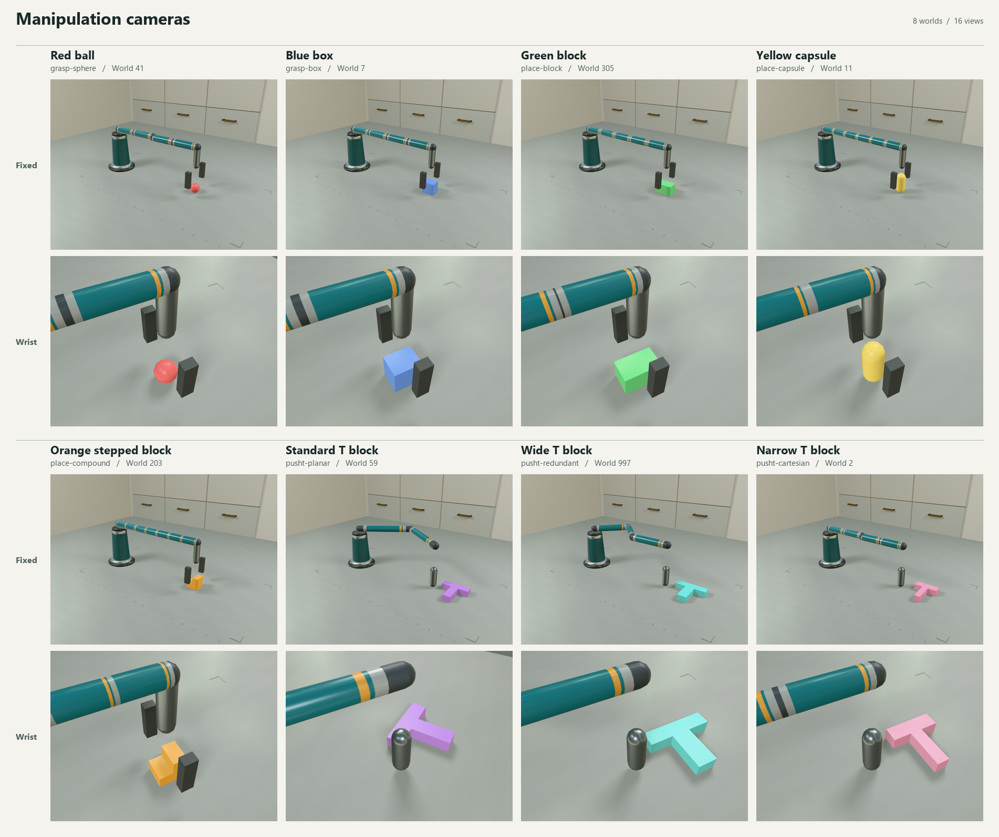

# 八个异构物理世界的十六路相机



八个场景共用一套工作室布光。每组上排看整体，下排看夹爪和工件。[八工位单镜头及分镜录像（30 秒）](studio/films/README.md) · [新旧布光同帧对照、原图与复现方法](studio/README.md)

在 NVIDIA GeForce RTX 4060 Laptop GPU 上，八个不同的 MuJoCo-TYX 模型同时推进。每个模型各有一台固定相机和一台安装在工具端的相机。**64 次实时曝光分别与同一模型单独运行的结果比较，RGB、深度、实例 ID 和有效掩码全部一致。** 从同一个物理端点交给 CPU 与直接交给 CUDA 的 256 对图像平面也逐字节一致。[实时验收记录](live-quality.json)

两套图都来自第 32 步的物理时刻（32 ms）。下文的像素与性能基准使用原始诊断灯光，单台相机为 320 × 240。实时 RQ4 从已提交的 CUDA 物理状态直接生成图像。R4 归档基准使用 221 个已保存的姿态，以及归档中的前、后相机。[原始诊断灯光十六格](heterogeneous-cameras.png) · [实时场景和镜头定义](../../../examples/_heterogeneous_camera_worlds.py) · [R4 归档说明](../../r4/README.md)

## 实时画质与重置

八个模型涵盖球、方块、胶囊、组合件及三种推 T 机构，物理配置和机械臂关节序列各有八种。每个执行器施加 0.025 的常值控制，物理步长 1 ms。程序在第 0、16、32 步和单世界重置后采集。独跑对照为每个模型重新初始化物理工作区和渲染会话，使用相同的初态、控制和相机。位置、速度、机体变换和物理时钟均参与核对。[场景清单与逐帧误差](live-quality.json)

RQ4 以光栅绘制主表面，硬件 ray query 计算方向光的阴影。RGB 采用 4× MSAA，在显示线性空间合成后编码为 sRGB，曝光为 1。深度、实例 ID 和有效掩码都在像素中心采样。八个世界各自建立一次顶层加速结构（TLAS），后续共更新 56 次，每次发布供两个机位使用。[渲染设置与设备计数](live-quality.json)

| 独跑对照 | 验收要求 | 64 次曝光实测 |
| --- | --- | --- |
| RGB | 每通道最大误差 ≤ 1 个 8 位码值 | 最大误差和平均绝对误差均为 0 |
| 前向深度 | 有效像素最大误差 ≤ 0.00002 m | 4,139,819 个有效像素最大误差 0 m，775,381 个背景像素均保留正无穷 |
| 实例 ID、有效掩码 | 每个像素完全相同 | 全部相同 |
| 物理状态与相机 | 机体与相机位置最大误差 ≤ 0.00004 m | 32 对物理状态的广义位置、速度及机体变换误差均为 0，相机位置误差为 0 m |

只重置世界 41 后，它从第 32 步回到第 0 步，重置代次由 0 变为 1，两台相机重新生成初始画面。另外七个世界仍在第 32 步，重置代次为 0，状态、机位及四通道图像保持逐位一致。Vulkan 验证错误与关闭后跟踪的活动资源、上下文和帧均为 0。[重置与清理记录](live-quality.json)

## 一批图像如何交付

每个物理端点打包八个世界的机体与相机位姿，再按世界发布。每个世界一次提交两台相机的请求。设备路径将八组结果合并，消费者在非默认 CUDA 流上按世界与请求顺序取得十六个带帧键和物理时间的结果。两条路径运行同一组 CUDA 归约，核对中央区域 RGB 分量和、可见像素、正无穷背景、实例 ID 和、有效深度和，以及传感器不一致计数。全部结果与独立 NumPy 计算相同。[采集和消费接口](../../../examples/_scale_camera_sensors.py)

下表仅统计八世界批量质量验收的四次采集，每条路径共 64 张图。原生附件每像素 13 B（RGBA8、float32、uint32、uint8），公开图像去掉 alpha 后每像素 12 B。

| 路径 | 实际传输 |
| --- | --- |
| CPU 批量读回后交给 CUDA 消费者 | GPU → 主机读回原生附件 63,897,600 B，再将公开图像从锁页缓冲上传 58,982,400 B |
| 直接交给 CUDA 消费者 | 32 次设备内复制共 63,897,600 B。图像主机上传和下载均为 0 B。32 个含传感器的世界批次共回读 32 B 校验状态 |
| 取证与数值对照 | 另行下载设备图像的公开平面 58,982,400 B 核对字节。机体位姿核验另读 26,496 B，两条路径返回的 GPU 特征合计 8,192 B |

两条交付路径的共享位姿矩阵合计在设备内复制 82,944 B，主机输入的实例变换为 0 B。[图像、位姿与校验字节明细](live-quality.json)

## 调用与复现

从仓库根目录使用已安装 Phymeo、渲染包、MuJoCo-TYX 与 CUDA PyTorch 的 Windows 环境。令 `$build` 指向包含 `phymeo_native.dll` 和配套 SPIR-V 的构建目录，输出目录须为空或尚未创建。本次质量验收开启 Vulkan 验证层，Release DLL 的 SHA-256 为 `d7f9221226fcc0cbef3725599e142c6cea009c4b4c48f810e088b64fb98848cb`。

```powershell
python rendering/examples/verify_heterogeneous_camera_scale.py --library "$build/phymeo_native.dll" --shader-directory "$build" --device 0 --device-index 0 --validation --shadow-mode ray_query --samples 4 --middle-step 16 --end-step 32 --output artifacts/heterogeneous-camera-quality
```

默认运行八个世界及八次独跑，写出 `report.json` 与 `heterogeneous-cameras.png`。使用 `--keys 41,7` 可先核对两个模型，`--asset-dir` 可复用由同一组原生几何生成的网格。[验收程序](../../../examples/verify_heterogeneous_camera_scale.py)

## 实时物理到 Torch 的整批性能

同一张 RTX 4060 Laptop、8 世界 × 2 机位、每机位 320 × 240，四组均开启 4× MSAA 与硬件光追阴影。每组在独立进程先热身 3 步，再真实推进 300 步，每步消费完十六路图像才停表。第 150 批前仅重置世界 41。CPU 路径与直达路径都从同一个 GPU 位姿入口拍摄；差别在于图像经过主机锁页缓冲重新上传，还是直接交给 CUDA。四组各 300 批的物理时钟与消费者特征逐批一致。[双序比较与计数](live-timing.json)

| 执行顺序 | 交付方式 | 位姿已打包 → 消费完成 p50 / p95（ms） | 物理步开始 → 消费完成 p50 / p95（ms） | 全链路相机图像/秒 | 进程专用显存采样峰值（MiB） |
| --- | --- | ---: | ---: | ---: | ---: |
| 正序 1 | 主机读回再上传 | 35.12 / 49.97 | 95.52 / 124.76 | 159.90 | 593.55 |
| 正序 2 | GPU 直达 | 28.48 / 43.49 | 90.83 / 125.01 | 166.17 | 640.21 |
| 反序 1 | GPU 直达 | 25.91 / 35.60 | 84.24 / 105.41 | 184.02 | 647.96 |
| 反序 2 | 主机读回再上传 | 32.62 / 41.16 | 90.06 / 109.24 | 172.28 | 593.55 |

直接交付每批省去 15,974,400 B 图像下载与 14,745,600 B 上传。每批仍有 15,974,400 B 附件在设备内复制，以及 8 B 图像状态回读。每轮 4,800 张图的原生 Vulkan 分配中，各会话设备本地峰值之和为主机路径 93.07 MiB、直接路径 108.30 MiB，主机可见峰值之和分别为 15.24 和 1.04 MiB。这些分配数与同进程的 WDDM 采样峰值覆盖范围有重叠。帧率分子是相机图像张数，除以 16 得到每秒完成整批数。重置操作和 1,024 B/批特征取证回读在单批计时窗外；跨整轮的物理计数包含重置。[四组计时原始记录](evidence.zip)

**整条实时链路的 p95 提速尚未证实。** 图像直接交付后，已打包端点的 p95 分别减少 6.48 和 5.56 ms，同配置基线自身的两轮差为 8.81 ms。完整物理链路的 p95 正序增加 0.24 ms，反序减少 3.83 ms，基线相差 15.52 ms。按计划事先约定的判据，两组比较均未达到提速门槛。GPU 直达路径的端到端平均吞吐为 10.39 和 11.50 批/秒。[预定性能判据](../../../plans/2026-11-24-physics-vulkan-device-interop.md)

下一步优先缩短求解器端点发布。真实步进调用的中位耗时为 45.70–49.19 ms，观察刷新和位姿打包为 11.66–12.86 ms。物理求解器累计平均每批下载约 620 kB，观察工作区另有 160 B 状态回读，共享位姿打包另读 1 B 状态与 384 B 相机元数据。可先合并各物理模型桶的状态回读，所有桶通过后才提交，并用当前的故障回滚、独跑一致性和双序 p95 检查收益。[求解器下载](../../../../src/phymeo/backends/_mujoco_tyx_runtime.py) · [物理观察发布](../../../../src/phymeo/backends/mujoco_heterogeneous_io.py) · [计时程序](../../../examples/benchmark_live_camera_scale.py)


## R4 归档回放的四档对照

复用原八个模型、相机内外参、RGB、前向深度、实例 ID 和有效掩码。原 R4 证据包保有逐视图哈希，本次重新运行 CUDA 诊断控制器 2,200 步，取得 221 个已接受端点。新的轨迹和清单文件 SHA 与旧记录不同。八份模型 XML 与全部可视网格的 SHA 均与原文件相同，十六个镜头的矩阵误差为 0。新的每世界独跑和四条采集路径逐像素相符，600 + 1,200 + 4,800 个视图的四通道哈希也全部与旧日志相同。八世界组共同有效深度像素 336,516,000 个，最大误差 0 m。诊断控制器的八个操作任务成功标记均为 false，此处验收相机状态、隔离与交付。[本次固定回放输入](replay-input.zip) · [原 R4 记录](../../r4/gpu-cameras.zip)

以下为正序 / 反序的整批 **p95 毫秒**。每档 3 批预热、300 批计时；每批结束于 GPU 上相同的 Torch 运算完成。前、后固定机位沿用 R4 单采样光栅和软件阴影。八世界回放包括 1,983,232 B 一次性矩阵上传，计时从预装的归档输入开始。[全部 p50、p95、吞吐和跨轮核验](replay-comparison.json)

| 世界 × 相机 | 主机位姿逐拍、回读上传 | 共享位姿逐拍、回读上传 | 共享位姿批拍、回读上传 | 共享位姿批拍、GPU 直达 |
| --- | ---: | ---: | ---: | ---: |
| 1 × 2 | 5.42 / 4.31 | 5.07 / 4.04 | 4.06 / 4.01 | 3.54 / 3.32 |
| 2 × 2 | 9.03 / 8.45 | 8.03 / 9.62 | 8.35 / 8.64 | 6.27 / 6.92 |
| 8 × 2 | 36.25 / 39.85 | 32.18 / 33.05 | 33.15 / 36.50 | **28.16 / 25.71** |

归档八世界端到端 p95 两轮分别改善 8.10、14.15 ms，超过基线两轮的 3.60 ms 差异。GPU 直达的平均吞吐为 686、704 张相机图像/秒，约 43、44 个十六视图批次/秒。仅启用批拍时，主机版一批仍要下载并上传全部传感器图像。原逐拍、共享位姿逐拍、共享批拍、直接到 GPU 四档的每批提交数分别为 16、32、24、24，CPU fence 等待次数相同。这些数字包括共享槽所有权的移交。[逐阶段原始计数和计时](evidence.zip)

八世界三个代表端点另做原生资源测量。原逐拍、共享位姿逐拍、共享批拍、GPU 直达，四档的 Vulkan 设备本地峰值之和分别为 11.70、11.71、22.33、37.57 MiB，主机可见峰值之和为 7.64、7.62、15.24、1.04 MiB。设备直达使用显卡本地附件保留可供 CUDA 读取的图像，显著缩小了主机可见的缓冲。每档 3 个端点共采集 48 个 Vulkan 时间戳样本；完整时间、字节与各会话的峰值在证据包的 `archive-resources/report.json`。[资源证据包](evidence.zip)

### 复现性能与像素对照

将 [固定输入](replay-input.zip) 解压到空目录，令 `$inputRoot` 指向其中的 `replay-source` 子目录。各次运行使用新的输出目录。归档质量采集另行读回完整像素、计时只读回核验用的缩减特征。独立资源测量取第 0、150、299 批，记录各档建场开销、原生分配、Vulkan 时间戳和 CUDA 消费事件。留存的四次实时计时报告包含每批样本、物理时钟和传感器特征摘要。[复现实验入口](../../../examples/verify_archived_camera_scale.py)

```powershell
$live = 'rendering/examples/benchmark_live_camera_scale.py'
foreach ($name in 'cpu-fwd','device-fwd','device-rev','cpu-rev') {
    $route = if ($name.StartsWith('cpu')) { 'cpu_upload' } else { 'direct_cuda' }
    python $live --route $route --library "$build/phymeo_native.dll" --shader-directory "$build" --output "artifacts/$name"
    if ($LASTEXITCODE) { throw "live measurement failed for $name" }
}
python $live --compare artifacts/cpu-fwd/report.json artifacts/device-fwd/report.json artifacts/device-rev/report.json artifacts/cpu-rev/report.json --output artifacts/live-comparison.json
$replay = 'rendering/examples/verify_archived_camera_scale.py'
python $replay --source "$inputRoot" --library "$build/phymeo_native.dll" --shaders "$build" --phase quality --validation --output artifacts/replay-quality
python $replay --source "$inputRoot" --library "$build/phymeo_native.dll" --shaders "$build" --phase timing --order both --output artifacts/replay-timing
python $replay --source "$inputRoot" --library "$build/phymeo_native.dll" --shaders "$build" --phase resources --output artifacts/replay-resources
python $replay --compare-reports artifacts/replay-quality artifacts/replay-timing --output artifacts/replay-comparison
```
