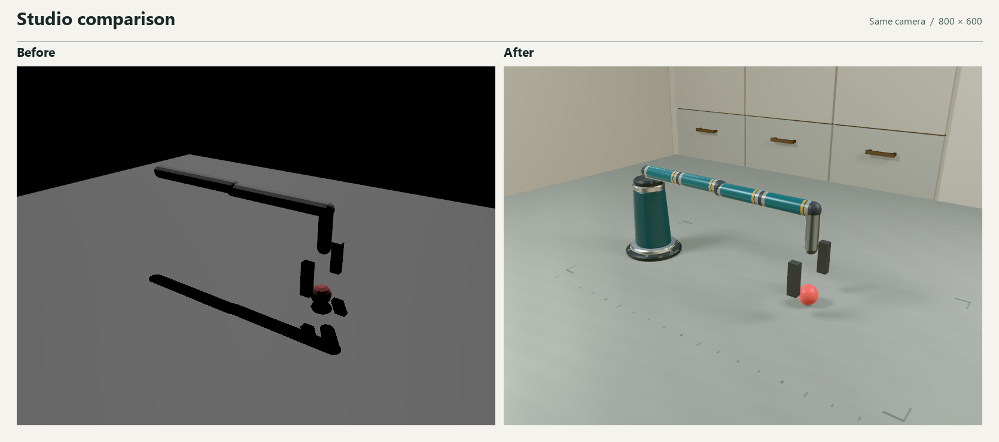
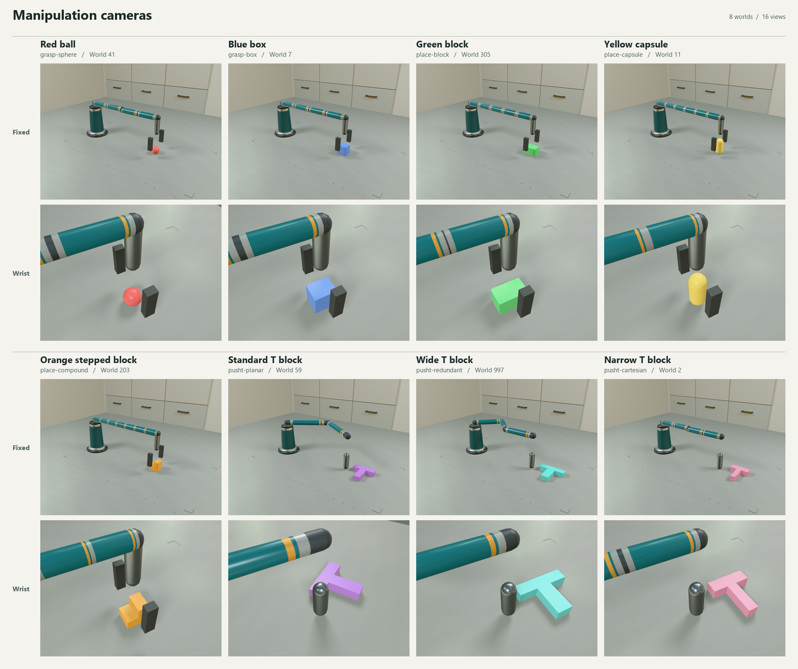

# 八世界机械臂摄影棚

**30 秒录像**　[一个镜头看八个工位](films/overview.mp4) · [八台独立相机同步播放](films/multiview.mp4) · [逐工位视频与说明](films/README.md)



左右两张图使用同一份第 32 步物理状态和同一台固定相机，均以 800 × 600 原生分辨率绘制。左侧复现原示例的单方向光。右侧是浅色工作室，有带定位刻度的工作台、安装底座和后墙储物柜。腕部相机提供近景，可以检查工件颜色、指垫轮廓和落在台面上的阴影。

两块矩形面积灯照亮操作区。车间 HDR 全景给机械臂背光面补光，也提供金属反射。蓝绿色漆面、合金套环和夹爪垫有各自的粗糙度，工件沿用物理模型的原色。底座、墙面和柜门是仅供渲染的静态布景，参与深度和实例 ID 输出。原有物体沿用相同的三角形、物理绑定和实例 ID。摄影版使用 4× MSAA、硬件光追阴影、每块面积灯 8 × 8 采样和 PBR Neutral 色调映射。[工作室预设](../../../../examples/_manipulation_photo_studio.py) · [HDR 来源与许可](../../../../examples/materials/NOTICE.md)



[固定机位原图](studio-fixed.png) · [腕部机位原图](studio-wrist.png) · [逐视图记录](capture.json)

RTX 4060 Laptop GPU 实拍的 16 个镜头均通过 Vulkan 验证层检查。以红球固定机位为例，RGB 三通道均不超过 8/255 的像素从 34.99% 降至 0%，机械臂表面对应像素的亮度中位数从 0 升至 93/255。在两种布光中，16 个镜头都逐像素比较了实例 ID 相同的机械臂和工件，其对应表面深度最大差为 0 m。另行比较原始布光下两种位姿传输路径，最大深度差为 0.087 mm。这里验证静帧外观，摄影版的动态帧率仍待测量。

## 复现

在仓库根目录使用前一批实测的 MuJoCo-TYX、CUDA PyTorch 和原生 Vulkan 环境。`$build` 为包含 DLL 和配套 SPIR-V 的目录。

```powershell
python rendering/examples/render_manipulation_studio.py --library "$build/phymeo_native.dll" --validation --output artifacts/rig-studio
```

程序实际推进 32 个 1 ms 步长。先用 CUDA 共享缓冲绘制诊断版，并取得固定相机和腕部相机的实际位置和朝向。拍对照图时，从同一快照一次读回整批刚体变换，两种布光都通过同一路径把变换交给 Vulkan，以相同镜头绘制。图像保存为 PNG；记录同时给出原始共享路径与同布光摄影路径的深度差。`--area-grid 2` 可在摄影棚使用实时共享缓冲路径，每灯采四点。`--keys 41` 只拍球形工件场景，默认拍全部八个世界。原来的 320 × 240 性能数据适用于[诊断布光](../README.md)。
