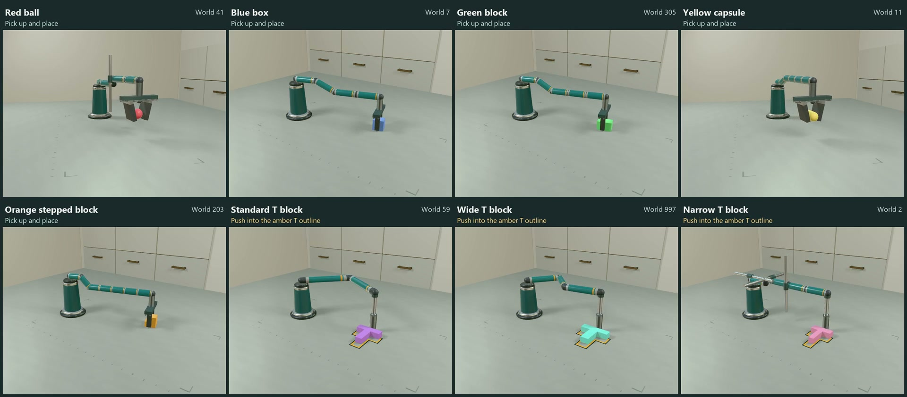
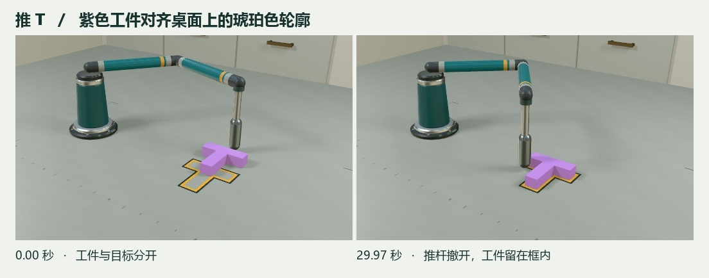
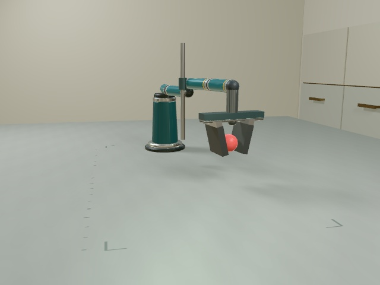

# 八工位接触操作录像

先看[八路同步近景](multiview.mp4)。前五格观察夹爪合拢、工件离开台面、移位和松爪。后三格观察推头接触 T 形件横边，把工件推向台面的琥珀色 T 形轮廓。轮廓内缘对应工件在目标位姿下的外边界。

[单镜头总览](overview.mp4) 展示两排四个工位。同步近景与总览共用逐帧时间戳，暂停在同一时刻即可对照。近景上排对应总览前排，下排对应后排，均从左往右排列。

| 工位 | 独立近景 | 观察动作 |
| --- | --- | --- |
| 前排一 · 41 | [红球](cameras/41-grasp-sphere.mp4) | 双指夹起球，移到放置点再松开 |
| 前排二 · 7 | [蓝色方盒](cameras/7-grasp-box.mp4) | 夹住相对的两个侧面，提起后放下 |
| 前排三 · 305 | [绿色长方块](cameras/305-place-block.mp4) | 长边随夹爪转移，落回台面 |
| 前排四 · 11 | [黄色胶囊](cameras/11-place-capsule.mp4) | 夹住曲面，运送后张开双指 |
| 后排一 · 203 | [橙色阶梯块](cameras/203-place-compound.mp4) | 留意上下两层随同一工件移动 |
| 后排二 · 59 | [紫色标准 T 形件](cameras/59-pusht-planar.mp4) | 推动横边，对齐琥珀色轮廓 |
| 后排三 · 997 | [青色宽 T 形件](cameras/997-pusht-redundant.mp4) | 对照较宽的两翼，观察工件接近目标边界 |
| 后排四 · 2 | [粉色窄 T 形件](cameras/2-pusht-cartesian.mp4) | 观察直线滑台如何带动推头，将窄柄推入轮廓 |

接触力、持物移动距离和 T 形件最终位置的测量值保存在[录制记录](recording.json)。[原版八工位动作录像](../films/README.md)保留了同一组机器人的早期动作，可并排观看。

## 抓取与对齐实测

工件开拍前放在张开指垫可达的桌面位置。红球和横卧胶囊使用内倾 13° 的加宽软指垫，圆件与台面接触启用原材质定义的滚动阻力。指垫的可见模型与碰撞模型共用同一套几何。八组演示由电机控制，工件在计时开始后始终保持自由刚体。红球和胶囊各抓放一次，另三个夹爪工位各抓放三次。

| 工件 | 双指承载时，工件底部离台最大高度 | 同一次连续抬升中带载横移的最大距离 |
| --- | ---: | ---: |
| 红球 | 9.05 cm | 9.36 cm |
| 蓝色方盒 | 7.07 cm | 14.51 cm |
| 绿色长方块 | 6.99 cm | 14.65 cm |
| 黄色胶囊 | 8.76 cm | 8.34 cm |
| 橙色阶梯件 | 7.35 cm | 14.63 cm |

三组推 T 都从目标外 8 cm 起步，目标位置和朝向在开拍前固定。标准 T 和宽 T 的推头在主推后绕到柄侧，修正横向偏差，再退开。最后一列是推头完全卸载、工件由桌面持续承重直到片尾的时长。

| 工件 | 最终投影重合度（交并比） | 中心误差 | 撤杆后持续时长 |
| --- | ---: | ---: | ---: |
| 标准 T | 96.82% | 0.20 mm | 9.80 s |
| 宽 T | 96.13% | 0.19 mm | 9.64 s |
| 窄 T | 98.58% | 0.28 mm | 17.93 s |

每组物理由 CPU MuJoCo 以 1 ms 步长推进，逐步读取实际接触力。自研 Vulkan 读取同一份曝光时刻和姿态来拍摄总览及独立机位。总览中球与胶囊的工作台转向相机，便于从指缝看到工件。两种视角均保留摄影棚面积灯、硬件光追阴影及 4× MSAA。
