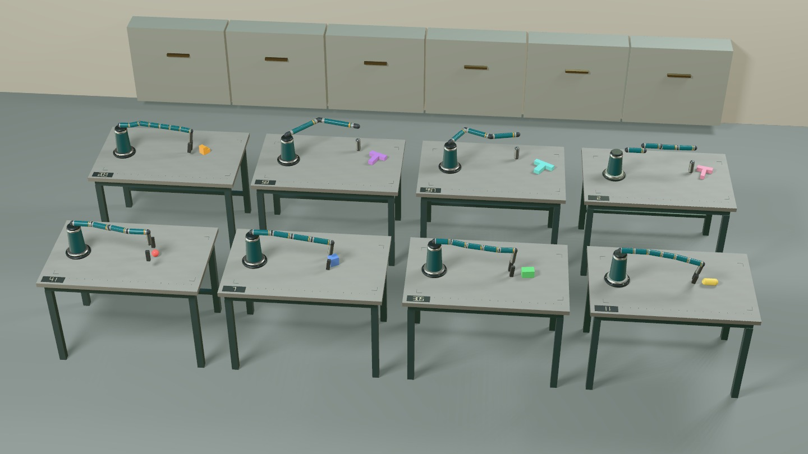
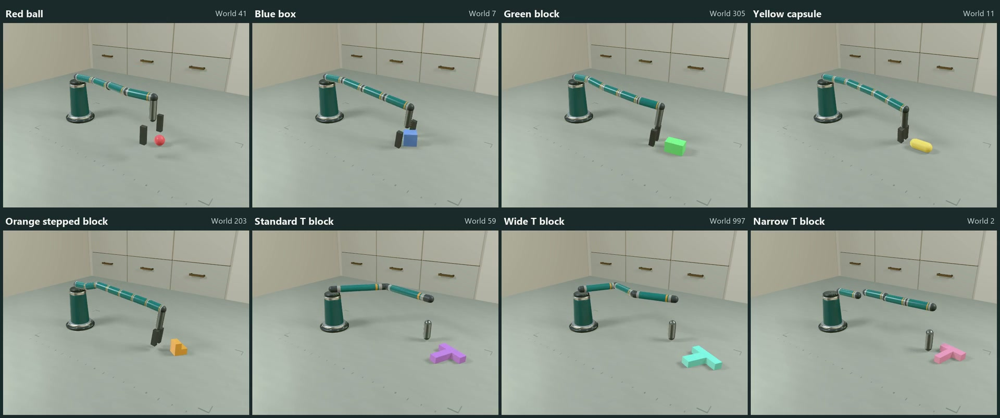

# 八个机械臂工位同期录像

[播放总览](overview.mp4) · [播放八个独立机位的同步拼版](multiview.mp4)



总览用一台固定相机拍摄两排四个工位。八张工作台、机器人、工件和后墙储物柜都在同一个 Vulkan 场景中，共用透视、深度和灯光。每组机器人与工件作为整体做平移，彼此仍是独立的物理世界。分镜使用八台固定相机，分别在原工作室布景中拍摄操作区。两种画面读取同一份带时间戳的运动记录，对齐到同一视频帧即可比较。

| 总览中的位置（从左至右） | 独立机位原片 |
| --- | --- |
| 前排一 | [红球与夹爪](cameras/41-grasp-sphere.mp4) |
| 前排二 | [蓝色方盒](cameras/7-grasp-box.mp4) |
| 前排三 | [绿色方块](cameras/305-place-block.mp4) |
| 前排四 | [黄色胶囊](cameras/11-place-capsule.mp4) |
| 后排一 | [橙色阶梯件](cameras/203-place-compound.mp4) |
| 后排二 | [标准 T 形件](cameras/59-pusht-planar.mp4) |
| 后排三 | [宽 T 形件](cameras/997-pusht-redundant.mp4) |
| 后排四 | [窄 T 形件](cameras/2-pusht-cartesian.mp4) |



## 运动与录制

八个原始 MJCF 模型由 Phymeo 编译，通过 CPU MuJoCo 各自连续推进 30,000 个 1 ms 步长。关节电机驱动伸臂、开合和推扫，工件保留自由刚体与接触。红球工位在球上方做预抓演示。视频用于观察动作、镜头与光照，任务成功率另行评估。

成片采用 Phymeo 自研 Vulkan 渲染器、4× MSAA、硬件光追阴影和每盏面积灯 64 点采样。总览为 1440 × 810，每台独立相机为 640 × 480。所有机位按共同的 30 fps 播放时钟取样到最近的 1 ms 物理步。第 900 帧覆盖到片尾 30 秒，归档另存精确 30 秒的物理终态。[逐片解码和源运动记录](recording.json)

在 RTX 4060 Laptop GPU 上，各相机均完成 900 帧光追阴影绘制，Vulkan 验证层记录 0 个错误。FFmpeg 对十条 H.264 成片逐帧解码，均得到 900 帧、30 fps、30 秒，八格拼版为 1920 × 804。五个抽查时刻，八个工件都能在总览和各自的固定机位中以实例 ID 识别。

## 复现

从仓库根目录运行下面的命令。`$build` 指向原生 Vulkan DLL 与配套 SPIR-V 文件，`$gpu` 是支持 Vulkan ray query 的设备索引。环境需要 Phymeo 的 MuJoCo 与渲染依赖，以及 PATH 中可用的 FFmpeg 和 FFprobe。

```powershell
python rendering/examples/record_eight_studio.py --library "$build/phymeo_native.dll" --device-index $gpu --motion artifacts/workcell-motion --output artifacts/workcell-films
```

默认生成一条总览、一条带工位名称的同步拼版及八条单独视频。首次运行保存 `motion.npz` 和 `motion.json`，随后指定同一运动目录和新的输出目录即可换镜头重拍。`--preview` 先检查五个时刻的构图、工件可见性和实例 ID。
