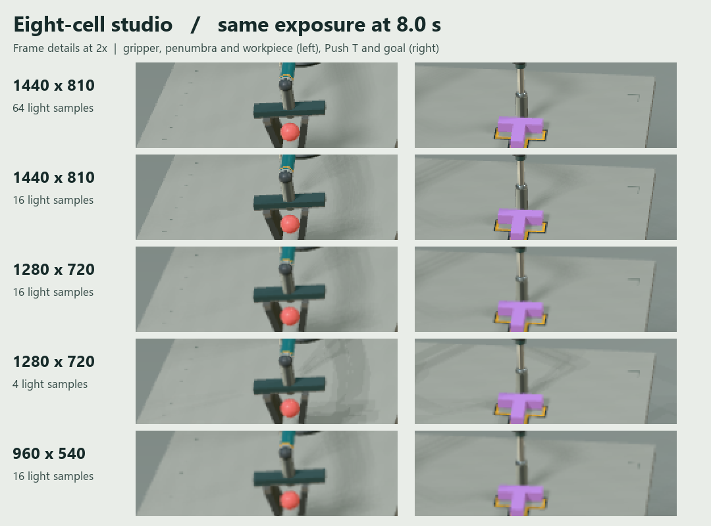

# 八工位交互预览

窗口打开后从一个镜头看八张工作台。按 **1–8** 切到对应工位，**0** 回到总览，**空格** 暂停或继续，**Esc** 关闭。也可以用左上角菜单选镜头。在第 8 秒暂停后按 **1**，可看到红球悬在两指之间；按 **6**，可从近处看紫色 T 件与桌面上的目标线。

## 启动

从仓库根目录，在装有 Phymeo、MuJoCo、NumPy、Pillow 和 Tk 的 Python 环境中运行。将原生渲染库和与它同一构建的 SPIR-V 放在一起，选择支持 ray query 的设备。下面的构建路径和设备索引对应本次 Windows 测试。

```powershell
python rendering/examples/view_eight_studio.py --library artifacts/physics-vulkan-interop/p1-raster-20261124/build/phymeo_native.dll --device-index 1
```

默认从初态现场模拟八个工位。MuJoCo 在 CPU 上以 1 ms 步长推进，控制器每 4 ms 更新。到 30 秒时停在终态，仍可切换镜头。也可传入 `--motion <含有 motion.json 和 motion.npz 的目录>` 查看已录轨迹。状态栏分别显示现场或回放、当前物理时刻、显示 FPS 和模拟时间倍率。[窗口入口](../../../../../examples/view_eight_studio.py) · [物理状态与活动相机](../../../../../examples/_eight_studio_view.py)

## 画质与开销

默认总览为 **1440×810，每盏矩形灯 4×4 采样，4× MSAA，保留硬件光追软阴影、HDR 环境和原有材质**。近景为 640×480。下表在 RTX 4060 Laptop GPU 上复用同一份已核验轨迹，单独计总览从组装位姿到可读 RGB 的耗时。每档正反顺序各一轮，每轮热身 7 帧、实测 45 帧；窗口、物理步进和编码在这个计时范围之外。

| 总览设置 | 每灯采样 | 平均渲染 FPS | 帧耗时 P95 |
| --- | ---: | ---: | ---: |
| 1440×810，录像参考 | 64 | 15.8 | 69.4 ms |
| **1440×810，默认窗口** | **16** | **40.9** | **27.8 ms** |
| 1280×720 | 16 | 48.5 | 24.3 ms |
| 1280×720 | 4 | 75.5 | 15.4 ms |
| 960×540 | 16 | 68.7 | 22.0 ms |

保留原分辨率时，16 采样与 64 采样在六个对应画面上比较。按参考图实例 ID 选出工件像素和目标线像素，先计算每个像素三通道的平均绝对色差，再分别取各区域的 P95；两类区域在六帧中的最大 P95 都为 **1/255**。桌面区域对应值约 **1.67/255**。较暗的半影仍能看到轻微采样差异。若降到 720p 并放回相同显示尺寸，细目标线因为重新落到不同像素上，这个局部色差明显变大。灯采样减至 4 时还会出现可见的阴影分层。[逐帧数据与比较口径](quality-timing.json)



## 实窗验证

窗口每次只请求选中的镜头。工作线程准备下一帧时，界面线程可以显示上一帧；队列至多有一个在途请求。所有工位的物理时间同步推进。实测默认总览从 0 到 30 秒，包含首尾共显示 **901 帧**，墙钟用时 **30.12 秒**，平均 **29.88 FPS**；显示间隔 P50 为 **33.27 ms**，P95 为 **39.59 ms**。这一次另外八个镜头的捕获次数全为零，八个模型的终态机体位姿均与原录像归档一致。FPS 以 Tk 完成画布更新的时刻计算，原生设备提交、CPU 读回和窗口呈现均在这条路径中。[完整窗口记录](full-window.json)

在同一次暂停中依次切换了八个独立镜头，再返回总览，曝光保持在同一个物理时刻。恢复后标准 T 近景短测约 **30 FPS**。单镜头按需打开 Vulkan 场景，第一次切入某个镜头会包含初始化。若某台设备的总览持续慢，可先加 `--wide-size 1280x720`；离线精看阴影可加 `--area-grid 8`。录像导出继续使用原来的 64 采样预设。
