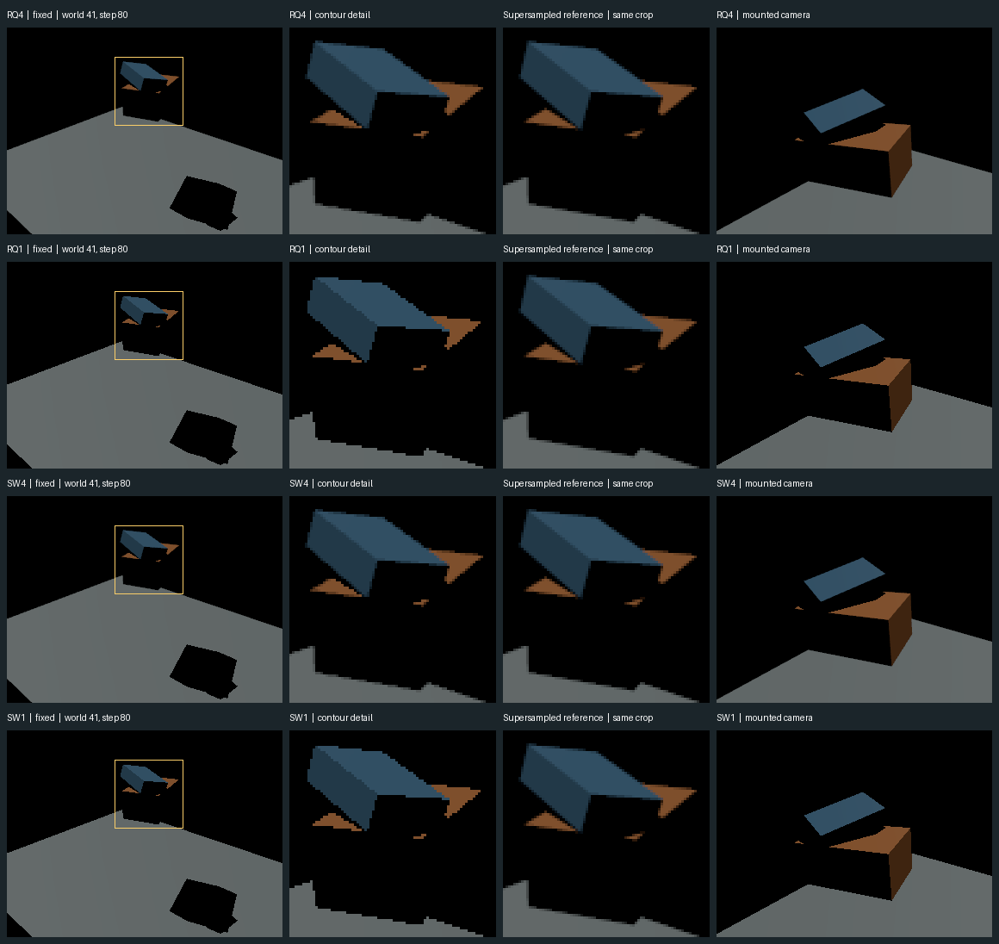
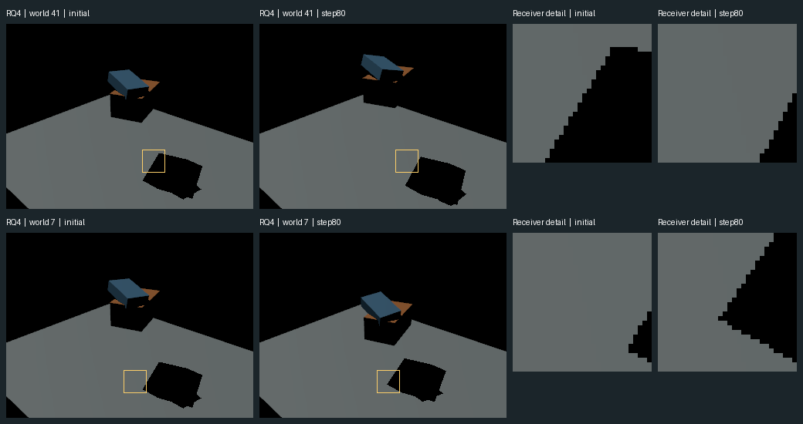

# 随动相机、抗锯齿与光追阴影实测

在一张 RTX 4060 Laptop GPU 上，两个 MuJoCo-TYX 世界施加方向相反的控制，各推进 80 个 1 ms 步。每个世界有三个绘制实例、一台固定相机和一台安装在移动云台上的相机。四种模式均从同一已提交物理端点生成视图。全部使用光栅绘制主表面，硬件 ray query 用于直接光的阴影可见性查询。本案例使用方向光，可分别观察物体轮廓和移动硬阴影。[验证记录](validation.json)



同一行的第二、第三列可直接比较。RQ 表示硬件阴影查询，SW 表示在 GPU 着色器中遍历网格求阴影。数字表示 RGB 采样数。4× 模式在显示线性空间合成颜色，深度、实例标识和有效区域继续取像素中心。轮廓参考以四倍宽高单采样渲染，在线性空间平均每组 16 个子像素。287 个包含不同实例的运动轮廓像素由高分辨率实例图选定。

## 整批耗时与画质

每批 2 个世界 × 2 个机位，320×240，每个机位返回 RGB、深度、实例标识和有效区域。正式计时关闭 Vulkan 验证层，预热 3 批后各测 300 批，轮换配置和主机／共享路线的执行顺序。起点是已生成的第 80 步设备快照，终点是四组 CPU 图像可读。计时包含视图构造、姿态交付、绘制和图像读回。物理步、快照生成、参考图、文件编码均在计时窗口外。[全部样本和分项耗时](timing.json)

| 阴影 | RGB 采样 | 共享路径中位数 | 共享路径 p95 | 主机位姿基线中位数 / p95 | 轮廓线性平均绝对误差 |
| --- | ---: | ---: | ---: | ---: | ---: |
| 着色器遍历 | 1× | 7.50 ms | 10.65 ms | 4.15 / 6.11 ms | 0.01613 |
| 着色器遍历 | 4× | 7.94 ms | 10.98 ms | 4.41 / 6.10 ms | 0.00432 |
| 硬件 ray query | 1× | 7.65 ms | 10.62 ms | 4.35 / 6.00 ms | 0.01613 |
| 硬件 ray query | 4× | 8.03 ms | 11.11 ms | 4.55 / 6.59 ms | 0.00432 |

这个场景优先选 4×。两种阴影方式的轮廓误差相同，4× 相对各自 1× 降低约 73%。在硬件光追阴影与 4× MSAA 模式下，两世界打包、发布及取得 GPU 所有权的中位数为 2.84 ms，解析两台随动相机的公开元数据 0.60 ms，四次绘制并返回 CPU 图像 4.12 ms，归还所有权 0.30 ms。各阶段独立取中位数。单个世界每步打包一次，相机复用实例矩阵；每台相机仍单独提交和等待。八世界、生产分辨率、室内间接光和训练消费者均需各自实测。

## 状态与光影是否一致

- 开启 Vulkan 验证层的独立运行覆盖 64 对共享／主机曝光。主机对照由 CPU MuJoCo 独立计算云台相机的世界位置与方向。四种配置的实例标识、有效区域、中心深度哈希互相相同。共享与主机路径间的最大深度差为 4.77×10⁻⁷ m，RGB 单通道最大相差 1 个 8 位色阶。
- 光追模式使用 Vulkan compute 将共享缓冲的实例矩阵转换成 GPU 加速结构记录。一次发布建立或更新一次 TLAS，供同世界的两台相机共用。300 批测量连同预热和品质校验，RQ4 共 614 次发布、1 次构建和 613 次更新，服务 1,228 次 RGB 曝光，动态 TLAS 实例记录的主机上传为 0 B。
- 云台的逆矩阵和位置由 Vulkan 从共享缓冲复制到相机常量，每次随动拍摄 76 B 设备内复制。CPU 版公开 Camera 元数据按每台随动相机、每次发布读回 48 B，打包有效性状态每次读回 1 B。四台相机每批交付 CPU 的四通道有效载荷共 3,686,400 B。
- 单世界重置后，另一个世界的两个机位仍输出相同图像。物理候选被否决时保持已提交状态。在真实 CUDA 观察计算后、提交观察前注入故障，所有模式均拒绝新曝光；同一物理版本成功刷新后，恢复的位姿逐位一致。过期曝光和伪造的随动外参均被拒绝。验证运行关闭后，原生资源、帧、上下文和验证错误计数均为 0。



## 复现

实现提交 `79e1f12c`。本机 Release DLL 的 SHA-256 为 `bc6907cf9d906cd12970eff6d81a081fe7f2b2b97e7a797afec5825906f20bbb`。将 `$build` 指向包含该版本 DLL 与 SPIR-V 的构建目录，在安装了项目物理和渲染依赖的 Windows 环境中，从仓库根目录运行。两个输出目录应各自为空或尚未创建。[验收程序](../../../examples/verify_mounted_camera_quality.py)

```powershell
python rendering/examples/verify_mounted_camera_quality.py --library "$build/phymeo_native.dll" --shader-directory "$build" --device-index 0 --device 0 --validation --warmup 3 --repeats 32 --output artifacts/mounted-validation
python rendering/examples/verify_mounted_camera_quality.py --library "$build/phymeo_native.dll" --shader-directory "$build" --device-index 0 --device 0 --modes RQ4,RQ1,SW4,SW1 --warmup 3 --repeats 300 --output artifacts/mounted-timing
```
