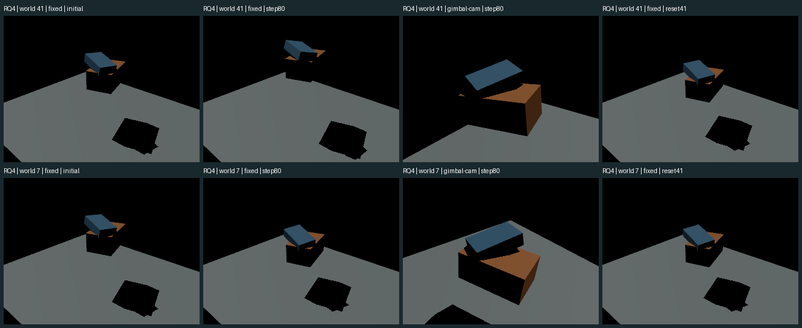

# 多世界打包与多机位批拍

同一张 RTX 4060 Laptop GPU 上，两个运动世界各有固定与随动相机。每个已接受物理快照只做一次跨世界位姿打包，每个世界的两台相机共用一次 Vulkan 图形提交和一次 fence 等待。硬件光追阴影配合 4× MSAA 时，两次独立测量的整批中位耗时从 7.14、7.02 ms 降到 5.49、5.38 ms。64 组曝光中，批拍与逐拍的四个通道逐字节相同。[验证记录](validation.json)



## 时间与内存

每批四张 320×240 图像。起点是已生成的 MuJoCo-TYX 设备快照，终点是 CPU 收到有独立所有权的 RGB、深度、实例 ID 和有效掩码。逐拍与批拍均用共享 GPU 位姿，两条路线各有独立渲染会话。两轮均关闭 Vulkan 验证层，每种配置、每条路线预热 5 批、测量 300 批。轮内交替路线、轮换配置，第二轮倒置初始顺序。计时不含物理步、快照生成和证据文件写入。[正序逐批数据](timing-forward.json) · [反序逐批数据](timing-reverse.json)

| 阴影 / RGB 采样 | 逐拍中位数，正 / 反 | 批拍中位数，正 / 反 | 逐拍 p95，正 / 反 | 批拍 p95，正 / 反 |
| --- | ---: | ---: | ---: | ---: |
| 软件遍历 / 1× | 6.91 / 6.71 ms | 5.23 / 5.12 ms | 8.35 / 7.80 ms | 6.20 / 6.10 ms |
| 软件遍历 / 4× MSAA | 7.04 / 7.01 ms | 5.43 / 5.37 ms | 8.63 / 8.06 ms | 6.60 / 6.32 ms |
| 硬件光追 / 1× | 6.92 / 6.81 ms | 5.26 / 5.19 ms | 8.31 / 8.06 ms | 6.18 / 6.12 ms |
| 硬件光追 / 4× MSAA | 7.14 / 7.02 ms | 5.49 / 5.38 ms | 8.48 / 8.09 ms | 6.48 / 6.27 ms |

硬件光追配合 4× 时，正序计时的四次绘制与附件复制的 Vulkan 时间戳合计平均为 0.72 ms（逐拍）和 0.71 ms（批拍）。主要改善在姿态打包、生成公开相机元数据和提交等待。四张图原有四次绘制提交与等待降至两次。把两个世界的 CUDA/Vulkan 所有权交接也计入，则总提交和等待均从八次降至六次。光追的 TLAS 每次世界发布更新一次。

同时在途的机位各有一套附件、相机常量和读回空间。反序运行中，RQ4 单会话记录的 Vulkan 设备本地分配峰值从 6,003,072 B 增至 12,335,488 B（约 5.72 → 11.76 MiB，含测试中的变分辨率）。两机位映射读回容量从 998,400 B 增至 1,996,800 B。两世界每批仍向 CPU 交付 3,686,400 B 有效图像数据，含原生颜色附件的 alpha 则为 3,993,600 B。这些数字不含物理引擎、Torch 和其他进程的内存。

## 画质与失败行为

- 三个运动时刻及一次单世界重置，共 64 组固定／随动曝光。批拍的四类通道均与逐拍相同，256 个通道哈希也与上一批实测归档完全一致。因此可以沿用同一帧的超采样参照：4× MSAA 的轮廓平均绝对误差为 0.00432，1× 为 0.01613。主表面使用光栅，ray query 计算直接光阴影。[原始轮廓参照与放大图](../mounted-quality/README.md)
- 同一批可混用尺寸和通道。随动机位的 157×101 有效掩码与实例 ID，以及固定机位的 237×165 深度与 RGB，都与逐拍结果完全一致。附加机位共用首个机位的 fence。
- 批内最后一台相机的外参错误时，公开接口拒绝整个世界的相机批次，绘制提交增量为零。同一曝光修正请求即可重试。世界 41 重置后，世界 7 仍对应它自己的物理端点。开启 Vulkan 验证层的独立运行结束时，跟踪的活动资源数和验证错误数均为零。
- 实际 CUDA 打包另覆盖两种不同身体数、不同视觉实例数、重排世界顺序、相机为空、重复世界以及末世界的镜像变换。对同一个含两台挂载相机的快照，将 1 B 有效性和两份 48 B 公开相机元数据合并为一次读回。相机绘制使用的视图矩阵仍通过设备缓冲提供。

## 接口与边界

对同一物理工作区的一组 `DeviceVisualBinding` 建立 `DeviceVisualBatchBinding`。每个快照调用一次 `pack(snapshot, producer_stream=stream)`。用 `session.publish_packed_device_poses(packed, workspace, world_key)` 取得该世界的曝光，再用 `session.capture_device_poses_batch(exposure, requests)` 按输入顺序获取已完成的一组图像。单个世界一次支持 1–16 个机位，总像素上限为 4096²。[可运行用例](../../../examples/verify_shared_camera_batch.py)

当前每世界提交一次，调用返回时 CPU 图像已就绪。跨世界可等待的整批结果、GPU 图像直接交付 Torch、八个异构世界十六机位的规模验收仍列在后续计划。此次速度改善相对上一种共享位姿逐拍路径；主机位姿路径本轮未计时。[互通计划](../../../plans/2026-11-24-physics-vulkan-device-interop.md)

## 复现

实现提交 `4bc60ec6`。本机 Release DLL 的 SHA-256 为 `7f830a55b1d67682f174309c31c9c84df4010aa5db89551f468782480a1d8b43`。`$build` 指向同一版本 DLL 与 SPIR-V 的目录，输出目录须为空。CUDA 与 Vulkan 适配器需匹配同一设备 UUID。

```powershell
python rendering/examples/verify_shared_camera_batch.py --library "$build/phymeo_native.dll" --shader-directory "$build" --device 0 --device-index 0 --require-archive-identity --validation --warmup 2 --repeats 8 --output artifacts/batch-validation
python rendering/examples/verify_shared_camera_batch.py --library "$build/phymeo_native.dll" --shader-directory "$build" --device 0 --device-index 0 --require-archive-identity --warmup 5 --repeats 300 --output artifacts/batch-forward
python rendering/examples/verify_shared_camera_batch.py --library "$build/phymeo_native.dll" --shader-directory "$build" --device 0 --device-index 0 --require-archive-identity --warmup 5 --repeats 300 --reverse-order --output artifacts/batch-reverse
```

公共批拍接口、读回和会话回归共 21 项、34 个子用例通过，CUDA 打包另有 2 项通过。原单拍入口的 MSAA 半像素覆盖、间接光与反射的 MSAA 组合，以及 HDR 双反弹累积均在实机通过。独立图形测试进程中，首次选用的 Vulkan 适配器 0 缺少所需光追扩展；以该进程的适配器 1 完成两项受影响的测试。共享 CUDA 实验始终使用 UUID 匹配的适配器 0。
