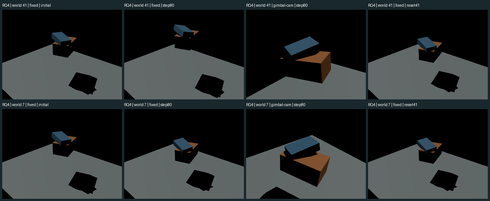
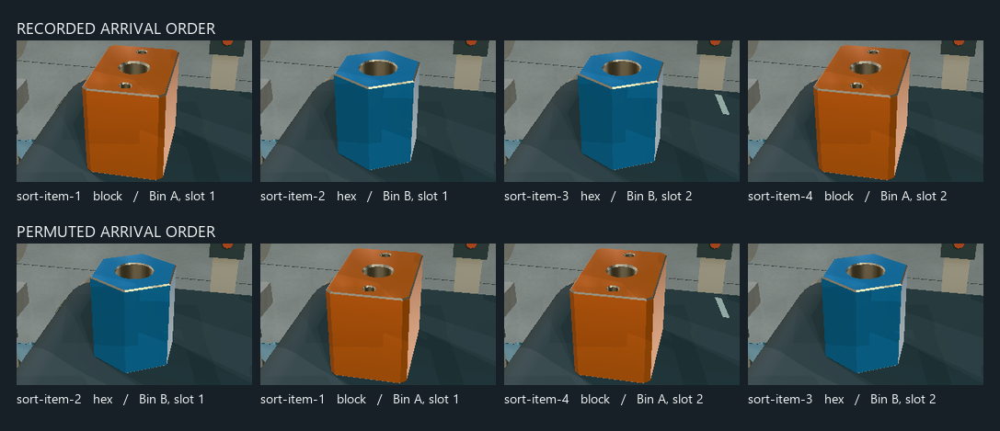

# Vulkan 相机图像直接交付 Torch

在 RTX 4060 Laptop GPU 上，两个 MuJoCo‑TYX 世界各运行一台固定相机和一台随机体转动的相机。每批四幅 320×240 图像，在同一张卡上直接交给 Torch 计算颜色、可见像素和运动部件深度。稳态整幅图像的主机往返从每批 7,680,000 B 降至 0 B。硬件光追阴影与 4× MSAA 一起开启时，整批到 GPU 消费完成的中位耗时由 8.20 / 7.75 ms 降到 6.61 / 6.40 ms。



## 相同工作量的两次测量

输入是同一已打包的物理端点。主机路径用已有批拍接口产生公开 CPU 图像，再通过可复用的页锁定缓冲上传。设备路径通过可导出的 Vulkan 缓冲和外部信号量交接，就地解释张量布局。两条路径都在另一个非默认 CUDA 流上运行同一组八项整数统计，墙钟计时在结果事件完成后结束。每档、每条路线预热 4 批，测量 300 批，轮内交替次序，第二轮颠倒初始次序。物理步进、位姿打包、截图和独立 NumPy 对照在计时窗口外。[正序逐批数据](timing-forward.json) · [反序逐批数据](timing-reverse.json)

| 阴影和 RGB 采样 | 经主机中位，正 / 反（ms） | 设备直读中位，正 / 反（ms） | 经主机 p95，正 / 反（ms） | 设备直读 p95，正 / 反（ms） |
| --- | ---: | ---: | ---: | ---: |
| 软件阴影，1× | 7.87 / 7.49 | 6.27 / 6.10 | 23.93 / 9.09 | 19.72 / 7.73 |
| 软件阴影，4× MSAA | 8.13 / 7.69 | 6.53 / 6.28 | 25.47 / 10.40 | 21.58 / 8.16 |
| 硬件光追阴影，1× | 7.85 / 7.63 | 6.41 / 6.17 | 23.79 / 9.62 | 18.77 / 7.89 |
| 硬件光追阴影，4× MSAA | 8.20 / 7.75 | 6.61 / 6.40 | 22.78 / 9.81 | 20.57 / 8.29 |

两轮的四个配置均观察到中位耗时下降。第一轮两条路径的尾部都明显较慢，端到端 p95 的两轮波动大于同轮两条路径的差值。稳定的尾延迟收益和八世界十六机位仍待 P4 验收。

## 传输与所有权

- **正常设备消费。** 每批四幅原始附件共 3,993,600 B（RGBA8、前向深度 float32、实例 ID uint32、有效掩码 uint8）。Vulkan 将附件整理到设备缓冲，CUDA 每世界做一次设备到设备复制，交给 Torch 自己的存储。公开 RGB 是 RGBA 的三通道视图，像素步幅为 4 字节。此布局允许原生槽被后续帧重用，同时旧张量继续供训练者使用。
- **主机流量。** 旧路径每批回读 3,993,600 B，随后上传公开的 3,686,400 B。新路径每个带传感器的世界另回读 1 B 有效性状态。校验涵盖深度、场景实例 ID 与背景掩码的一致性。RGB 单通道无此状态回读。物理工作区内部检查和相机元数据另行计量。
- **同步。** 当前实现每世界仍会等待 Vulkan 绘制的 fence，并在复用输出槽前确认 CUDA 已交还。跨世界批次绑定同一物理快照，等待接口按提交顺序返回所有机位。需要截图时可请求异步拷贝到页锁定主机内存。

## 画面与生命周期验证

两个世界各走 80 个物理步，对初始、第 40 步、第 80 步及只重置世界 41 后分别采集。在四档配置中，64 组配对曝光的全部四通道均与主机路径及先前相机归档逐字节一致。抗锯齿应用于 RGB，深度、ID 和有效掩码保持中心采样。独立 CPU 计算逐项核对 GPU 消费者结果。真实 Vulkan 验证层报错数和关闭后的跟踪资源数均为零。[验收记录](validation.json)

混合通道用例将 157×101 的掩码和 ID 与 237×165 的深度和 RGB 一起提交，显式异步回读的 353,020 B 与主机结果一致。慢消费者排队后复用同一原生槽；持有的图像可跨后续提交、单世界重置和原生会话关闭读取。过期曝光、不同源帧的组合、重复世界和错误的最后一台相机均被拒绝。未完成的 Vulkan fence 保留所占资源，故障注入验证重试期间不会在尚未就绪的信号量上挂起 CUDA。

## 星海图 R1 分拣读头

从原分拣轨迹取四个停靠姿态，重建完整工位的 71 个网格、98 个可视实例和 63 种材质。沿用原来标定的机位与 320×192 镜头。两条路径在相同的硬件光追阴影、1× 采样与 PBR Neutral 设置下重新绘制。对照图展示本次的 CPU 参照画面。GPU 读头直接消费 Vulkan 生成的 RGB，在另一条 CUDA 流上统计同一片 3,840 像素的区域。[完整工位记录](station.json) · [验证程序](../../../examples/galaxea_r1/verify_device_station.py)



原顺序选箱为 A、B、B、A，换序为 B、A、A、B。两个读头在八次曝光上的像素计数、工件类别、目标箱和槽位完全一致。橙色方件每次命中 3,694 个橙色像素，蓝色六角件每次命中 3,840 个蓝色像素；相反颜色的命中数均为零。设备路径每次只向主机返回两个整数，八次合计 128 B。整幅图像主机传输为 0 B。位姿来自 CPU 编排，上传位姿记录另计 100,352 B；换序验收覆盖停靠、识别与选箱，停靠之间的机械臂运动沿用原归档场景说明。

首次核对机位时，逐位比较重新生成的四元数与旧归档出现差异，最大为 1.11×10⁻¹⁶。程序现检查镜头内参、平移与旋转矩阵，并直接使用归档的校准位姿绘制。实测平移误差为零，旋转矩阵最大元素差 2.22×10⁻¹⁶。四张材质纹理重新编码后改变了场景文件哈希，独立逐像素检查确认纹理内容相同。两个读头的参照均取自本次渲染。

## 调用

```python
with session.publish_packed_device_poses(packed, workspace, world_key) as exposure:
    ticket = session.capture_device_poses_device_batch(exposure, requests, consumer_stream=delivery)

with torch.cuda.stream(training):
    shots = ticket.wait(training)
    rgb = shots[0].planes[Channel.RGB]
    features = encoder(rgb)
```

同一快照的多个世界可通过 `DeviceImageBatch.combine(tickets)` 合并，提供给各自的消费流。每个消费流调用一次 `wait(stream)`，使 Torch 在该流使用完毕后才回收存储。请求主机副本时使用 `ticket.readback_async(stream).result()`。调用方应在写入返回张量后自行对后续读取排序。[公开接口](../../../src/phymeo_rendering/device_images.py) · [可运行对照](../../../examples/verify_shared_device_images.py)

## 复现

实现提交 `dd07960e`，本机 Release DLL SHA-256 为 `d7f9221226fcc0cbef3725599e142c6cea009c4b4c48f810e088b64fb98848cb`。相机对照程序默认使用全部四档与 300 次重复，输出目录须为空。

```powershell
python rendering/examples/verify_shared_device_images.py --library "$build/phymeo_native.dll" --shader-directory "$build" --device 0 --device-index 0 --require-archive-identity --validation --warmup 1 --repeats 2 --output artifacts/device-image-check
python rendering/examples/verify_shared_device_images.py --library "$build/phymeo_native.dll" --shader-directory "$build" --require-archive-identity --output artifacts/device-image-forward
python rendering/examples/verify_shared_device_images.py --library "$build/phymeo_native.dll" --shader-directory "$build" --require-archive-identity --reverse-order --output artifacts/device-image-reverse
python -m galaxea_r1.verify_device_station --library "$build/phymeo_native.dll" --shader-directory "$build" --device-index 0 --device 0 --validation --output artifacts/device-station-check
```

R1 命令需要把 `rendering/examples`、`rendering/src` 加到 Python 搜索路径，并提供官方资产、原始轨迹及模型缓存；非默认位置可用 `--asset-dir`、`--archive`、`--cache-dir` 指定。桥接与相机入口的回归测试通过 24 项及 25 个子用例，另有 6 项 R1 读头测试通过。
