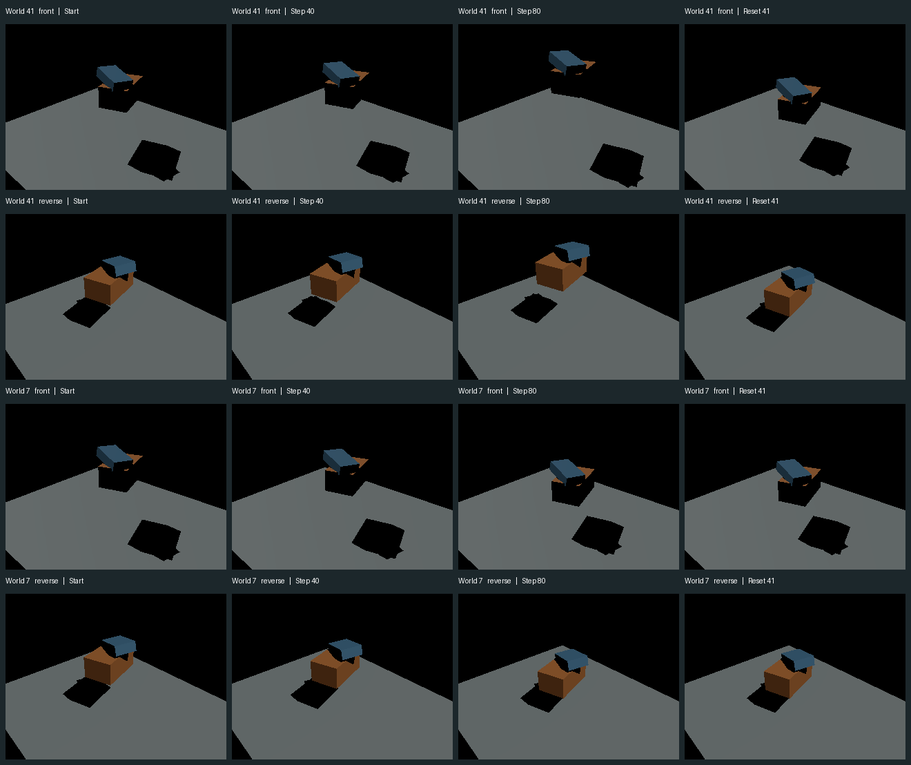

# 两个物理世界共用 GPU 位姿驱动各自的相机

Windows，RTX 4060 Laptop GPU，2026-11-24。两个 MuJoCo-TYX 滑块施加相反控制，各推进 80 个 1 ms 步。每个世界有一张固定台面、两个带不同局部平移和旋转的滑块外观，以及前后两个固定机位。同一世界在同一端点只发布一次实例矩阵。两个机位都从该 Vulkan SSBO 读取。[逐曝光原始记录](report.json)



**读图。** 横向依次为起点、第 40 步、第 80 步、只重置世界 41。前两行是世界 41，后两行是世界 7。对比前视角，第 80 步时世界 41 的橙色件中心上移 21.16 像素，世界 7 的对应中心下移 19.79 像素。固定台面同深度、同实例 ID 的位置也随阴影移动而变亮或变暗。最后一列中，世界 7 的两个视角都与第三列相同。

| 检验 | 实测 |
| --- | --- |
| 原有主机矩阵路径与共享 SSBO 路径 | 在相同设备、场景、相机参数和物理端点下对照 16 对 320×240 曝光。RGB 不同像素数为 0，实例 ID、有效掩码逐像素相等；656,490 个共同有效深度样本的最大绝对差为 0 m。负、正方向运动及旋转、局部偏置均进入绘制。 |
| 同状态多机位 | 每世界 4 次发布、8 次曝光。3 个外观实例每次发布 384 B 正逆矩阵，两世界共 3,072 B 设备内复制。渲染器收到的主机位姿载荷为 0 B；刚性与有限性检查每次发布读回 1 B。 |
| 重置与生命周期 | 只重置世界 41，其时钟和 tick 回到 0，世界 7 留在第 80 步。旧快照被拒绝。两世界关闭后各自 CUDA 导入对象数为 0，Vulkan 验证错误与跟踪的活动资源数均为 0。 |
| CPU 参考与图像读回 | 原生 CPU MuJoCo 独立步进，核对 GPU 刚体坐标。验证分支为主机矩阵对照与物理参考累计读回 768 B 位姿。共享路径与基准各向主机交付 14,745,600 B 的图像通道，供逐像素对照。 |

**适用范围。** 当前支持同卡 Windows、常驻单采样软件光栅。软件阴影遍历每个实例的静态网格 BVH，使用刚发布的逆矩阵。这个实现优先保证遮挡正确；实例数增大时仍需测量成本。相机输出为原有 CPU 图像。绑定在运动连杆上的相机、硬件 ray query、批内一次提交多个机位、图像直接交给 GPU 消费者与整批 p95 均有各自的后续验收。

实机运行使用本地实现 `f4778dbd`。本次 DLL 的 SHA-256 为 `78c9aa15e385f6ffd193f49587148f905ae96d2b155a52d40e59b8fc5fadb530`，常驻软件光栅片元 SPIR-V 为 `138576de11b8e00cfafbda203561394795fad1944aeeeeb0590a13f0121d349e5`。共享发布、原渲染入口、传感器合同和刚体观察的定向回归共 36 项通过，另有 90 个子用例通过。

## 从公开入口运行

在仓库根目录使用支持项目 CUDA 后端的 Python 环境，以及现有 Vulkan SDK、验证层和 MSVC x64 工具链。此示例另外使用 Pillow 生成对照图。选择与 CUDA 同物理设备的 Vulkan 枚举位置，本轮两者均为 0；两套 API 的枚举顺序可能不同，运行时检查 UUID。

```powershell
$build = 'artifacts/resident-pose-raster-build'
cmake -S rendering/src/phymeo_rendering/backends/_native -B $build -G "Visual Studio 17 2022" -A x64
cmake --build $build --config Release --target phymeo_native
$env:PYTHONPATH = 'src;rendering/src;rendering/examples'
python rendering/examples/verify_live_pose_raster.py --library "$build/phymeo_native.dll" --device-index 0 --device 0 --validation --output artifacts/resident-pose-raster-results
```

上层通过 `NativeBackend(resident=True, shared_cuda_device=...)` 打开场景，以 `DeviceVisualBinding` 固定世界、物理刚体和可视实例的对应关系。进入 `session.publish_device_poses(...)` 后，按曝光的帧键为每个机位调用 `capture_device_poses`。退出该上下文后，旧曝光失效。实测中另一个 Vulkan 枚举位置被 UUID 检查拒绝。首次重置夹具提供了非零初始时钟，物理引擎按既有规则拒绝；最终夹具采用零时间，并保留非零的重置位置。[可运行示例](../../../examples/verify_live_pose_raster.py) · [开发计划](../../../plans/2026-11-24-physics-vulkan-device-interop.md)
