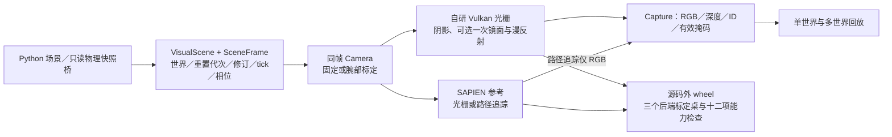

# 渲染引擎 · 能力与实测导航

这里收录 Windows／RTX 4060 Laptop 上的实测结果。自研 Vulkan 已支持直接 PBR、面积灯、法线与粗糙度贴图、4× MSAA、光滑金属的一次镜面反射，以及粗糙表面的一至两次漫反射和静止视图的 GPU 线性累积。[原图降噪与多次反弹](progressive-room/index.html)。可以在同一帧查看附近色板如何照亮白色夹爪的暗面，以及画外物体在钢球中留下的倒影。[红板与夹爪](diffuse-bounce/index.html) · [近场反射开关](near-reflections/index.html) · [材质开关](normal-maps/index.html) · [全部影片](index.html) · [架构图](../architecture.html) · [自研 Vulkan 画质路线](../plans/2026-11-23-native-vulkan-quality.md) · [首版验收](../plans/09-acceptance.md)

| 能力 | 已实测与可打开证据 | 边界 |
| --- | --- | --- |
| 轮廓抗锯齿 | 自研驻留式 Vulkan 新增可选 4× MSAA。固定斜边的覆盖误差下降 **64.91%**，深度、ID、掩码与 1× 逐字节一致。[标定与 Panda 回放](msaa/README.md) | 亚像素细杆的帧间误差下降 **14.95%**，20% 的运动改善门槛仍开放。首版独立安装记录对应原 1× 构建。 |
| 动态材质展示 | [车间光下的 8 秒绕拍](r2/material-orbit/material-orbit.mp4)让两颗相同几何的钢球、哑光橡胶和扫描木板同时入镜。48° 相机行程，192 帧均经解码核对。[交付记录](r2/material-orbit/delivery-audit.json) | 几何、光源与曝光固定，镜头运动用于观察反射。Panda 的物体运动另见抓放片。 |
| 帧、相机与输出 | 两种光栅均发布 sRGB8、米制前向深度、小端 uint32 ID、有效掩码；[R3 固定／腕部十曝光](r3/README.md)内部 ID 错误 0，标记最大误差 0.541 px，深度误差均小于 2 mm。 | 不混用世界、reset、修订或物理时相；背景深度 +∞、ID 0。输出为主机拥有的不可变字节，未宣称 GPU 零拷贝。 |
| 自研实时渲染 | 完整 Panda 网格常驻、直接 PBR、面积灯、方向 HDR 环境。相同 300 帧 720p、2×2 灯面样本，[软件阴影 p95 41.62 ms](r2/daylight-software-camera.json)，[硬件阴影 10.65 ms](r2/daylight-hardware-camera.json)。 | 硬件模式显式请求 `ray_query`，主可见性仍是光栅；不支持设备拒绝，不回退。间接光支持表中有界的镜面与漫反射光路，通用离线路径追踪参考来自 SAPIEN。 |
| 面积灯积分 | 软件／硬件两种求交分别实测 **2×2、4×4、8×8**；8×8 通过独立有限面积灯半影门，4×4 仅部分通过。[完整格点证据](r2/area-light-grid-results.json) | 此处是灯面采样密度，不是世界数量；高档画质与采集成本分别记录。 |
| 材质与环境 | 不透明颜色图、UV 重复／双线性与线性粗糙度。16 块粗糙度标定对常量材质的最大 RGB8 差为自研 1、参考光栅 0、参考光追 0。[自研](r2/roughness-chart-native.json) · [参考光栅](r2/roughness-chart-sapien-raster.json) · [参考光追](r2/roughness-chart-sapien-pt.json) · [HDR 方向与反射](r2/native-ibl-calibration.json) | 颜色按 sRGB 解码，粗糙度按线性数据读取。透明、折射与材质参数拟合尚待开发。环境全景提供远场照明。 |
| 自研切线空间法线图 | 线性 RGB、+Y、镜像 UV 手性。三块标定板共 24 个预定区域与解析 RGB8 预测一致。真实材质绕拍验证三帧的深度、实例 ID 与有效掩码逐字节一致。[标定与成本](normal-maps/README.md) · [同帧开关](normal-maps/index.html) | 用世界坐标与第一套 UV 重建切线。显式顶点切线、MikkTSpace 对齐、mip 过滤尚待开发。SAPIEN 参考路径会在绑定此贴图时明确报错。 |
| 近场镜面反射 | 自研硬件射线查询使用当前实例与最近三角形。独立平面镜标定通过 1 px 边界门。钢球样片的画外帧中红块直接 ID 像素为 0，解析预测的镜内红区仍清晰可见。90 对画面的深度、ID、掩码逐字节相同。[同帧查看器](near-reflections/index.html) · [几何与性能实测](near-reflections/README.md) | 光滑金属、一次理想镜向、命中不透明表面。粗糙倒影和递归镜面待开发。 |
| 漫反射间接光 | 16 个余弦样本查询一次近场反弹。有限色板的区域平均传光系数相对独立积分偏差 −0.31%。真实 Panda 两指的净染红程度在加入黑板后下降 86.3% 和 85.5%。[夹爪开关](diffuse-bounce/index.html) · [测量与分辨率成本](diffuse-bounce/README.md) | 单帧有采样噪声。1280 × 960 的四组静态摆台开启档 p95 为 49.65–69.44 ms。封闭室内的第二次反弹通过独立标定。静止 Panda 累积到 1024 样本时，两指噪声降低 87.3%。状态改变会清空历史，运动首批可选 GPU 空间滤波，25 个运动姿态中的三个高采样对照姿态，两指误差降低 59.5%；运动首批 p95 为 74.0 ms。仅首帧滤波时，停稳后第二批会短暂变粗糙。可选按批减弱滤波，三个停点的第二批两指误差比旧模式低 52.6%，第 2–15 批全通道采集 p95 为 70.5 ms。[停稳对照与完整成本](guided-settling/README.md)。[运动对照与指标](guided-motion/README.md)。[测量、成本及范围](progressive-room/README.md)。 |
| 显示与参考成像 | 自研在两种阴影求交、三档灯面密度下验证 Neutral 高光显示。SAPIEN 在同一原始 HDR 上保留 1600 个原先剪裁的像素。两种光栅均保留几何附件。[自研标定](r2/native-neutral-verification.json) · [参考标定](r2/reference-neutral-calibration.json) | SAPIEN 路径追踪发布 RGB。512 样本下夹爪近景仍有可见颗粒；本机 OIDN 及 OptiX 在实际采集阶段退出，高清片采用直接采样。[兼容性记录](r2/denoiser-probe.json) |
| 分块与相机回放 | 647×419 离轴相机分九块，两个光栅后端分别与整图对照；全部 ID、有效掩码、RGB 一致，内部深度差 0。[标定读数](r3/README.md) · [同相机 1080p 动态片](r2/README.md) | 光追分块改变像素的随机序列。独立记录单图采集、传感差异和最终有损编码误差。 |
| 单／多世界回放 | [R4](r4/README.md)：**1、2、8 世界 × 两相机**，每档 300 批，6,600 次曝光对照独跑，深度差 0、ID／掩码逐字相同，单世界 reset 不影响其他世界。 | 此全套是原软件阴影路径，未声称硬件阴影也完成 R4。逐世界、逐相机提交；渲染不推进物理，回放成功不等于控制任务成功。 |
| 独立交付 | [已验 wheel 与安装说明](g5/README.md)。候选 `5fdf4ec3` 在源码外建环境，从安装包编译 Vulkan 并完成三个后端的标定桌与 12 项能力检查。[逐项结果](g5/installed-report.json) | 已验 Windows、CPython 3.11.9 和 RTX 4060 Laptop。自研后端需要本机 Vulkan SDK、C++ 工具链与 CMake；SAPIEN 和图像依赖通过可选安装项提供。 |

直接观看：[同轨迹日光自研版](r2/workshop-daylight-native.mp4) · [同轨迹日光光追版](r2/workshop-daylight-reference.mp4) · [八世界及单世界 reset](r4/eight-worlds.mp4) · [单世界推 T 光追近景](r4/pusht-reference.mp4)。原图、采样、编码损失与硬件范围以各具名收据为准。
