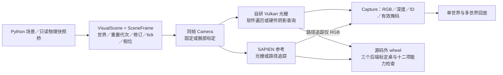

# 渲染引擎 · 能力与实测导航

当前证据来自 Windows／RTX 4060 Laptop：日光成片与软硬阴影对照基线 `9417f4f6`，另含随后接受的粗糙度贴图、面积灯格点记录。先看[同步影片入口](index.html)，实现全图见[架构图](../architecture.html)；本页不替代[模块计划](../plans/README.md)与[验收规程](../plans/09-acceptance.md)。

| 能力 | 已实测与可打开证据 | 边界 |
| --- | --- | --- |
| 动态材质展示 | [车间光下的 8 秒绕拍](r2/material-orbit/material-orbit.mp4)让两颗相同几何的钢球、哑光橡胶和扫描木板同时入镜。48° 相机行程，192 帧均经解码核对。[交付记录](r2/material-orbit/delivery-audit.json) | 几何、光源与曝光固定，镜头运动用于观察反射。Panda 的物体运动另见抓放片。 |
| 帧、相机与输出 | 两种光栅均发布 sRGB8、米制前向深度、小端 uint32 ID、有效掩码；[R3 固定／腕部十曝光](r3/README.md)内部 ID 错误 0，标记最大误差 0.541 px，深度误差均小于 2 mm。 | 不混用世界、reset、修订或物理时相；背景深度 +∞、ID 0。输出为主机拥有的不可变字节，未宣称 GPU 零拷贝。 |
| 自研实时渲染 | 完整 Panda 网格常驻、直接 PBR、面积灯、方向 HDR 环境。相同 300 帧 720p、2×2 灯面样本，[软件阴影 p95 41.62 ms](r2/daylight-software-camera.json)，[硬件阴影 10.65 ms](r2/daylight-hardware-camera.json)。 | 硬件模式显式请求 `ray_query`，主可见性仍是光栅；不支持设备拒绝，不回退。未实现自研路径追踪。 |
| 面积灯积分 | 软件／硬件两种求交分别实测 **2×2、4×4、8×8**；8×8 通过独立有限面积灯半影门，4×4 仅部分通过。[完整格点证据](r2/area-light-grid-results.json) | 此处是灯面采样密度，不是世界数量；高档画质与采集成本分别记录。 |
| 材质与环境 | 不透明 base-color 贴图、UV 重复／双线性与线性粗糙度通道。16 块粗糙度标定对常量材质的最大 RGB8 差：[自研 1](r2/roughness-chart-native.json)／[参考光栅 0](r2/roughness-chart-sapien-raster.json)／[参考光追 0](r2/roughness-chart-sapien-pt.json)。[HDR 方向与反射](r2/native-ibl-calibration.json)有独立采样核对。 | 颜色图按 sRGB 解码，粗糙度按线性数据读取；暂无 normal map、透明／折射或真实材质参数拟合保证。环境全景无近场几何深度。 |
| 显示与参考成像 | 自研在两种阴影求交、三档灯面密度下验证 Neutral 高光显示。SAPIEN 在同一原始 HDR 上保留 1600 个原先剪裁的像素。两种光栅均保留几何附件。[自研标定](r2/native-neutral-verification.json) · [参考标定](r2/reference-neutral-calibration.json) | SAPIEN 路径追踪发布 RGB。512 样本下夹爪近景仍有可见颗粒；本机 OIDN 及 OptiX 在实际采集阶段退出，高清片采用直接采样。[兼容性记录](r2/denoiser-probe.json) |
| 分块与相机回放 | 647×419 离轴相机分九块，两个光栅后端分别与整图对照；全部 ID、有效掩码、RGB 一致，内部深度差 0。[标定读数](r3/README.md) · [同相机 1080p 动态片](r2/README.md) | 光追分块改变像素的随机序列。独立记录单图采集、传感差异和最终有损编码误差。 |
| 单／多世界回放 | [R4](r4/README.md)：**1、2、8 世界 × 两相机**，每档 300 批，6,600 次曝光对照独跑，深度差 0、ID／掩码逐字相同，单世界 reset 不影响其他世界。 | 此全套是原软件阴影路径，未声称硬件阴影也完成 R4。逐世界、逐相机提交；渲染不推进物理，回放成功不等于控制任务成功。 |
| 独立交付 | [已验 wheel 与安装说明](g5/README.md)。候选 `5fdf4ec3` 在源码外建环境，从安装包编译 Vulkan 并完成三个后端的标定桌与 12 项能力检查。[逐项结果](g5/installed-report.json) | 已验 Windows、CPython 3.11.9 和 RTX 4060 Laptop。自研后端需要本机 Vulkan SDK、C++ 工具链与 CMake；SAPIEN 和图像依赖通过可选安装项提供。 |

直接观看：[同轨迹日光自研版](r2/workshop-daylight-native.mp4) · [同轨迹日光光追版](r2/workshop-daylight-reference.mp4) · [八世界及单世界 reset](r4/eight-worlds.mp4) · [单世界推 T 光追近景](r4/pusht-reference.mp4)。原图、采样、编码损失与硬件范围以各具名收据为准。
