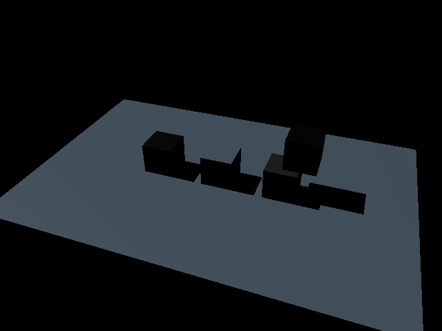
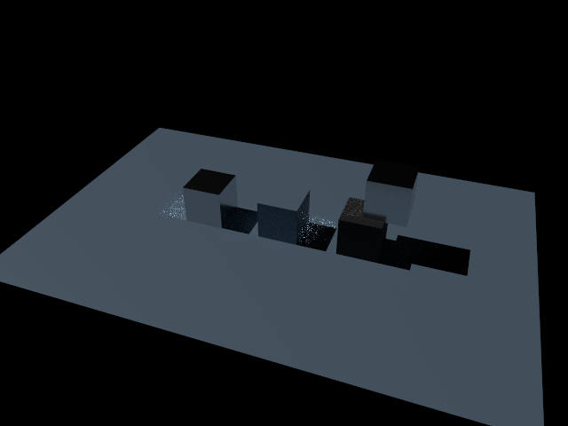
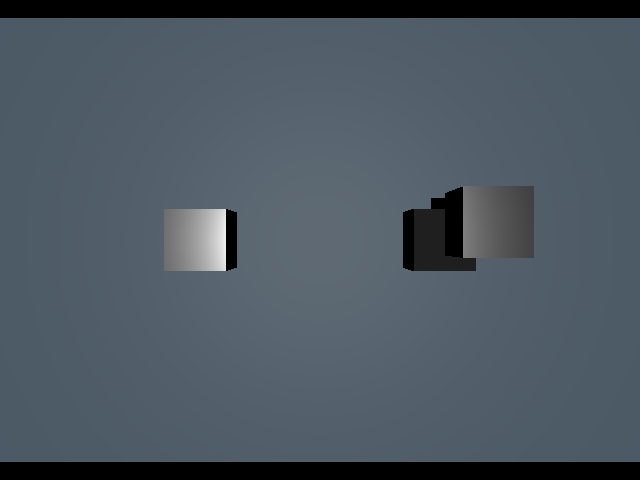
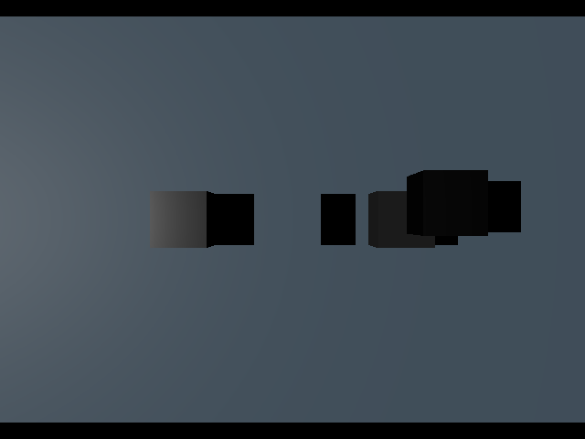
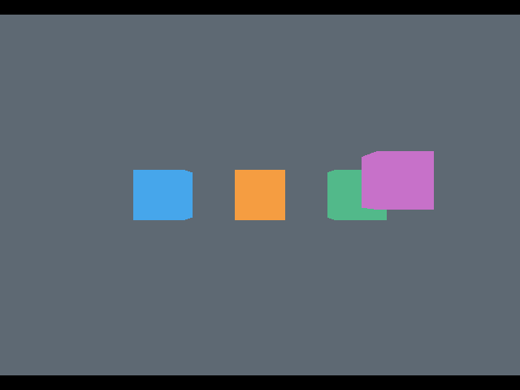

# G3 标定桌实测

同一张桌子、同一个物理时刻、同一组相机和灯光，分别交给自研 Vulkan 和 SAPIEN。三张图均为 RTX 4060 Laptop 离屏读回。颜色可以因光照算法而异；相机看到哪个物体、该物体离相机多远，可以用同一份几何独立检验。

| 自研 Vulkan 光栅 | SAPIEN 光栅 | SAPIEN 路径追踪 |
| --- | --- | --- |
|  |  |  |

从左向右是铝、哑光塑料和橡胶样块，右侧另有一块较高的铝块，从俯视相机看会遮住一部分橡胶。斜视图用来认物体，数值验收使用下面的固定俯视机位。黑色背景、单方向光和大块纯色表面便于定位阴影、遮挡或坐标错误。三张图的可见范围限于这个标定场景；机器人资产、环境光及纹理属于后续关口。

| 主光垂直向下 | 主光向右倾斜 | 同机位实例 ID |
| --- | --- | --- |
|  |  |  |

观察中间样块右边的桌面，转灯后那里进入阴影。铝块表面的亮部也换了方向。右图直接给实例 ID 着色，蓝色为左侧铝块，橙色为塑料，绿色为橡胶，紫色为上方遮挡物。即使阴影改变，逐像素的深度、ID 和掩码仍应相同。

## 本次验收

Windows x64，NVIDIA GeForce RTX 4060 Laptop GPU。设备验收使用 Python 3.11.9、SAPIEN 3.0.3 和 NumPy 1.26.4。本机自研端选择 Vulkan 设备 1，参考端选择 `cuda:0`，对应同一独立显卡。自研端由 MSVC 构建，使用 Vulkan 和编译为 SPIR-V 的顶点／片元着色器。参考端只创建 SAPIEN 渲染系统。两个光栅端各返回 sRGB、前向深度（米）、uint32 实例 ID 和有效掩码；参考路径追踪返回 sRGB。

| 检查 | 实测 |
| --- | --- |
| 同帧几何 | 640 × 480 中全部 307,200 个像素的两路光栅 ID 相同。284,160 个共同前景像素的最大前向深度差为 0.000000179 m。此数表示两路输出在该帧的一致性。 |
| 独立几何参照 | 7 个解析测点覆盖背景、桌面、三种材料、遮挡块顶面及侧面。可见物体、掩码及背景无穷远均正确；前景到解析深度的误差均在原定 2 mm 内。 |
| 移动主光 | 阴影区有 192 个像素，三条路径各有 192 个像素至少一个颜色通道变化 ≥2 个 sRGB8 码值。阴影区／对照区平均亮度下降量分别为自研光栅 103.47／21.82、参考光栅 97.58／21.71、参考光追 99.87／21.60。 |
| 铝表面反射方向 | 取左侧铝块顶面两条相等宽度的采样带。垂直光下自研端左／右平均亮度为 131.66／190.73，斜光下为 76.65／58.00。两条参考路径均出现相同的亮度梯度反转。该比较只读取保存的原始像素。 |
| 帧与资源所有权 | 各路径完成 20 次打开、采集、关闭。原生会话、帧及跟踪资源的活动计数归零，Vulkan 验证错误为 0。两个 SAPIEN 路径关闭后的附着实体、相机和渲染体计数归零。这些是本模块跟踪的资源计数。 |
| 时序与重复性 | 每次采集源帧摘要保持相同，物理步数为 0。错帧、未支持路径及关闭后拍摄均被拒绝。参考光追每像素 64 个样本、最多 4 次反弹、关闭降噪；同机固定采样的 4 次 160 × 120 输出逐字节一致。 |
| 测试范围 | 启用真机的 Python 3.11 环境运行渲染包 189 项测试，全部通过。独立的 Python 3.13 标准库环境通过 177 项，显式跳过 12 项设备测试。 |

首轮有两个预期测点选错。俯视像素 (445, 240) 命中遮挡块侧面；原选的阴影对照区也被邻块遮住。两个后端给出相同观测。最终夹具保留原侧面点，增加橡胶内部点 (430, 240)，并用独立射线与盒子的交点核对两种灯向下的整块对照区。几何、材料、相机及验收容差沿用原值。预期值修正在重新采集前独立提交为 `b644d968`。

## 从源代码复现

以下命令从仓库根目录运行，要求 Windows x64、Python 3.11、VS 2022 C++ 工具、CMake、支持当前路径的显卡和 Vulkan 开发工具。原生构建从 `VULKAN_SDK` 查找头文件、加载器导入库及 `glslang` 或 `glslangValidator`；也可用 CMake 的 `VULKAN_INCLUDE_DIR`、`VULKAN_LIBRARY` 和 `GLSLANG_VALIDATOR` 显式指定。验证用例要求可加载 Khronos 验证层。使用便携验证层时将 `VK_LAYER_PATH` 指向其 manifest 目录。基础 Python 包单独使用时仅需要标准库。

```powershell
py -3.11 -m venv artifacts/rendering/r0-env
$python = (Resolve-Path artifacts/rendering/r0-env/Scripts/python.exe).Path
& $python -m pip install './rendering[sapien]'
cmake -S rendering/src/phymeo_rendering/backends/_native -B artifacts/rendering/r0-build -G 'Visual Studio 17 2022' -A x64
cmake --build artifacts/rendering/r0-build --config Release

$env:PYTHONPATH = (Resolve-Path rendering/src).Path + ';' + (Resolve-Path rendering/tests).Path
$env:PHYMEO_R0_NATIVE = '1'
$env:PHYMEO_R0_REFERENCE = '1'
$env:PHYMEO_SAPIEN_DEVICE = '1'
# 这两个编号是本机取值，复现时按设备实际枚举选择同一块独立显卡。
$env:PHYMEO_R0_DEVICE_INDEX = '1'
$env:PHYMEO_R0_SAPIEN_DEVICE = 'cuda:0'
$env:PHYMEO_R0_LIBRARY = (Resolve-Path artifacts/rendering/r0-build/phymeo_native.dll).Path
$env:PHYMEO_R0_OUTPUT = Join-Path (Get-Location) ('artifacts/rendering/r0-' + [guid]::NewGuid().ToString('N'))
$env:PHYMEO_SAPIEN_ARTIFACT_DIR = Join-Path $env:PHYMEO_R0_OUTPUT 'reference-sampling'
& $python -B -m unittest discover -s rendering/tests -v
& $python -B rendering/tests/integration/compare_table.py $env:PHYMEO_R0_OUTPUT
```

每次用新的输出目录。各路径的 `metrics.json` 含相机、输入摘要、实际设备、输入资产和原始通道的 SHA256；同目录保存无损 PNG 与逐像素通道。第二条验证命令读取同次原始数据，复核帧绑定、摘要、整帧几何差异及反射梯度。此工作树的采集保存在 `artifacts/rendering/g3-table/table-03/`，设备和标准库测试日志分别在同级的 `device-suite.log` 和 `host313.log`。本页六张预览随代码保存。[原生集成测试](../../tests/integration/test_native_table.py) · [参考集成测试](../../tests/integration/test_reference_table.py) · [离线读回比对](../../tests/integration/compare_table.py)

## 下一关

G4／R1 用具备来源和许可的 Panda 外观网格，从两帧真实回放出图，验证基座、腕、手指和相机是否与原始位姿对齐。当前网格入口支持单网格、单索引三角形图元、内嵌缓冲、位置及单位法线的本地 glTF；原生端使用直接光照与硬阴影。纹理、环境光、自研路径追踪、R2 速度及画质、R3 完整标定和 R4 八世界尚待开发或实测。参考路径追踪采用官方着色器的固定采样序列，同机可复现；独立随机种子组和跨设备一致性另行验证。[分批验收条件](../../plans/09-acceptance.md)
