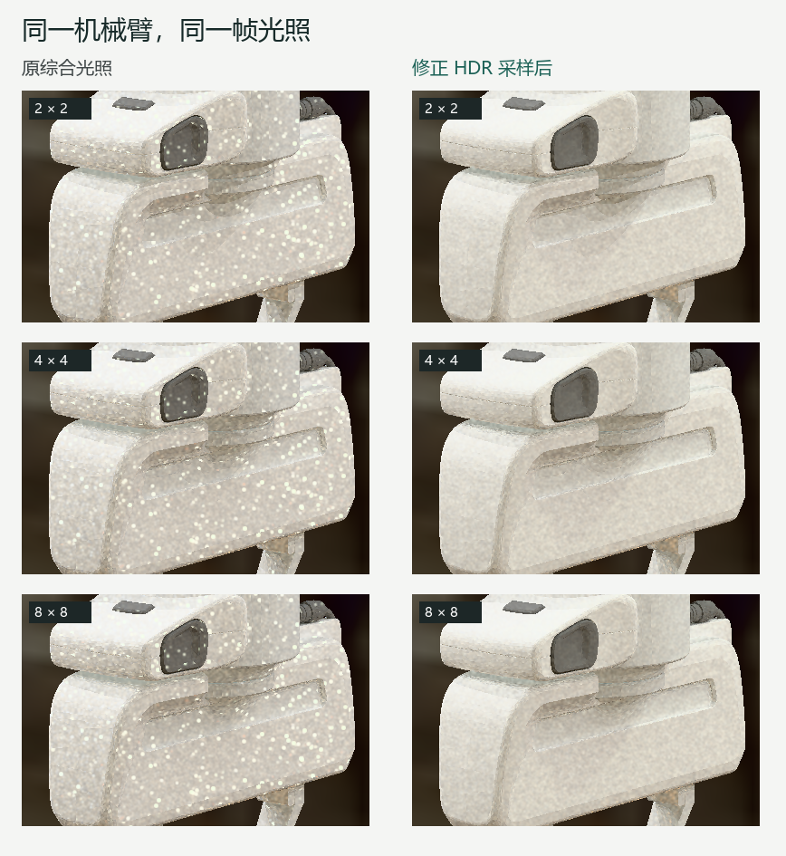

# Panda 综合光照三档复核

原性能表中的三张综合光照图都复现了同一问题。白色夹爪和左侧机械臂在单帧曝光里出现离散亮斑，深色台面上也有亮点。三个档位共用的间接光采样器很少采到车间 HDR 中面积小但很亮的光源。提高面积灯网格密度主要细化半影，对这些亮点帮助很小。



左列的三份原图与原性能矩阵的 PNG 逐字节一致。右列沿用相同 HDR、曝光、白壳材质、相机、降噪设置和每像素 16 条主路径。细噪仍然可见。可以打开 [修正后的单帧原图](panda-16spp.png)、[同一姿态累积至 1,024 样本的原图](panda-1024spp.png)，或在 [Excel 中逐档查看旧图、新图、性能与验证记录](综合光照三档复核.xlsx)。

## 找到问题的依据

在第 60 帧按原模型的三个白壳实例 ID 固定取样，要求其 3×3 邻域的深度、有效性与实例归属一致，共 49,800 像素。在线性色调映射前的 GPU 原始辐亮度上，计算中心亮度与四个相邻像素平均值之差的 RMS。该数值也包含真实的光照变化，适合比较相同几何、相同姿态下的颗粒程度。

| 旧版照明对照，2×2 网格 | 白壳局部亮度波动 |
| --- | ---: |
| 原照明 | 0.10661 |
| 仅关闭方向灯 | 0.10661 |
| 仅关闭两盏面积灯 | 0.10660 |
| 用原配置的均匀环境填充替代车间 HDR | 0.00814 |

均匀环境对照也改变了入射光分布和能量。为排除靠调暗来降低噪声的解释，另外做了两项检查：在原 HDR 下比较白壳的平均亮度，并用独立数值积分预测黑白测试面板的亮度差。

## 修正和效果

渐进漫反射现在用八条路径按表面余弦采样，另八条按环境贴图的亮度分布采样；两种路径的概率共同决定贡献权重。构建分布时计入立方贴图每个纹素的立体角以及双线性过滤覆盖的邻居。亮区边缘因此也能得到足够的采样机会。每条路径仍然查询实际遮挡，第二次反弹也使用对应的采样概率。采样表在上传环境时一次构建，GPU 上用累计概率和反查索引定位样本。

| 每盏面积灯 | 单帧白壳局部波动，旧 → 新 | 显示输出局部波动，旧 → 新 | 单帧白壳平均线性亮度，旧 → 新 |
| --- | ---: | ---: | ---: |
| 2×2 | 0.10661 → 0.01645 | 0.03140 → 0.02169 | 0.08202 → 0.08242 |
| 4×4 | 0.10661 → 0.01642 | 0.03356 → 0.02367 | 0.08117 → 0.08158 |
| 8×8 | 0.10660 → 0.01641 | 0.03278 → 0.02274 | 0.08098 → 0.08138 |

三档的原始线性波动均降低约 85%，白壳平均亮度的变化约 0.5%。显示输出经过同一个降噪器和色调变换，表中该列只对最终 RGB 做逆 sRGB 后测量。另以原档不同随机种子的 1,024 样本成图作有限参考，白壳显示 RGB 的均方根差在 2×2 档从 0.1003 降至 0.0780，4×4 从 0.1019 降至 0.0768，8×8 从 0.1022 降至 0.0764。

独立设备测试使用一个小面积高亮 HDR 光斑，固定四个随机种子，每种子一批 16 样本。黑白介质面板采用相同的镜面参数，取二者输出差以检验漫反射。独立积分预测 RGB 为 (0.165818, 0.043416, 0.012815)，实际为 (0.165854, 0.043426, 0.012820)，向量相对误差 0.022%。逐像素跨种子的相对波动从旧版 3.429 降至 0.142。转动光斑、改变受光面朝向以及用黑色物体遮住光斑的设备对照均通过。第一版只按纹素中心分配概率，小光斑相对波动仍有 0.963，超过事先固定的 0.60 上限；补全滤波足迹及分层采样后通过。

## 运动开销

RTX 4060 Laptop GPU，1280×720，同一段 Panda 运动。每个配置、每轮分别预热 6 帧，再计时 8 帧；第二轮运行顺序完全反转。总共 96 次计时，72 次预热。整帧时间自调用开始，含将 RGB、深度、实例 ID、有效掩码同步返回主机。GPU 时间包含渲染和拷贝。两轮同配置同姿态的 RGB 一致，三种几何通道在全部配置、两轮和各对应姿态间逐字节一致。

| 每盏面积灯 | 旧平均 ms | 新平均 ms | 旧 → 新 GPU 平均 ms | 旧 → 新整帧 P95 ms |
| --- | ---: | ---: | ---: | ---: |
| 2×2 | 298.4 | 397.8 | 271.4 → 371.7 | 328.5 → 433.0 |
| 4×4 | 495.6 | 570.3 | 469.1 → 543.7 | 572.7 → 646.8 |
| 8×8 | 744.5 | 827.5 | 716.8 → 800.2 | 897.9 → 1,096.2 |

本轮单帧用时分别增加约 33%、15% 和 11%。此前性能矩阵采用另一段计时样本，本轮旧版绝对耗时也有明显差异，因此修复前后的速度比较只使用上表的配对数据。就此场景而言，2×2 已消除大部分离散亮斑；需要更细面积灯半影时才有理由支付额外开销。三档都还达不到 30 FPS。此处未测跨帧重投影及同等画质下的最快成图时间。

## 数据与复现

验证覆盖 12 项着色器与采样数学测试、一个独立 C++ 分布构建测试程序、3 项 Vulkan 设备参考测试，以及环境、累积、重置、空间滤波等 52 项回归。新库配原着色器单独渲染了第 60 帧，显示 RGB、原始浮点均值、深度、实例 ID、有效掩码均与历史构建逐字节相同。新采样作用于使用非恒定 HDR 的渐进漫反射路径，普通单反弹模式仍沿用原采样器。

[逐档像素量测、原图哈希、设备测试和逐帧计时](measurements.json) · [同姿态采集脚本](reproduce/compare.py) · [新旧版本运动计时脚本](reproduce/perf.py) · [独立设备参考测试](../../tests/test_native_hdr_sampling_device.py)

使用同一台设备，两套构建分别提供相互匹配的 DLL 和 SPIR-V。设置 `PYTHONPATH` 指向 `rendering/src`，在仓库根目录运行。各输出目录须为新目录。旧版使用原性能报告的构建，新版使用本次源码编译的构建，具体 DLL 哈希见测量数据。

```powershell
python rendering/results/hdr-importance/reproduce/compare.py --library $oldDll --output artifacts/repro-old --grids 2 4 8 --batches 1 16 --device-index 1
python rendering/results/hdr-importance/reproduce/compare.py --library $newDll --output artifacts/repro-new --grids 2 4 8 --batches 1 16 64 --device-index 1 --compare-to artifacts/repro-old
python rendering/results/hdr-importance/reproduce/perf.py --old-library $oldDll --new-library $newDll --output artifacts/repro-timing --device-index 1
```
