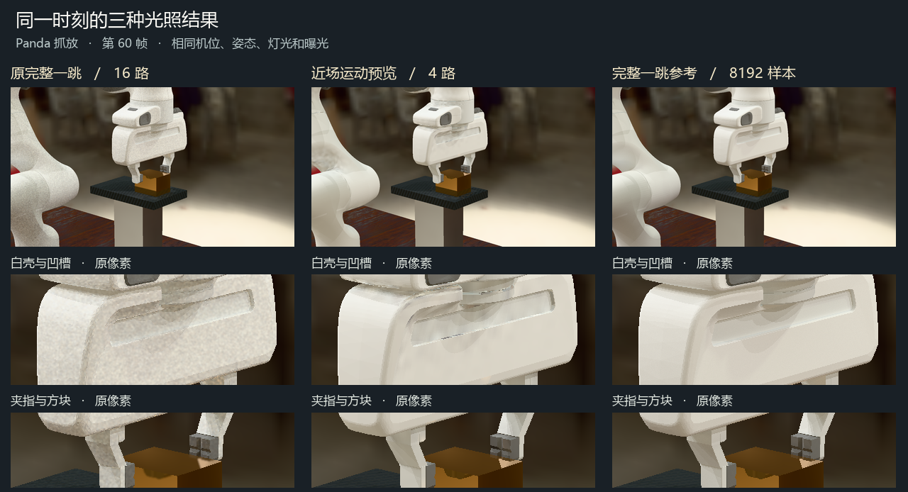

# Panda 运动光照预览

[看 10 秒抓放影片](panda-motion.mp4) · [同步比较近场与完整距离](compare/index.html) · [查看第 60 帧三档原像素](pose-60.png)

先看影片中夹爪接近方块的一段。白壳正面能看到连续的明暗变化，凹槽和夹指仍能分开。再打开同帧图查看左臂内侧与方块上缘：快速档省略远处表面的漫反射，左臂比完整距离参考更亮。同步查看器中可分别暂停并看原图。两条对照片保持录制现场的相同灯光，首页影片另用了柔光棚和整臂／细节切镜。三个视频均由 300 个连续的真实状态逐帧曝光，播放速度 30 帧/秒，播放帧率与下表实测速率独立。

## 在 RTX 4060 Laptop 上选哪一档

表中前三项为同一场景、同一固定相机的单轮 300 帧 RGB 采集，近场档另做两轮反序配对，最后一项是实际成片的单轮。本页的 FPS 从同步取得 CPU 自有结果的平均耗时换算；P95 为对应轮次的第 285 帧排序值。开场、PNG 保存和视频编码另计，显示器呈现延迟尚待实测。

| 用法 | 请求输出 | 平均 FPS | P95 整帧 | 可见差别 |
| --- | --- | ---: | ---: | --- |
| 快速直接光、HDR、近镜面 | RGB | 68.4 | 17.44 ms | 适合看姿态和轮廓，间接漫反射来自预计算环境 |
| 原完整一跳，16 提案和引导滤波 | RGB | 5.82 | 197.8 ms | 保留远处遮挡，单运动帧仍可见颗粒 |
| 原完整两跳 | RGB | 5.76 | 221.4 ms | 适合检查多次反弹 |
| 12 cm 近场一跳，固定镜头，直接发布各图层 | RGB | 52.30 / 56.99 | 21.97 / 20.82 ms | 两轮 600 帧均在 33.3 ms 内 |
| 同一近场档，固定镜头，直接发布各图层 | RGB、深度、实例 ID、有效性 | 40.42 / 40.73 | 30.72 / 31.67 ms | 两轮中 295 / 291 帧在 33.3 ms 内 |
| 12 cm 近场一跳，柔光棚，整臂与夹爪切镜 | RGB | 49.19 | 23.36 ms | 首页成片，300 帧均在 33.3 ms 内 |

正式速度门槛要求两个轮次均达到 30 FPS 且 P95 ≤33.3 ms。近场 RGB 与四通道同步采集分别通过。早期实现先复制整块读回缓冲，再拆成四张自有图像，四通道 P95 为 34.15 / 33.54 ms。新实现从会话锁内的缓冲直接生成请求的自有图层。两轮、两种模式共 1200 次公开输出的颜色和请求到的几何平面、姿态和时间逐帧吻合。新旧源码生成器对私有导引缓冲的诊断标记略有差异。实测设备为 NVIDIA GeForce RTX 4060 Laptop GPU，720p、1× MSAA。设备常驻窗口、其他显卡与不同场景需要各自计时。

## 画质验收

- **白壳亮斑**。固定镜头第 60 帧，和第一组 8192 样本的相同模型参考比较，白壳显示线性 RGB 的 RMSE 为 0.03230，原一跳为 0.03362。三张注册姿态的白壳均在“原一跳误差 +0.005”内。这个指标没有覆盖整幅图。
- **远处照明**。同帧左臂误差为 0.06964，原一跳为 0.03372；近场假设遗漏了远处遮光。提升主面光源的采样密度可以减弱半影分层，继续增大漫反射样本数对这项系统偏差的作用有限。
- **运动连续性**。在相邻两帧、同一组 5353 个可追踪的指部像素上，扣除参考本身的运动变化后，快速档残差 P95 为 0.05686 / 0.05577，原一跳为 0.08703 / 0.08823。斜杠两边为两个独立参考种子，只描述本段运动。
- **显露细边**。另一个场景用薄板遮住夹指。第 15 帧新露出的 69 个右指像素，快速档 RMSE 约 0.041，原一跳约 0.0076。新开会话与从前一帧运动而来的输出逐字节相同。这处误差可以在单帧光照和重建中复现。
- **细边偏差的方向和来源**。同一夹具实测中，69 个像素共用 6 个低分辨率锚点。53 个像素只得到 1 个邻居，15 个只得到 2 个，只有 1 个进入光照回退。新显露区整体偏暗。相同 4 路采样、相同紧凑光栅下，去掉 12 cm 上限后这 69 个像素的 RGB 值完全一致。这里应检验对支撑不足的细几何补射真实光线的收益。
- **参考自身的精度**。两组独立 8192 样本在三个姿态、五个区域共 15 项中，快速档有 9 项落在预定误差余量内。两参考互差 ≤0.0025 的只有三项，均为橡胶台。其余区域的单项结果作为观察值；全套画质门槛仍开放。薄边独立夹具使用两个 1024 样本参考。
- **真实光照控制**。同一张白色接收面，开口及远处黑墙的间接辐亮度均为 (0.25, 0.25, 0.25)。近黑墙降到平均约 0.0136，换近红墙后为 (0.199, 0.0195, 0.0195)。换颜色前后实际深度、ID、有效性字节完全相同。此结果验证 12 cm 这一显式模型下的近处遮挡与颜色传递。

## 使用与复核

左肘内侧还有一处能在静帧重现的半影分层。可打开[原 2×2 面光源采样](left-arm-grid2.png)和[8×8 面光源采样](left-arm-grid8.png)，在同一位置来回切换。两张均取自第 60 帧、同一种子累计 64 批的原始裁图，方向光、曝光与机器人姿态相同。这一对比较展示面积灯积分密度对外观的影响；首页影片采用 2×2 的运动预算。

[从当前源码构建并拍摄](../../../examples/preview_nearfield/README.md) · [预设的原始验收门槛](../../../plans/2026-11-24-native-lighting-30fps.md) · [两条影片的实际解码检查](compare/checks.json) · [逐档时序和精度数据](measurements.json) · [新显露的 69 个像素](thin-edge.png)

另做了四通道读回的单因素实验。在相同生成器、相同光照和相同 300 姿态上，以旧、新、新、旧的顺序独立打开会话。四组 P95 依次为 **37.05、33.16、32.27、34.67 ms**；平均分别为 28.31、25.36、25.28、26.92 ms。新方案缩短了内存复制路径，冻住的历史帧仍有各自独立的字节所有权。设备自身的内存分配峰值及冷启动时间见测量 JSON。此次近场档设备本地显式分配峰值约 112 MiB，含摄影棚资产的开场约 8–9 秒。

### 需要看远处阴影时

[完整距离一跳与刚体时域降噪的实拍影片](panda-rigid-history.mp4)保留远处面的光照，使用各个零件真实变换复用最近最多 4 帧。固定机位实测 RGB 46.17 FPS，P95 26.39 ms；四通道 32.88 FPS，P95 39.43 ms。这里每种输出各测了一轮 300 帧。第 60 帧左臂 RMSE 从同预算当前帧的 0.0429 降到 0.0365，完整距离 16 路基线为 0.0337，12 cm 近场运动档为 0.0696。白壳仍能看到较低频的斑驳。相邻指部运动残差 P95 相比同预算当前帧有所下降，仍略高于 16 路基线。单独的 12 帧运动控件上，958 个独立确认的新显露位置均未沿用旧历史。隐藏表面的二次遮挡变化仍要单独评价。[复现实验](../../../examples/preview_compact_rigid_history/README.md)

当前预览是明确选择的配置。静态高保真图、长距离色彩反射、细缝定量观察仍可选择完整距离的一跳或两跳路径。用户原始输入、工作室照明和高样本参考按各自身份保存，供后续策略在相同条件下复测。
