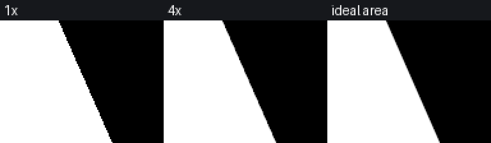

# 自研 Vulkan 的 4× 抗锯齿

**先看 Panda 的夹指。** 打开[同一时刻的 1×／4× 开关](compare.html)，在 0.5–2.3 秒看夹指斜边，暂停在 2.00 秒切换最容易比较。也可以直接播放[左右对照影片](panda-msaa-split.mp4)。两侧各保留原始 1280×720 画面，下面另加标签。对细小差异，以[第 60 帧的无损局部图](finger-1to1-pair.png)为准。

在 RTX 4060 Laptop 上，4× MSAA 把静止斜边的覆盖误差降低了 **64.91%**，把移动细杆的相邻帧误差降低了 **14.95%**。静态目标通过，运动改善低于预定的 20%。这两个数都以独立几何面积计算为参照。[冻结的实验条件](../../plans/2026-11-23-native-msaa.md)

在左图中，一个边界像素只能全黑或全白。中图根据四个覆盖位置得到中间亮度，已经接近右侧按像素内面积计算的结果。图上放大了像素，便于看清阶梯。

| 测量 | 1× | 4× | 判定 |
| --- | ---: | ---: | --- |
| 固定斜边，与理想覆盖的平均绝对误差，138 个边界像素 | 0.184723 | 0.064825 | 下降 64.91%，目标 ≥25% |
| 细杆每次平移 1/16 像素，相邻帧覆盖变化的平均绝对误差，224 个像素、15 次变化 | 0.067065 | 0.057042 | 下降 14.95%，目标 ≥20% |
| 黑白边界在 1/4、1/2、3/4 覆盖处的 RGB8 | — | 137、188、225 | 三处均与线性混合后编码的预期相同 |

两档使用同一机位和几何。区域由理想几何预先确定。运动指标比较每次亮度变化与理想变化之间的差值，所以一张更平滑的截图仍可能在运动中闪烁。[16 个相位的图像](motion-contact-sheet.png) · [逐相位数值](motion-phases.json) · [设备标定记录](calibration.json)

独立的离线程序读取原始 FP32 顶点和相机，用标准中心／四点覆盖位置预测颜色。它逐字节重建了两档全部 **32 张细杆原图**，也重现了 **14.9456%** 的时间误差改善。这解释了本例的剩余误差：当 0.625 像素宽的杆缓慢移动时，真实覆盖连续变化，而固定四点能表达的覆盖等级有限。程序单列了外侧边界恰好落在采样点的情况以及未知的设备子像素精度。[预测结果与假设](sample-audit.json) · [离线复现工具](../../examples/msaa_sample_audit.py)

## Panda 的实际帧耗

相同的 300 个物理记录姿态、同相机、同显示曝光、同日光与两盏面积灯，每档预热 10 帧。每盏灯用 2×2 个光源采样点；硬件射线查询负责阴影。下表统计 300 次公开同步 RGB 读回，PNG 写盘和影片编码单列。[固定输入与设备构建](protocol.json) · [逐帧计时和显存](comparison.json)

| 1280×720，RTX 4060 Laptop | 中位耗时 | p95 | 最大耗时 | 超过 33.3 ms | 引擎记账的峰值设备本地内存 |
| --- | ---: | ---: | ---: | ---: | ---: |
| 1× | 23.09 ms | 31.78 ms | 40.62 ms | 6 / 300 | 56.78 MiB |
| 4× | 25.13 ms | 34.22 ms | 42.34 ms | 17 / 300 | 109.28 MiB |

4× 比快速档的 p95 上限多 **0.92 ms**。GPU 时间戳覆盖了含预热的 310 次采集，渲染段平均由 7.19 增至 9.34 ms，附件复制平均由 1.16 变为 1.14 ms。平均增量集中在包含 TLAS 更新、光栅、阴影和颜色合并的渲染段。当前时间戳无法再将该段拆分到单个 pass，也无法把累计平均值归因到某一个 p95 帧。[1× 采集记录](1x/capture.json) · [4× 采集记录](4x/capture.json)

三部 MP4 各 300 帧、30 Hz、10 秒，均逐帧解码并比对编码输入，像素长宽比 1:1。分屏影片的全片 RGB8 平均绝对误差为 1.81，单帧平均误差最大为 1.96，局部单通道最大误差为 149。页面在 Edge 实测能从 0 秒切换，暂停在 2.00 秒时两档时间一致，播放中切换能继续前进。[编码记录](encoding.json)

本批保留默认 1×，将 4× 提供为轮廓质量选项。下一次针对运动稳定性的实验可先在同一套细杆数据上比较其他采样方式，并同时观察快速档成本。实现时间累积时，还需单独验证遮挡、切镜与场景重置。材质路线的下一个独立节点是法线贴图。[后续画质路线](../../plans/2026-11-23-native-vulkan-quality.md)

## 使用方式与传感输出

复核本批可使用[两档 Panda 汇总](panda-summary.json)、[浏览器同步复验](viewer-check.json)和[离线逐像素预测、差值与边界掩码](sample-audit.zip)。拍摄完成后，查看器修复了第一次在 0 秒切换会等待无效 seek 的问题，三部影片沿用原始已验码流。

在现有驻留式渲染入口配置 `NativeBackend(..., resident=True, msaa_samples=4)`。默认值为 1。4× 对颜色执行多重覆盖采样，在线性显示空间合并后编码为 sRGB。深度、实例 ID、有效掩码始终读取独立的单样本像素中心。标定中的遮挡、尺寸切换、代次变化和关闭后重开均已检查。三种请求组合得到一致的对应通道，1× 与 4× 的传感数据逐字节相同。

软件阴影和硬件射线查询阴影都在新构建上跑过。原 DLL 的默认 1× 路径可继续使用。请求 4× 时会检查设备、附件格式和着色器能力。首版 wheel 的收据对应原版本。本次新构建及设备记录绑定到源码提交 `40e4ca2b`。[新构建记录](native-build.json) · [完整标定原图、传感缓冲和解析真值](calibration.zip)
