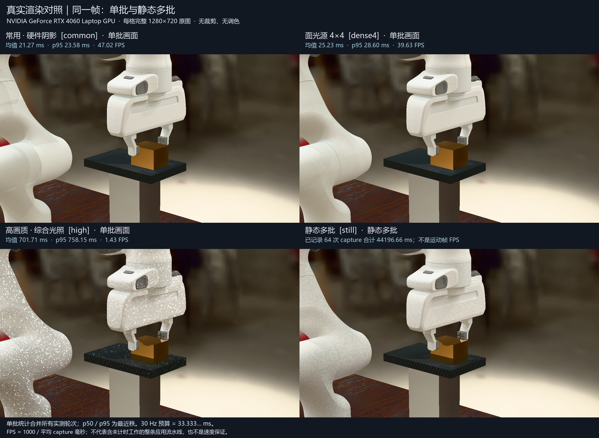

# Panda 抓放近景的原生 Vulkan 渲染性能

2026-11-23 在 RTX 4060 Laptop GPU 上实测。720p 四通道同步采集时，硬件阴影基线平均 **47.02 FPS**，增加 4× MSAA 后平均 **41.39 FPS**，两档全部 64 帧都在 33.33 ms 内完成。叠加 4×4 面光源和 4× MSAA 后平均 **31.16 FPS**，其中 17 帧超时。需要以 30 Hz 查看机器人运动时，优先选择单开 MSAA 或单升 4×4 面光源。

## 同帧画质



看夹爪白壳下方的半影，左上 2×2 面光源能看到分段，右上 4×4 的明暗过渡较平滑。下排同时加入了间接光、金属近场反射、台面法线和引导降噪。左下是运动档的一次曝光，白壳上有明显的亮点。右下保持同一姿态累积 64 批，大颗粒减少，仍能看到细噪。静态成图共 **44.20 秒**，每像素累积 1,024 条间接采样路径。各算法行的链接可打开未缩放的同帧原图。

## 运动性能

以硬件阴影基线为起点。表中单项只改变所列设置。综合光照统一使用一次近场镜面、台面法线、两次间接漫反射和引导降噪。三档综合光照仅改变每盏面积灯的采样网格。渐进间接光路径使用 1× 光栅采样，每个运动帧独立进行 16 个间接样本。4× MSAA 单独列在直接光照路径。

| 设置与原图 | 平均 ms | P50 ms | P95 ms | GPU 平均 ms | 平均 FPS | 33.33 ms 内 |
| --- | ---: | ---: | ---: | ---: | ---: | ---: |
| [硬件光追阴影，2×2 面光源（基线）](images/common.png) | 21.27 | 21.20 | 23.58 | 4.39 | 47.02 | 64/64 |
| [GPU 软件遍历 BVH 阴影](images/software.png) | 43.71 | 43.37 | 50.11 | 23.20 | 22.88 | 0/64 |
| [4× MSAA 轮廓抗锯齿](images/aa4.png) | 24.16 | 23.69 | 28.70 | 6.86 | 41.39 | 64/64 |
| [4×4 面光源](images/dense4.png) | 25.23 | 25.07 | 28.60 | 7.86 | 39.63 | 64/64 |
| [8×8 面光源](images/dense8.png) | 41.39 | 40.88 | 46.75 | 22.45 | 24.16 | 0/64 |
| [4× MSAA 与 4×4 面光源](images/balanced.png) | 32.09 | 31.05 | 38.17 | 13.49 | 31.16 | 47/64 |
| [橡胶台面法线贴图](images/normal.png) | 23.50 | 23.88 | 27.88 | 4.28 | 42.55 | 64/64 |
| [光滑金属一次近场镜面反射](images/mirror.png) | 21.94 | 21.61 | 24.29 | 4.72 | 45.59 | 64/64 |
| [一次间接漫反射](images/gi1.png) | 59.61 | 58.97 | 66.65 | 36.84 | 16.77 | 0/64 |
| [二次间接漫反射](images/gi2.png) | 104.81 | 104.88 | 113.06 | 80.67 | 9.54 | 0/64 |
| [二次间接漫反射与引导降噪](images/denoise.png) | 106.20 | 104.95 | 117.37 | 82.07 | 9.42 | 0/64 |
| [综合光照，2×2 面光源](images/high_grid2.png) | 108.08 | 108.37 | 116.77 | 83.78 | 9.25 | 0/64 |
| [综合光照，4×4 面光源](images/high_grid4.png) | 222.05 | 223.80 | 239.51 | 196.13 | 4.50 | 0/64 |
| [综合光照，8×8 面光源](images/high.png) | 701.71 | 707.07 | 758.15 | 675.80 | 1.43 | 0/64 |

均值、P50 和 P95 统计从调用到返回一帧四通道数据的耗时。P95 使用最近秩，FPS 取 1,000 除以平均毫秒数。GPU 平均值由同一采集区间内的硬件时间戳给出，含渲染和拷贝，已包含在整帧耗时中。软件 BVH 一行同样在 GPU 上运行，由着色器自行遍历加速结构。

- **直接光照的取舍。** 本场景中两种阴影算法在展示帧输出相同的 RGB 字节，硬件光线查询将平均采集时间从 43.71 ms 降到 21.27 ms。基线中 GPU 计时为 4.39 ms，其余约 16.88 ms 是 GPU 时间戳区间外的合计，细分原因需单独剖析。
- **高画质的耗时。** 综合光照从 2×2 提高到 4×4、8×8，整帧依次为 108.08、222.05、701.71 ms，GPU 区间依次为 83.78、196.13、675.80 ms。最高档大部分时间发生在 GPU。仅直接光照时，面光源 2×2 提高至 8×8 只增加 20.12 ms。评估间接光与面积灯组合时需要测完整档位。
- **降噪与画质。** 同为二次反弹，把引导降噪打开后，GPU 平均增加 1.40 ms。对相同姿态，使用另一个随机种子累积 1,024 样本作为有限参考，线性化显示 RGB 的全图均方根差由 0.07631 降至 0.06127。综合光照 4×4 和 8×8 的单批数值分别为 0.05955 和 0.05960。这一帧、这一指标没有显示 8×8 的画质优势。可见的动态噪声仍是选择档位的因素。[独立参考图](images/reference-seed1.png)

## 测量范围与复现

- 固定 1280×720，134,960 个三角形，Panda 抓放回放帧索引 33–64，移动近景相机，展示帧索引 60。所有设置沿用相同的车间 HDR 环境、两盏面积灯、方向光、曝光和显示变换。夹持物统一为铜色光滑金属，台面使用相同几何和 UV，使镜面与法线贴图开关都作用在可见物体上。
- 每个运动设置开启两个独立驻留会话，每个会话先预热 6 帧，再计时 32 帧。主矩阵和补充矩阵分别按正序、逆序各跑一轮。14 档共 896 次运动采集，加上两个独立种子的 128 次静态采集，共 1,024 次计时。额外的独立种子只用于参考图。
- 计时从同步调用 `session.capture` 开始，到主机取得 RGB、米制前向深度、实例 ID、有效掩码为止。一次性加载、预热、物理推进、图片保存及视频编码均在计时区间外。两轮展示帧的 RGB 字节、各档完整运动序列的深度、实例 ID 和有效掩码均已核对。结论适用于这段回放、这个视角、这台 GPU 和该输出接口。
- 输入为仓库内 Panda 回放，运行时使用 2026-11-23 的原生构建，DLL SHA-256 为 `ae6960eeff326aacd002c5cc019ed538b165518bf17eb55411db3fc0dfdd8671`。[构建清单](../guided-settling/native-build.json) · [主矩阵逐帧时间](benchmark.json) · [补充对照和第二个随机种子](additional.json) · [统计与原图校验值](performance.json)

在仓库根目录使用已具备 NumPy、Pillow 和渲染运行依赖的 Python，设置 `PYTHONPATH` 指向 `rendering/src`。将同一构建的 DLL 和着色器放在同一目录，选择本机 Vulkan 枚举中的目标 GPU 序号，依次执行以下步骤。主矩阵需要一个尚不存在的输出目录。

```powershell
$env:PYTHONPATH = (Resolve-Path rendering/src).Path
$dll = Read-Host '原生渲染 DLL 绝对路径'
$gpuIndex = Read-Host 'Vulkan 设备序号'
$outputDir = 'artifacts/rendering/panda-render-benchmark/new-run'
python rendering/examples/panda_render_performance.py --library $dll --device-index $gpuIndex --output $outputDir
python rendering/examples/panda_render_grid_sweep.py --library $dll --device-index $gpuIndex --output $outputDir
python rendering/examples/render_performance_summary.py $outputDir
```
