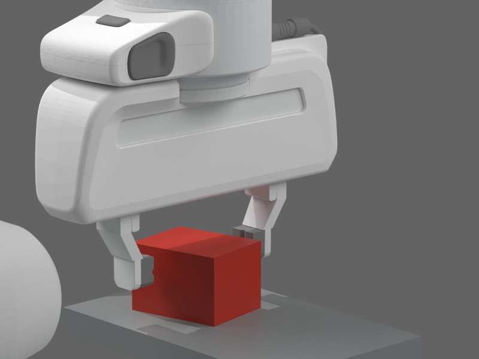
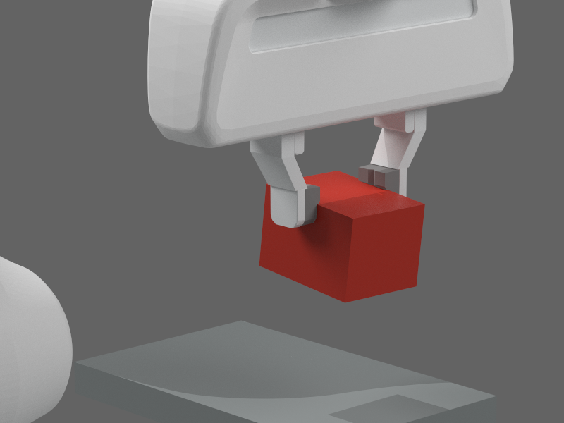
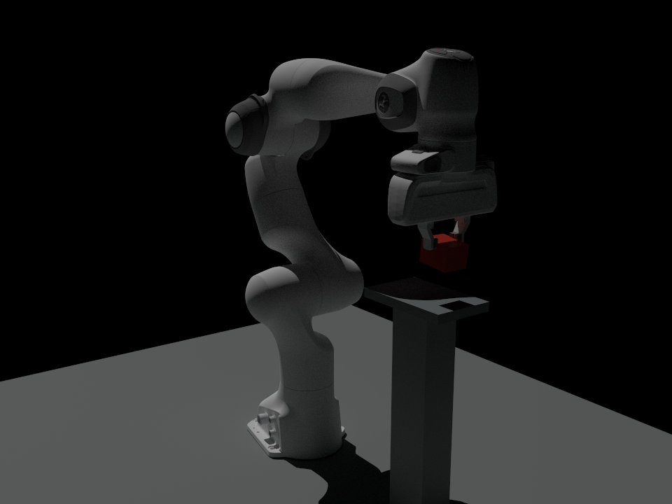
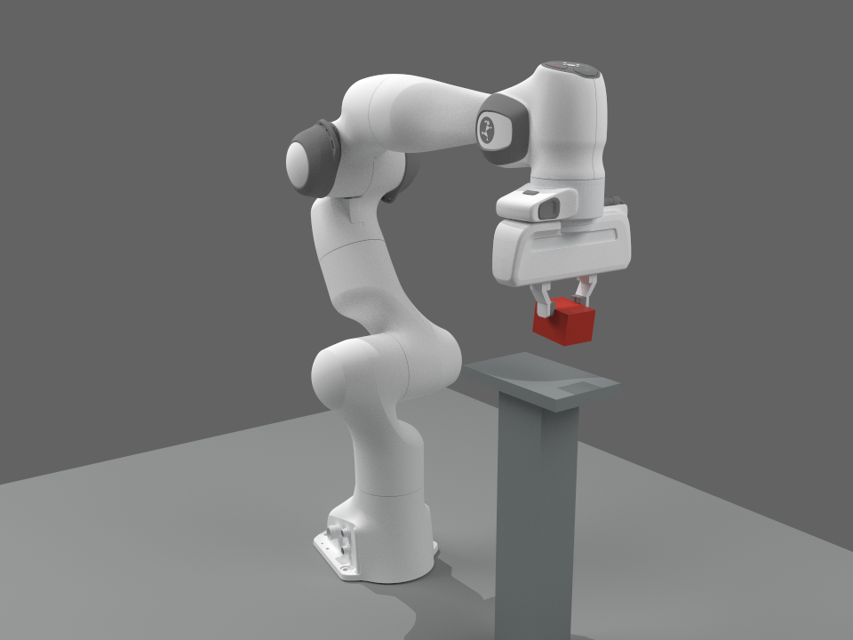
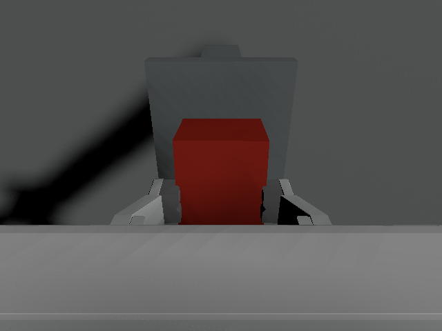
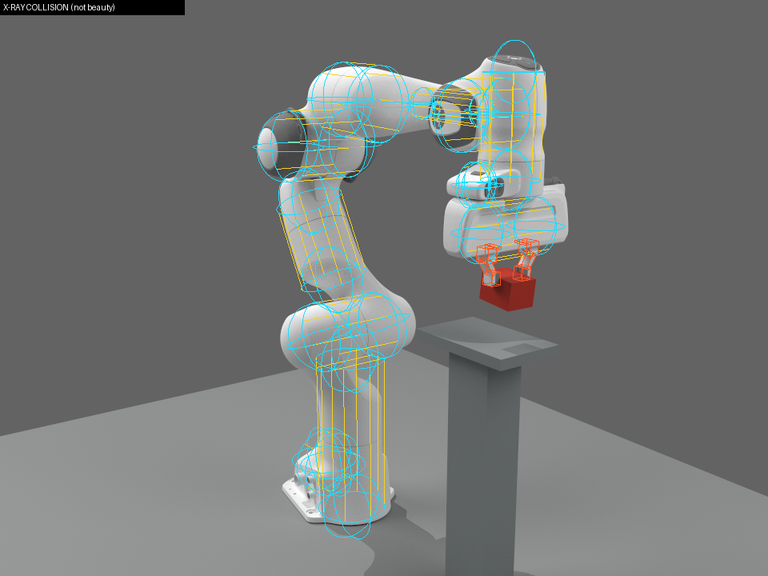

# Panda 抓取回放 · G4/R1

这两帧来自同一次 Phymeo 抓取仿真。0.30 s 时红色方块在桌上；1.35 s 时夹指收拢，方块中心升高 58.3 mm。渲染器读取归档中的关节坐标和方块位姿，每次曝光推进物理 0 步。完整机器人由 RTX 4060 Laptop 上的 SAPIEN 3.0.3 离屏渲染。

| 0.30 s · 入抓前 | 1.35 s · 提起后 |
| --- | --- |
|  |  |

## 为什么之前显黑

下面两张固定机位图使用相同的抬升状态、原厂网格、材质、曝光和显示变换。右图保留左图的方向光，增加两盏有面积的矩形灯和均匀中性 HDR 环境光。观察腕部下沿、肘内侧和白色外壳的曲面轮廓。两张均为每像素 512 个样本、最多 4 次反弹、关闭降噪的路径追踪输出。

| 单方向光 | 同机位加入摄影棚布光 |
| --- | --- |
|  |  |

在抬升帧的 96,709 个机器人像素上，亮度中位数从 38.79 升至 163.79，近黑像素占比从 9.82% 降至 0%，摄影棚近白占比为 0.72%。入抓帧的 89,758 个像素中，中位数从 37.21 升至 163.00。亮度取 sRGB8 图像上各颜色通道的加权和，近黑阈值为 16，近白阈值为 250；机器人区域由同机位光栅实例标签确定。两个新增光源类型同时启用，读数描述组合效果。[逐帧统计](evidence/summary.json)

厂家资产提供米制 CAD 网格、分件颜色和 Phong 材质。源文件没有纹理或 UV；当前取源漫反射色、金属度 0，并从光泽指数近似粗糙度。灯光改善了轮廓与暗部，漆面、金属和橡胶的真实光泽还需要实物或带标定的参考照片。灰色地面和小桌下的支柱是本次布景；方块与桌面尺寸来自仿真。灯光强度使用渲染器相对单位。[资产来源、许可和转换规则](../../assets/panda/README.md)

## 画面与运动如何对上

| 实际检查 | 两帧结果 |
| --- | --- |
| 输入 | 归档记录 479 和 2159，按原 URDF 解算七个臂关节和两个独立指位。方块位置和四元数直接取记录。第二步记录的双指法向载荷约 5.42、5.44 N，载荷对应入步几何，渲染画面对应出步状态。 |
| 固定相机 | 拍摄前冻结基座、腕和指上三个材料点。对两帧独立标记图测得最大重投影误差 **0.146 px 以内**，门槛 1 px。六处未标记机器人原图的可见实例均正确，前向深度与解析射线最大差约 1.17 µm。这是六处测点的结果。 |
| 虚拟腕部相机 | 相机随手掌运动，两帧方块分别占 21,039、19,573 像素；左右指分别占 5,126／5,144 和 4,379／4,400 像素。保存同次曝光的 RGB、前向深度、实例 ID 与有效掩码。 |
| 异常输入 | 资产路径故意缺失时，打开场景给出含文件名的错误；错世界、错修订的曝光被拒绝。 |
| 后端范围 | SAPIEN 上传完整场景的 134,960 个三角形，含 Panda 可见网格 134,912 个。自研 Vulkan 对完整场景按 4,096 个三角形上限拒绝；原厂双指、方块与桌面共 1,272 个三角形在自研端实际渲染，两次曝光、验证层错误 0。 |

| 腕部 · 完整场景的光栅观测 | 抬升帧 · 原 URDF 碰撞体叠加在外观图上 |
| --- | --- |
|  |  |

[抓取前全景](studio-1-fixed.png) · [抓取前腕部相机](raster-1-wrist.png) · [固定相机锚点标注](anchors-2.png) · [自研 Vulkan 局部原图](native-detail-2-wrist.png) · [两帧输入及相位约定](../../tests/fixtures/panda_replay/README.md)

## 复现

Python 3.11，安装本仓库的 `./rendering[sapien]` 和 Pillow。在仓库根目录执行，输出目录使用新名称。可选的原生验证使用 G3 构建的 ABI 2 DLL、同目录的 SPIR-V、Vulkan 验证层及实际独显设备序号。

```powershell
$env:PYTHONPATH = (Resolve-Path rendering/src).Path
python rendering/examples/panda_replay.py --assets rendering/assets/panda --output artifacts/rendering/my-r1-capture --device cuda:0 --spp 512
```

加上 `--native-library <DLL路径> --native-index <设备序号>` 可生成原生局部对照。在本机对应设备序号 1。首次联调在光栅传感路径上请求了三盏投影方向灯，设备拒绝；最终传感配置使用一盏朝向机器人的方向光，摄影棚对照使用独立光追配置。两路均通过同一公开拍摄接口取得图像。

已验证资产转换与加载 15 项、归档适配 8 项、摄影棚 8 项（含 3 项真实设备）、既有 SAPIEN 路径回归 11 项，以及本批完整设备集成 1 项。集成测试包含实拍、错帧拒绝、锚点、源文件缺失、原生容量与局部采集。[设备集成测试](../../tests/integration/test_panda_replay.py)

完整场景、独立材料点、曝光配置与通道摘要位于 [scene.json](evidence/scene.json)、[source-anchors.json](evidence/source-anchors.json)、[光追单灯](evidence/single-capture.json)、[光追摄影棚](evidence/studio-capture.json)、[光栅](evidence/raster-capture.json)、[标记](evidence/fiducials-capture.json)、[原生局部](evidence/native-detail-capture.json)。[24 份原始传感数据](evidence/sensor-planes.zip)按文件名与上述曝光对应，深度为小端 float32 米、实例为小端 uint32、掩码为 uint8。

本批验收覆盖两帧真实仿真记录。后续 R2 验证连续 10 秒、画质与原生 720p 耗时，R3 单独验证固定与腕部相机的全幅深度和标签。[验收规程](../../plans/09-acceptance.md)
