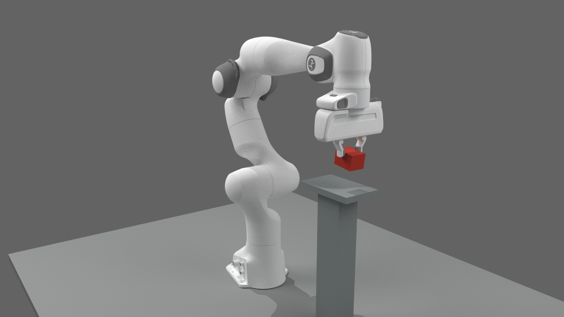

# Panda 抓放的十秒回放

[播放摄影棚参考片](panda-grasp-10s.mp4)。前 2.25 秒看两指夹住红方块、离台、平移和松手，后 7.75 秒看开爪的机械臂返回。方块放下后继续受重力与台面接触力作用。搬运净空 54.8 mm，最终离目标 0.55 mm。[物理记录与控制](../../tests/fixtures/panda_film/SOURCES.md)

参考片在 RTX 4060 Laptop 上使用 SAPIEN 3.0.3 路径追踪，960×540、每像素 256 样本、4 次反弹，两盏矩形灯、均匀 HDR 环境及原场景方向光。300 个姿态以 30 fps 原速播放。逐帧解码后，与 GPU 原图的最大单帧平均绝对色差为 1.16 个 RGB8 码值以内。[相机记录](studio-camera.json) · [解码核对](panda-grasp-10s.decoded.json)

## 原生 Vulkan 交互回放

固定相机、1280×720、完整厂家几何、单方向光及几何投影。预热 10 帧后，计时从公开相机调用开始，到调用者取得 RGB 字节结束。下表两次采集使用同一段 300 个实际源姿态，300 对 RGB 读回逐帧 SHA256 全部相同。

| 版本 | p50 | p95 | 最慢 | 超过 33.3 ms |
| --- | ---: | ---: | ---: | ---: |
| 每网格 BVH、四附件读回 | 56.5 ms | 79.3 ms | 86.6 ms | 300/300 |
| 两层 BVH、缓存一致内存、按需 RGB 读回 | 9.55 ms | 11.43 ms | 14.08 ms | 0/300 |

在中间版本的 20 帧剖析中，GPU 绘制和复制合计平均 5.16 ms，主机从映射区读出占 34.89 ms。修改后 RGB 请求每像素由 13 B 设备传输变为 4 B，公开结果仍为每像素 3 B 的不可变 RGB。独立的固定及腕部相机同时核过深度和标签，六处基座、腕及指锚点的最大重投影误差为 0.146 px 以内。[改动前](fast-baseline.json) · [改动后及设备计时](fast-cached.json) · [跨后端几何核对](geometry.json)

## 采样与材质

在同一搬运帧，以两个独立 1024 样本流的均值为参照。下表是三个预定流在 130,141 个前景像素上的平均 MSE，信号为公开 sRGB8 除以 255。

| 每像素样本 | 原图 | 空间滤波后 |
| ---: | ---: | ---: |
| 4 | 0.0018693 | 0.0002438 |
| 16 | 0.0004738 | 0.0001440 |
| 64 | 0.0001240 | 0.0001349 |
| 256 | 0.0000353 | 0.0001337 |

低采样时滤波压低噪声，高采样时边缘和窄高光开始受损。独立种子改变路径随机数和像素内采样偏移。相同种子的切镜返回与重新开场得到相同字节。参考流彼此的前景 MSE 为 0.0000173。滤波使用同相机的深度和标签指导，不积累历史帧。[预登记与信号定义](../../plans/2026-11-23-r2-capture-protocol.md) · [各区域和各次实测](quality.json) · [完整原图、掩码和曝光记录](sampling.zip)

在另一幅同机位、同曝光的受控金属球图中，粗糙度从 0.18 增到 0.52 时，高光半高全宽从 9.70 px 扩到 59.0 px，剖面峰值从 0.789 降至 0.098。两张图都未出现饱和像素。这里的误差只衡量对参考渲染的逼近。真实表面的反射参数仍需通过实测标定。[光滑球原图](roughness-018.png) · [粗糙球原图](roughness-052.png) · [完整剖面](roughness.json)
