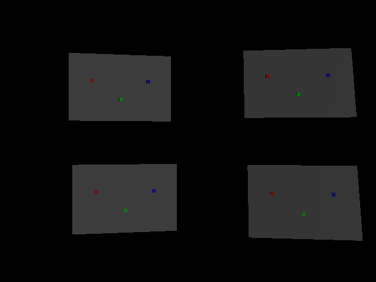

# R3 双相机标定

固定相机和腕部相机各拍五个状态，共十次曝光。几何覆盖 0.25–2 m 的近远平面、离轴彩色标记与遮挡板。下图是转腕后的一帧，两块板的远近、标记位置与背景都有解析参考值。

| 单个后端的全部十帧 | 自研 Vulkan 光栅（原 ABI 2） | SAPIEN 3.0.3 光栅 |
| --- | ---: | ---: |
| 距离轮廓超过 2 px 的前景像素 | 799,341 | 799,341 |
| 内部实例标签错误 | 0 | 0 |
| 内部前向深度最大绝对误差 | 0.001922 mm | 0.001458 mm |
| 彩色标记或 ID 标记最大重投影误差 | 0.541 px | 0.541 px |
| 边缘像素／其中与解析标签不同 | 152,783／56 | 152,783／56 |
| 背景深度、标签、有效掩码错误 | 0 | 0 |

参考器使用独立的射线与有限平面求交，按相机前向轴计深度。像素中心与解析射线采用同一约定。每个机位分别检查正视、倾斜、遮挡、反转和 reset。reset 后的四个通道与新场景的相同曝光逐字节一致，使用旧曝光键的请求被拒绝。每次曝光同时获取彩色图、深度、实例标签和有效掩码。[原生逐帧读数](native-measurements.json) · [SAPIEN 逐帧读数](sapien-measurements.json)

第一次实拍发现，挡板的阴影落在一个仍然可见的绿色标记上，RGB 无法识别它，深度与标签仍正确。补一盏光后，SAPIEN 默认着色器拒绝第二盏投影方向灯。最终夹具给两个后端统一使用一盏斜向主光，保留原遮挡几何、五个阶段与验收阈值。两后端均实际执行六项主机检查对应的夹具／参考规则和十次成像，其中六项主机检查共享。[测量实现](../../tests/integration/_r3_oracle.py) · [可执行案例](../../tests/integration/test_r3_calibration.py)

每份归档包含 79 项，包括原始四通道、PNG、夹具与按帧统计，归档已逐项与原始采集文件比对。取深度时按小端 float32 米解码，背景为正无穷，实例标签按小端 uint32 解码。[Vulkan 采集](native.zip) · [SAPIEN 采集](sapien.zip) · [归档校验值](archives.json)
## 离轴相机的分块读回

在 647×419 像素的偏心相机上，用 257×173 像素的分块曝光覆盖原图的九个矩形。最后一列和最后一行均为不满块。三块几何平面横跨拼缝，竖向和横向拼缝附近分别有 684、1138 个前景采样。自研及 SAPIEN 光栅的整幅与九块拼接之间，全图 RGB、ID、有效掩码差异为零，内部前向深度差也为零。与独立平面交点相比，内部最大深度误差为 4.77×10⁻⁸ m。路径追踪的随机采样会随分块改变，需另行测量颜色情况。[自研标定及分母](tiles-native.json) · [SAPIEN 光栅标定及分母](tiles-sapien.json)
