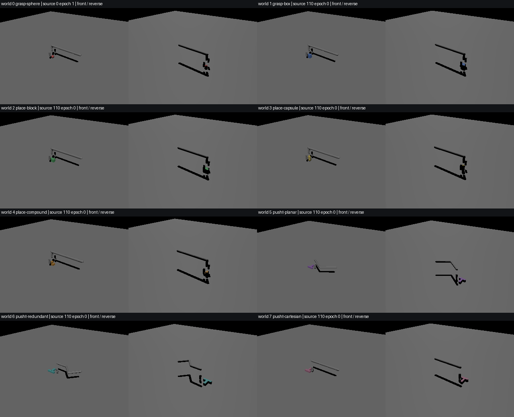

# 八个世界共用渲染入口

在同一台 RTX 4060 Laptop 上回放八个不同的机器人模型。每个世界有前、后两台 320 × 240 相机，每次都读取 RGB、前向深度、实例 ID 和有效掩码。画面来自已保存的 221 个物理状态。第 150 批让世界 0 从回放开头重新开始，另外七个世界继续播放。

每个世界先独立运行 300 批并保存两台相机的原始通道。随后分别打开 1、2、8 个世界，各预热 3 批并测量 300 批。6,600 次批量曝光均通过和各自独跑结果的对照，最大深度差为 0，标签及有效掩码逐字节一致。八世界一组实际核对 336,516,000 个有效深度像素。调用顺序为逐世界、逐相机提交，同一批的最后一次消费者读回完成后停止计时。[完整逐帧日志、设备和传输记录](gpu-cameras.zip)

| 场景数 × 每场相机数 | 批次 p50 / p95 | 仅采集的总相机帧/秒 | 含逐像素对照、压缩和归档的总相机帧/秒 | 进程专用显存采样峰值 |
| --- | ---: | ---: | ---: | ---: |
| 1 × 2 | 7.43 / 9.51 ms | 263.58 | 73.44 | 10.18 MB |
| 2 × 2 | 14.68 / 17.47 ms | 268.17 | 73.03 | 18.69 MB |
| 8 × 2 | 62.03 / 72.69 ms | 254.96 | 72.88 | 61.95 MB |

资源采样按 Windows 进程与显卡 LUID 匹配，共 372 条，最大间隔 0.432 秒。表中 MB 使用十进制；相邻采样间的短时峰值仍可能更高。每个关闭的会话分配与释放字节相等，最后的活动上下文、帧和资源数均为零。各阶段的 Vulkan 时间戳见日志中的 `transfers.capture_profile`；CPU 等待 fence 和 GPU 执行时间分别记录。

八个模型覆盖球与盒拾取、三种放置构型，以及平面、冗余、笛卡尔推 T。源控制器在这八条诊断回放中的任务成功标记均为 false。此处验证的是相机隔离、状态来源、读回和渲染规模。

**先看八机位同期录像。** 每格来自一个世界的前相机，标签给出模型、物理时间和 reset 代次。播放到 5 秒时，左上角的世界重新开始；其余七格沿各自的源序列继续。全部 2,400 张前相机图都按独跑原图的哈希核过。[播放八世界](eight-worlds.mp4) · [逐帧解码记录](eight-worlds.decoded.json)

**再看单世界近景。** 推 T 的两连杆末端接近并推移 T 形件。镜头取完整运动包围盒，画面以 0.3 倍物理速度播放，便于看清接触位置。221 个实际记录姿态覆盖 2.20 秒，影片约 7.37 秒。控制器在这次运行中未达到任务目标。[播放路径追踪近景](pusht-reference.mp4) · [逐帧解码记录](pusht-reference.decoded.json)
