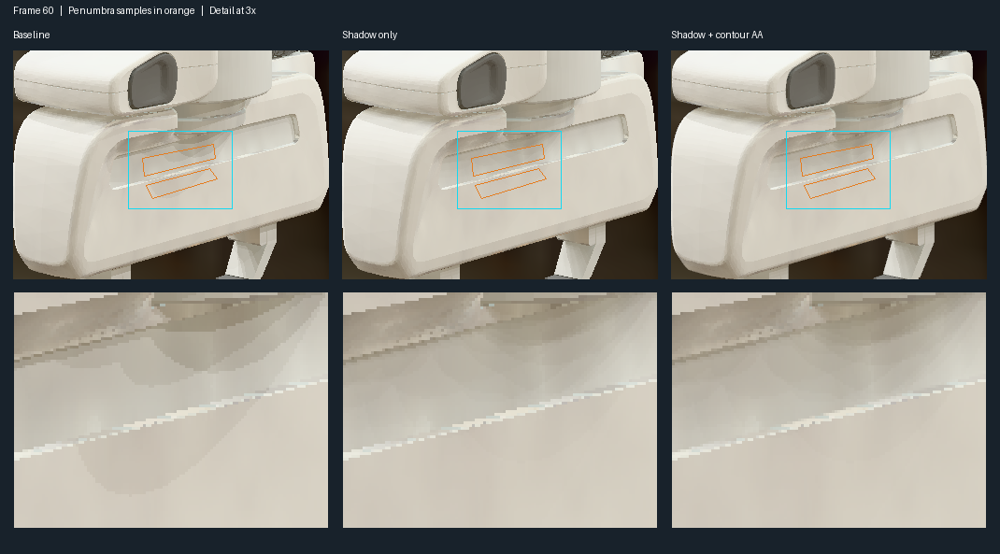
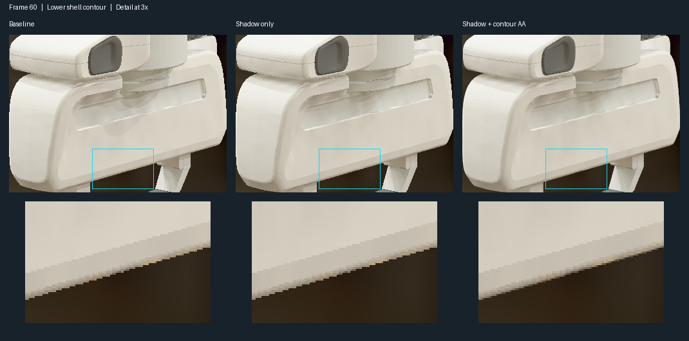

# Panda 白壳的软阴影与轮廓覆盖

同一台 RTX 4060 Laptop GPU、720p、同一段 300 帧 Panda 运动，推荐观看档为**每灯 16 个主表面采样点，加四子像素轮廓覆盖**。固定近景的两轮同步 RGB 回放分别为 **57.41 和 59.30 FPS**，整帧 P95 为 **19.17 和 18.61 ms**。这次两轮共 600 帧均在 33.3 ms 内。计时从发起采集到取得 CPU 自有 RGB，影片按 30 FPS 播放。

[构建和回放](../../examples/preview_surface_quality/README.md) · [本机整臂切到夹爪的实拍影片](../../../artifacts/rendering/panda-surface-fix/sequence-media/panda-rigid-t4-p8-g2-k25-r2-age4-visibility-ratio-panel16-contour4-sequence-soft-studio.mp4) · [固定近景影片](../../../artifacts/rendering/panda-surface-fix/combined/motion.mp4)

## 第 60 帧

从左到右依次是原预览、只改灯面采样、灯面采样加轮廓覆盖。先看手腕正下方，暗带在中图已经减轻。再看白壳底部与背景相交的斜边，右图的像素台阶变小。模型、曝光、机位、录制灯光和反弹次数在三次拍摄中相同。

在同材质、同光照的独立高采样 Vulkan 裁图上，两个预先指定的半影区域共 2,393 像素。RGB 平均绝对误差由 3.88 降至 3.02，降低约 22%。底部斜边的 247 个边界像素，在只开软阴影时为 13.77，接入轮廓覆盖后为 9.36，降低约 32%。这些误差按 0–255 显示码值计算。参考每个最终像素有 4 个相机位置，每个位置累积 1,024 个间接光方向，灯面使用 8×8 积分。[分区、原始计数和误差](assessment.json)

第 60 帧的深度、实例 ID 和有效性在三档间逐字节相同。16,974 个邻近实例边界的候选像素共发出 67,879 条可见性射线，5,213 个有可用的混合覆盖，10 个缺少邻域着色的像素回退到中心。其余 904,626 个远离实例 ID 边界的像素，开启轮廓覆盖前后 RGB 逐字节相同。

## 实际运动与成本

| 本次画质与机位 | 完整 RGB 回放 | 平均 FPS | P95 整帧 |
|---|---:|---:|---:|
| 原预览，固定近景 | 300 帧 | 82.93 | 13.16 ms |
| 仅 16 点软阴影，固定近景 | 300 帧 | 57.54 | 20.22 ms |
| 16 点软阴影＋轮廓覆盖，固定近景 | 2 × 300 帧 | 57.41 / 59.30 | 19.17 / 18.61 ms |
| 同一组合，柔光棚整臂与夹爪切镜 | 300 帧 | 58.53 | 18.80 ms |

各档独立开会话，预热 10 帧后重置历史。表内耗时包含当前姿态的场景更新、照明、合成和同步 RGB 读回。诊断读回、入场、编码及显示器呈现另计。各轮 P95 有波动，单个 GPU pass 的成本还需要独立计时。四通道同步采集的吞吐待单测。[逐帧耗时、设备、相机重置及影片指纹](timing.json)

- **移动阴影。** 挡板移开和返回的第一帧，576 个固定接收面像素的主表面直接光和最终 RGB 均与相同姿态、无历史的新会话一致。两次明暗变化都超过本实验预定幅度。[逐帧记录](moving-shadow.json)
- **轮廓。** 独立解析斜边的 138 个部分覆盖像素，平均覆盖误差从 0.18472 降至 0.06478。宽 0.625 像素的移动细杆经过 16 个位置，相邻帧亮度变化误差降低 14.36%。杆完全移开后的 76 次像素观察均恢复背景。[静态标定](static-edge.json) · [运动标定](moving-edge.json)
- **切镜。** 柔光棚回放在第 14、68 帧切换相机并重置历史。两个切换帧的 RGB 都与相同采样序列的无历史对照逐字节一致。

比较中白壳内部仍有细小明暗纹理。固定灯面采样能减轻离散暗带，有限点数仍是近似。轮廓方法覆盖当前帧邻域中能识别的不同实例及背景；同一网格内部由材质、法线或自遮挡形成的边缘，以及整个邻域都没有中心命中的极细几何，仍使用原着色。
